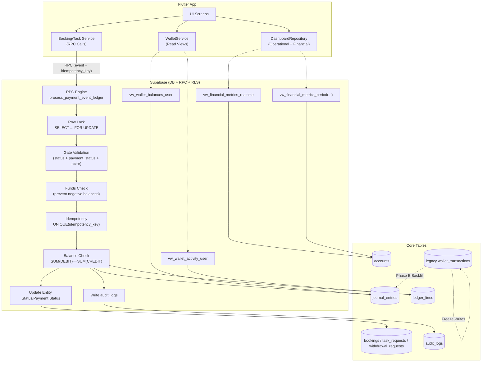
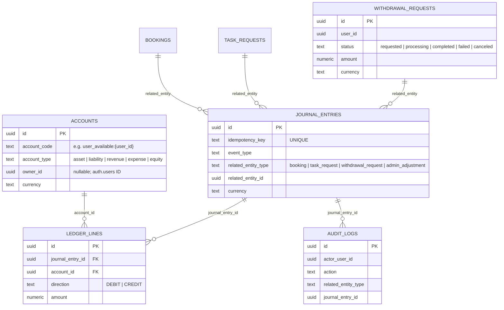
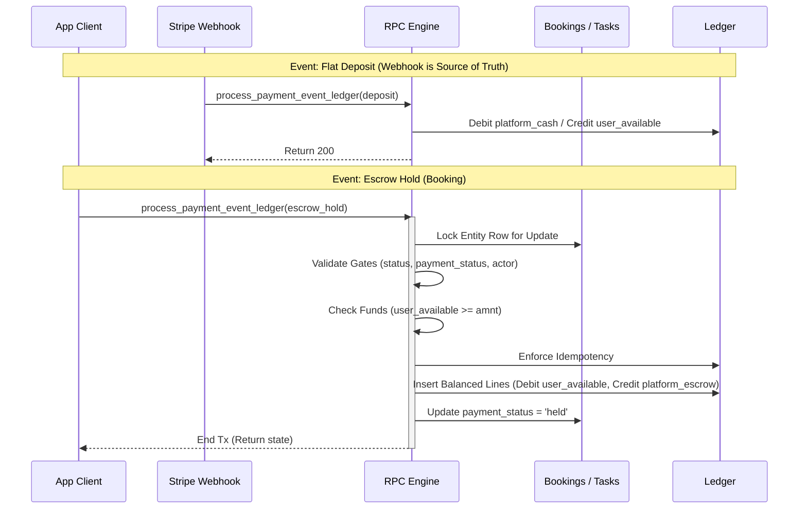
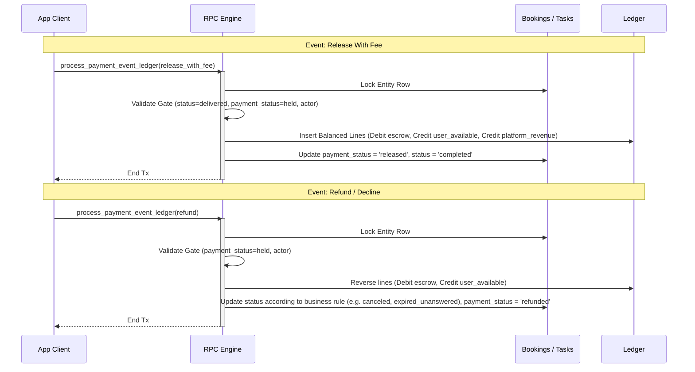
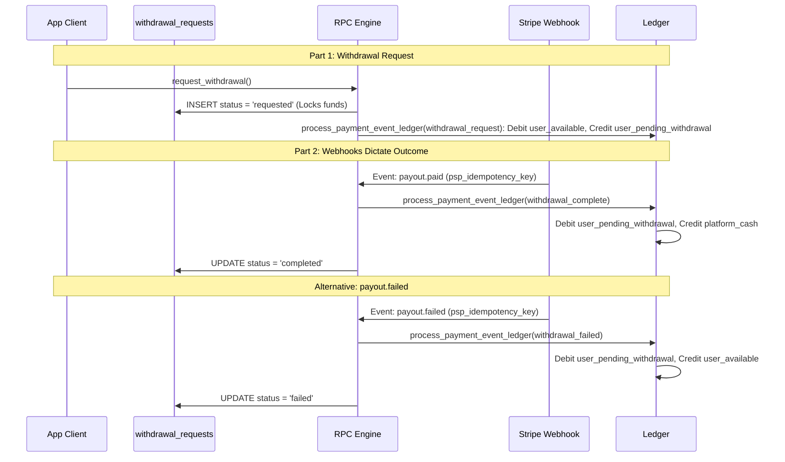
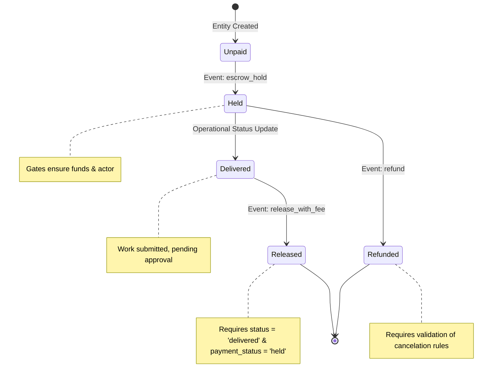
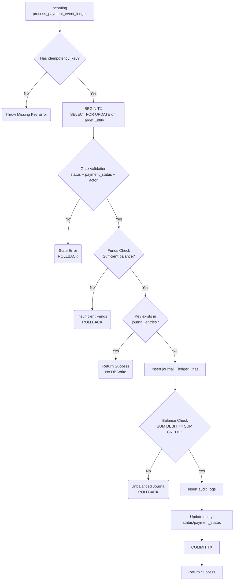

# PAYMENT LEDGER SYSTEM - DIAGRAM PACK

## 1. Master Poster (Component, Read/Write, Cutover)

Provides an eagle-eye view of app inputs descending down past validation layers to the ledger.

---

## 2. Entity Relationship Diagram (ERD)

Illustrates how the ledger is isolated securely from UI models. Notice the distinct coverage (no generic tasks).

---

## 3. General Sequences (Deposit, Escrow, Release, Refund)

### Event: Deposit (Top-up) & Escrow Hold

### Event: Release with Fee & Refund

### Event: Withdrawal Flow (Request & Webhook Resolutions)

---

## 4. Entity Payment State Machine

Highlights the allowed execution events gated by `payment_status` and operational `status`.

---

## 5. Idempotency Flow

Depicts the absolute isolation mechanism inside the core engine protecting against duplicity.

