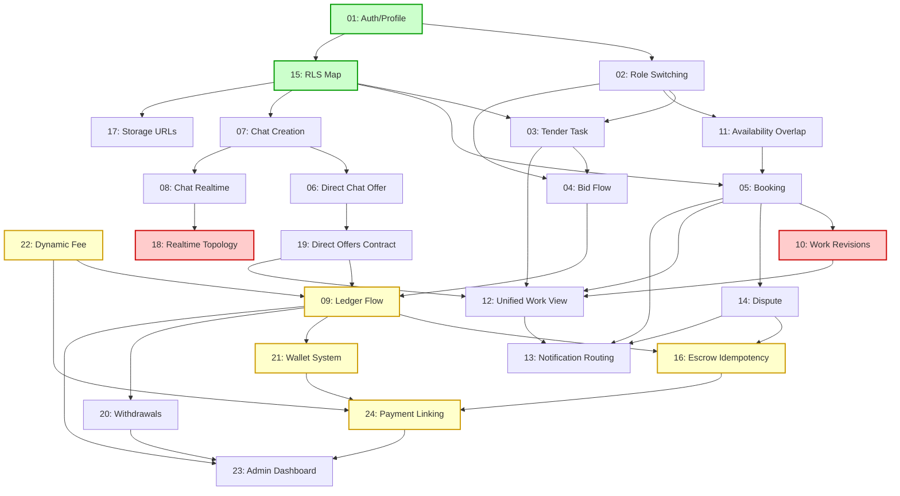

# 03_DEPENDENCY_GRAPH: Implementation Order

---

## Mermaid Dependency Graph

---

## Topological Execution Order

The following order ensures no folder is implemented before its dependencies are ready.

### Tier 0 — Foundations (No Dependencies)

1. **01: Auth & Profile Provisioning** — Identity is the root of everything.
2. **15: RLS Authorization Map** — Security policies must exist before any data flow.
3. **22: Dynamic Platform Fee** — `platform_settings` table must exist before ledger uses it.

### Tier 1 — Core Identity & Scheduling

4. **02: Role Switching Flow** — Requires `profiles` (01) and RLS (15).
5. **11: Availability Overlap Guard** — Requires role awareness (02) for provider-only slot creation.

### Tier 2 — Core Marketplace Flows

6. **03: Tender Task Lifecycle** — Requires roles (02) and RLS (15).
7. **05: Booking Lifecycle** — Requires slots (11) and RLS (15).
8. **04: Task Request (Bid) Flow** — Requires tender tasks (03) and roles (02).

### Tier 3 — Financial Engine

9. **09: Ledger Event Flow** — Requires fee config (22). Powers all money flows.
10. **16: Escrow Invariants & Idempotency** — Requires ledger (09). Fixes the broken key.
11. **21: Wallet System** — Requires ledger (09). Migrates off frozen tables.
12. **20: Withdrawals Lifecycle** — Requires ledger (09) and wallet (21).

### Tier 4 — Chat & Offers

13. **07: Chat Creation Matrix** — Requires RLS (15) and favorites.
14. **06: Direct Chat Offer Flow** — Requires chat (07).
15. **19: Direct Offers Work Contract** — Requires offer flow (06) and ledger (09).
16. **08: Chat Realtime Sync** — Requires chat (07).
17. **18: Realtime Subscription Topology** — Requires realtime (08). Fixes stream bug.

### Tier 5 — Work Management

18. **10: Work Contract Revisions** — Requires booking (05) and tender (03).
19. **14: Dispute Lifecycle** — Requires booking (05) and escrow (16).
20. **12: Unified Work View** — Requires ALL work entities (03, 05, 19, 10).

### Tier 6 — Platform Integration

21. **13: Notification Routing** — Requires unified view (12), booking (05), dispute (14).
22. **17: Storage Signed URLs** — Requires RLS (15). Independent of most.
23. **24: Hardened Payment Linking** — Requires escrow idem (16), wallet (21), fee (22).

### Tier 7 — Admin Observability

24. **23: Admin Dashboard Wallet & Finance** — Requires ALL financial flows (09, 20, 24).

---

## Dependency Justifications

| From → To         | Reason                                                                          |
| ----------------- | ------------------------------------------------------------------------------- |
| 01 → 02           | Role switching operates on `profiles.active_role` created by auth provisioning  |
| 01 → 15           | RLS policies reference `auth.uid()` which requires auth to be set up            |
| 15 → 03           | Task RLS policies (owner-only update) must exist before task lifecycle          |
| 02 → 04           | Bid submission requires `active_role = 'freelancer'` enforcement                |
| 11 → 05           | Booking creation depends on `availability_slots` and overlap guard              |
| 22 → 09           | Ledger must read `fee_rate_default` from `platform_settings`                    |
| 09 → 16           | Escrow idempotency patches the ledger's `process_payment_event_ledger` RPC      |
| 07 → 06           | Direct offers are sent inside conversations created by chat matrix              |
| 05 → 14           | Disputes are raised on bookings/tasks with held escrow funds                    |
| 14 → 16           | Dispute resolution triggers ledger release/refund; must check for dispute locks |
| 12 → 13           | Notifications need to reference unified work items for deep-linking             |
| 16 + 21 + 22 → 24 | Payment linking integrates all financial subsystems                             |
| 24 → 23           | Admin dashboard needs payment intent auditability                               |

---

## Circular Dependency Analysis

**No circular dependencies detected.** The graph is a valid DAG (Directed Acyclic Graph).

The closest to a cycle is:

- `05 (Booking)` → `14 (Dispute)` → `16 (Escrow)` → `09 (Ledger)` → back?

But `09 (Ledger)` does NOT depend on `05 (Booking)`. The ledger is a generic engine. The direction is always: entities → ledger, not ledger → entities. **No cycle.**
