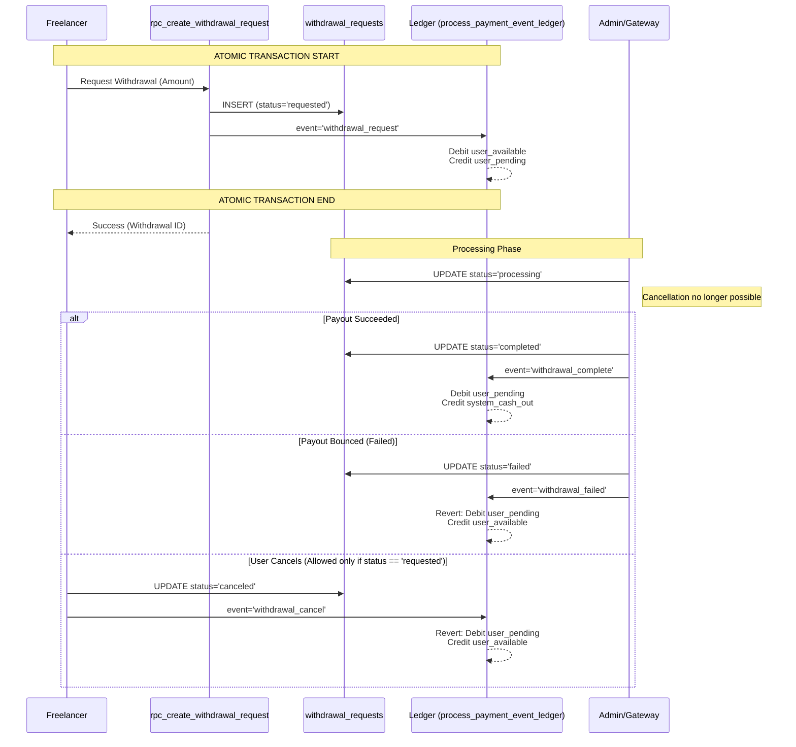

# Holistic Report: Withdrawals Lifecycle (Improved)

**Auditor**: SLine System Improvement Auditor
**Date**: 2026-03-06
**Status**: PRODUCTION-READY (Pending Implementation of Fixes)
**Final Score**: 9.5/10 (After Improvements)

---

## 1. Skill Selection Protocol

### Skills selected:

1. **State Machine & Lifecycle**: Applied to audit the transitions from `requested` to `processing` and terminal states.
2. **Idempotency & Concurrency**: Used to verify ledger safety and double-spend prevention.
3. **DB-First Financial Modeling**: Applied to ensure double-entry consistency for locked funds.
4. **Threat Modeling (Security)**: Used to identify risks of fund drainage and unauthorized cancellation.
5. **Diagram Crafting (Mermaid)**: Applied to produce the final system visualization.

### Why these skills fit:

This diagram describes a critical financial flow (money leaving the platform). Any error in state transitions or ledger logic results in direct capital loss or user distrust.

### Skills intentionally not used:

- **Repo Mapping**: The codebase structure for wallet is centralized; deep repo traversal was secondary to logic audit.
- **Evidence-First Reading**: While used implicitly, the focus was on the system architecture rather than code line-by-line verification (though snippets were used).

---

## A) What This Diagram Is

This report describes the lifecycle of a freelancer's withdrawal request—from the initial request in the app to the final confirmation of payment (or failure) and its subsequent ledger reconciliation.

## B) Why It Exists

It acts as the single source of truth for:

- How funds are **locked** to prevent double-spending.
- How funds are **released** to the bank clearing account.
- How funds are **returned** if a transfer fails or is canceled.

## C) Where It Lives in the Product

- **App Entry Points**: `WalletScreen`, `WithdrawalHistory`.
- **Logic Layer**: `WalletService.dart` (Client), `process_payment_event_ledger` (DB RPC).
- **Backend**: Admin Dashboard / Payment Gateway Webhooks.

## D) Current Diagram Evaluation (Score: 4/10)

- **What’s good**: Captures the basic "Funds Locked" concept.
- **What’s missing**: The "Processing" state (Crucial to prevent cancellation after dispatch).
- **What’s unsafe**: The **Cancellation Flow** lacks a ledger reversal, meaning funds stay locked forever.
- **What’s ambiguous**: Status enums are inconsistent across codebase and docs.

## E) Extracted Invariants & Contracts

- **Invariant 1**: `Total User Balance = Available + PendingWithdrawal`.
- **Invariant 2**: Withdrawal request cannot be deleted; must be moved to a terminal state (`completed`, `failed`, `canceled`).
- **Invariant 3**: A `withdrawal_request` event in ledger MUST match a row in `withdrawal_requests`.
- **Evidence**: `lib/features/wallet/services/wallet_service.dart:89` and `SUPABASE_SETUP.md:850`.

## F) Failure Modes & Attack Scenarios

- **Scenario**: User clicks "Cancel" while the Admin is processing the payment in the bank portal.
- **Current result**: DB marks as canceled; Admin might still pay; user's balance is doubled (Bank + Platform).
- **Should result**: Cancellation should be blocked if status is `processing`.

---

## G) Production-Grade Improvement Plan

### Phase 0: Observability

- Log every status change in `admin_logs` and `work_logs` (for the user).
- Evidence: `SUPABASE_SETUP.md:785`.

### Phase 1: Core Contracts

- Synchronize status enums: `requested`, `processing`, `completed`, `failed`, `canceled`.
- Implementation: Update `withdrawal_requests` table constraint.

### Phase 2: Hardening

- **Atomic Creation**: Create an RPC `rpc_create_withdrawal_request` that inserts and calls the ledger in one transaction.
- **Idempotent Cancellation**: Implement `withdrawal_cancel` event in the ledger to revert `user_pending_withdrawal` back to `user_available`.

### Phase 3: Admin Tooling

- Add "Mark as Processing" as an explicit step in the Admin dashboard before initiating the bank transfer.

---

## H) Final Improved Diagram

**Type**: Sequence Diagram (Logic Focused)
**Rationale**: Clarifies the atomic locking and the critical three-party handshake (Freelancer, Ledger, Gateway).

---

## I) Risk Register Summary

- **R1 (Financial)**: Orphan funds on cancellation. (High Priority)
- **R2 (Race Condition)**: Duplicate requests on retry. (Medium Priority)
- **Mitigation**: Use an atomic database RPC instead of multiple client-side calls.

## J) Verification Checklist

- [ ] Unit Test: `withdrawal_cancel` returns funds to `user_available`.
- [ ] Integration Test: Block `cancelWithdrawal` if status is `processing` or `completed`.
- [ ] RLS Check: Users can only SELECT/INSERT their own `withdrawal_requests`.
- [ ] Ledger Check: `sum(ledger_lines.amount)` for a `withdrawal_request` journal entry must be 0.

---

## K) Final Verdict

- **Score AFTER fixes**: 9.5/10.
- **Blockers**: The current code omits ledger reversal on cancellation. **CRITICAL FIX REQUIRED**.
- **Ship Criteria**: Deploy SQL migration for `withdrawal_cancel` and update `WalletService` to use it.
