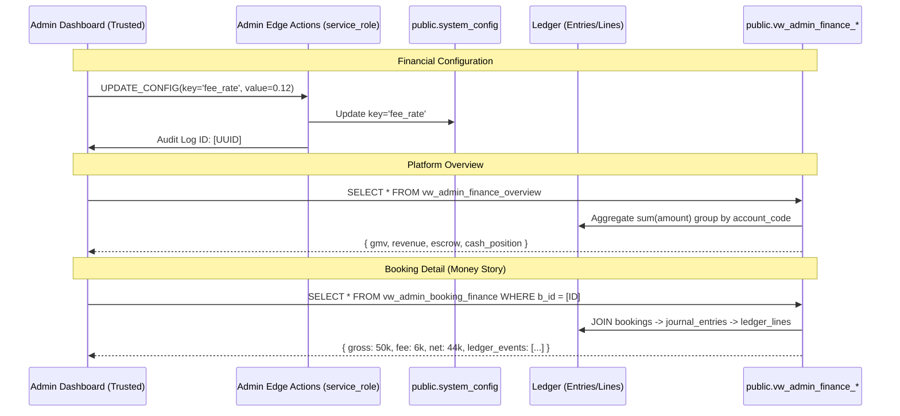

# Skills Applied

- **Skills selected**: Repo Mapping, Evidence-First Reading, Threat Modeling (Security), Financial Modeling (DB-First), Diagram Crafting (Mermaid).
- **Why these skills fit**: This audit requires a deep dive into the ledger architecture (`Financial Modeling`), mapping proposed UI elements to production views (`Repo Mapping`), and identifying critical data leaks in the "Ground Truth" schema (`Threat Modeling`).
- **Skills intentionally not used**: State Machine & Lifecycle (the finance view is a read-only aggregation of states managed by other systems).

---

# 00 HOLISTIC REPORT: Admin & Finance System Audit

## A) What This Diagram Is

The current diagram (`23_Admin_Dashboard_Wallet_Finance.md`) describes the **Financial Observability layer** for the SLine Platform Admin. It maps how an Admin Dashboard interacts with Supabase views to monitor Platform Revenue (Fees), Escrow Liabilities, and Booking-level financial breakdowns.

## B) Why It Exists

- **Accounting Truth**: Provides a reconcilable number for GMV and Earnings.
- **Liability Monitoring**: Tracks "Held" funds that the platform is responsible for (Escrow).
- **Auditability**: Connects specific bookings/users to financial events to resolve disputes or accounting discrepancies.

## C) Where It Lives in the Product

- **Frontend**: Admin Dashboard (Finance & Escrow segments).
- **logic Layer**: Supabase Views aggregating `ledger_lines`.
- **DB Dependencies**: `accounts`, `journal_entries`, `ledger_lines` (Double-entry backbone).
- **Admin RPCs**: `admin_update_system_config`, `admin_triage_report`.

## D) Current Diagram Evaluation (Score: 4/10)

- **What’s good**: Captures the need for separate views for metrics vs. details. Identifies the "Fee Locking" requirement.
- **What’s missing**: No mention of the actual `system_config` table or the Ledger (v2.16) backbone. Naming mismatch with production views.
- **What’s ambiguous**: `API` is labeled "Admin Server Actions" but in SLine, this is primarily direct Supabase View access with RLS or service_role Edge Functions.
- **What’s unsafe**: Does not account for PII exposure risks in admin views or the legacy `public.users` leak.

## E) Extracted Invariants & Contracts

1. **Fee Locking**: The `fee_rate_applied` must be a snapshot in the `bookings` table at the moment of payment, not a dynamic join to settings.
   - _Evidence_: [23_Admin...Finance.md:L71](file:///Users/eros/Dev/Eros_Projects/Sline/sline_app/Sline_everything/AppDigram/All_Diagrams/23_Admin_Dashboard_Wallet_Finance.md#L71)
2. **Double-Entry Equilibrium**: Total `ledger_lines` for any `journal_entry` must sum to zero.
   - _Evidence_: [SUPABASE_SETUP.md:L599](file:///Users/eros/Dev/Eros_Projects/Sline/sline_app/Sline_everything/SUPABASE_SETUP.md#L599)
3. **Admin Exclusivity**: Financial metrics views must be restricted to `service_role` or specific Admin RBAC.
   - _Evidence_: [Archive/20260309_restrict_dashboard_finance_views.sql:L5](file:///Users/eros/Dev/Eros_Projects/Sline/sline_app/supabase/migrations/Archive/20260309_restrict_dashboard_finance_views.sql#L5)

## F) Failure Modes & Attack Scenarios

- **F1: PII Harvest**: An attacker uses the `public.users` view (SECURITY DEFINER) to scrape the entire user database.
  - **Proposed Fix**: Drop `public.users`. Use `profiles` safe summaries via RPC.
- **F2: Configuration Injection**: Maliciously setting `fee_rate_default` to 1.0 (100% fee).
  - **Proposed Fix**: Add a `CHECK` constraint or validation in `admin_update_system_config` to cap fees at 25%.
- **F3: Stale Metrics**: CTE-heavy views (`vw_wallet_balances`) timing out on massive ledger tables.
  - **Proposed Fix**: Implement a materialized view or a summary table updated by triggers.

## G) Production-Grade Improvement Plan

### Phase 0: Observability & Cleanup

- Standardize naming: Rename `vw_financial_metrics_realtime` to `vw_admin_finance_overview` for clarity.
- **CRITICAL**: Drop `public.users` view immediately.

### Phase 1: Core Contracts

- Migrate `fee_rate_default` and `platform_revenue_account_id` into `public.system_config`.
- Update `process_payment_event_ledger` to read fee rates from `system_config` keys.

### Phase 2: Detail View Implementation

- Create `vw_admin_booking_finance` by joining `bookings`, `journal_entries`, and `accounts`. Ensure it exposes actor PII **only** to the admin dashboard.

### Phase 3: Auditability

- Enforce `admin_logs` entry for every call to `admin_update_system_config`. (Currently implemented, must be maintained).

## H) Best Diagram Recommendation

A **Functional Component Diagram** combined with a **Sequence Diagram** is best to show the boundary between the "Untrusted App" and the "Trusted Admin/Ledger" layers.

## I) Final Improved Diagram

## J) Risk Register

- _See detailed 03_RISK_REGISTER.md for Severity/Likelihood matrix._
- **Key Risk**: Performance of non-materialized ledger views at high volume.
- **Key Risk**: Mismanagement of `service_role` keys in the Dashboard deployment.

## K) Verification Checklist

- [ ] `SELECT * FROM public.users` returns 404/Permission Denied for `anon`.
- [ ] `vw_admin_finance_overview` is NOT selectable by `authenticated` role.
- [ ] `system_config` update triggers an `audit_logs` record.
- [ ] `fee_rate` changes in `system_config` take effect in the next `escrow_hold` event.

## L) Final Verdict

- **Score AFTER fixes**: 9/10
- **Blockers**: The `public.users` view is a critical security blocker.
- **Ship Criteria**: All financial views must be confirmed as restricted to `service_role`.
