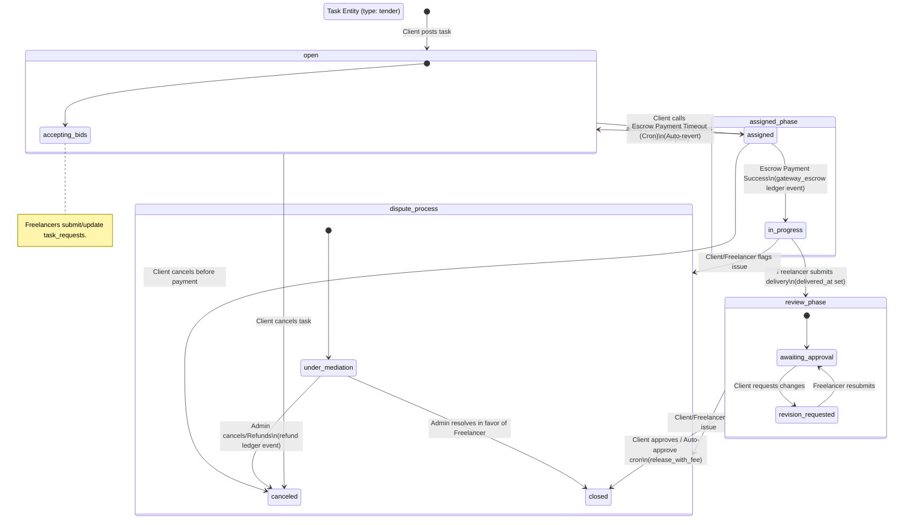

# Skills Selected

- **State Machine & Lifecycle**
- **Invariants & Contracts**
- **DB-First Financial Modeling**
- **Idempotency & Concurrency**
- **Diagram Crafting (Mermaid)**

**Why these skills fit this diagram:** The tender task lifecycle involves strict state transitions and escrow payment dependencies. Financial modeling is critical for the escrow to in-progress gateway constraint. Diagram crafting is vital to output an accurate Mermaid flow. Idempotency & Concurrency are required to handle multiple freelancer bids safely.

**Skills intentionally not used:** Repo Mapping, Observability, Production Migration Planning, etc. The scope focuses on the exact logic flow and state constraints rather than migration strategy or general observability setup.

---

## A) What This Diagram Is

This diagram illustrates the lifecycle of a `tender` task (a public job posting) from creation by a client to completion or cancellation.
**System boundaries and assumptions:** The diagram assumes that the marketplace enforces task statuses strictly, controls the acceptance of `task_requests` (bids), and handles the release of funds upon completion. It spans the client UI, the task service, and the Supabase database.

## B) Why It Exists

It maps out the core marketplace feature: the progression of work. Task states dictate allowed actions—for example, preventing bids on an `assigned` task, or preventing cancellation of an `in_progress` task without dealing with escrowed funds.

## C) Where It Lives in the Product

- **App entry points:** Create Task Screen, Task Details Screen, Task Feed.
- **Service/logic layer touchpoints:** `TaskService`.
- **DB/RPC dependencies:** `tasks` table, `task_requests` table, `accept_task_request` RPC, `process_payment_event_ledger` ledger processing.

## D) Current Diagram Evaluation (Score)

- **What’s good:** Captures the basic, happy-path sequence (`open` -> `assigned` -> `in_progress` -> `closed`).
- **What’s missing:**
  - The crucial escrow payment step that bridges `assigned` and `in_progress`.
  - The delivery phase where a freelancer submits work before it can be closed.
  - Differentiation between pre-escrow and post-escrow cancellation.
- **What’s ambiguous:** Shows `[*] -> canceled` from any early state, masking the complexity of refunding locked funds.
- **What’s unsafe:** It implies `task_status_enum` exists as an ENUM type, when the DB uses a simple `TEXT` column with a `CHECK` constraint. There's no representation of handling concurrent bids.
- **Score NOW:** 4/10. It is a highly oversimplified mental model, not a production-grade system design.

## E) Extracted Invariants & Contracts

- **Status Constraint Rule:** `tasks.status` is checked via `CHECK (status IN ('open', 'assigned', 'closed', 'in_progress', 'canceled'))`. (Evidence: `SUPABASE_SETUP.md` `tasks` table definition).
- **Payment Gateway Rule:** Task only transitions from `assigned` to `in_progress` when a QiCard payment succeeds and triggers the `gateway_escrow` event inside `process_payment_event_ledger`. (Evidence: `SUPABASE_SETUP.md` migration `20260314000000_tender_gateway_escrow_accept_assigned.sql`).
- **Acceptance Lock Rule:** Accepting an offer via `accept_task_request` RPC immediately marks the task request `accepted` and transitions the task from `open` to `assigned` (unpaid state). (Evidence: `SUPABASE_SETUP.md` RPC section).

## F) Failure Modes & Attack Scenarios

1. **Abandoned Assigned Tasks**
   - **What happens now:** Client accepts a bid to lock the freelancer but never pays the escrow. Freelancer is stuck. Task remains `assigned`.
   - **What should happen:** The system must auto-expire unpaid `assigned` tasks after a set threshold (e.g., 24h), reverting to `open` or `canceled`.
   - **Missing guardrails:** A cron job or Edge Function to reap stale assigned tasks.
   - **How to validate:** Create a mock unpaid task and run the cron function; verify it reverts status.

2. **Concurrent Offer Tampering**
   - **What happens now:** A freelancer could update their offer price just milliseconds before the client clicks "Accept". The client accepts the new, unseen price.
   - **What should happen:** `accept_task_request` should accept an expected price or `updated_at` parameter. If the offer was modified, the acceptance must fail.
   - **Missing guardrails:** Optimistic concurrency control on the `accept_task_request` RPC.
   - **How to validate:** Attempt to accept an offer with a mismatched `expected_price` param and verify it reverts the transaction.

3. **In-Progress Direct Cancellation**
   - **What happens now:** The diagram states "Any early state -> canceled", implying a client can cancel while `in_progress` and funds are held.
   - **What should happen:** Post-escrow cancellation requires mutual consent (via `change_requests`) or staff dispute mediation to ensure proper ledger `refund` routing.
   - **Missing guardrails:** Triggers checking `payment_status` when a user attempts to set `status = 'canceled'`.

## G) Production-Grade Improvement Plan (Step-by-step)

- **Phase 0: Observability & logs**
  - Implement structured logging inside `accept_task_request` and the `gateway_escrow` handler to trace state shifts.
  - _Verify_: Check admin logs for "Task Assigned" and "Task In Progress" events.

- **Phase 1: Core contracts/invariants enforcement**
  - Patch `accept_task_request` to include optimistic concurrency (validate expected price).
  - Modify `tasks` update triggers to completely block user-initiated cancellation if `status = 'in_progress'`, forcing them to use the dispute/refund pipeline.
  - _Verify_: Run integration tests that attempt an inline price update right before acceptance.

- **Phase 2: Hardening (security, idempotency, race conditions)**
  - Implement the "Unpaid Escrow Timeout" Cron job to automatically cancel/revert tasks stuck in `assigned`.
  - _Verify_: Trigger the cron on test data and assert the freelancer is released.

- **Phase 3: Admin tooling & auditability**
  - Add dashboard controls to forcibly refund and cancel an `in_progress` task, dropping a record into `admin_logs`.
  - _Verify_: Ensure the admin action correctly drops a `refund` record into `journal_entries` and updates the task status.

- **Phase 4: Performance & scale**
  - Add compound indexes for `(status, payment_status)` to optimize the unpaid timeout Cron job.
  - _Verify_: Run `EXPLAIN ANALYZE` on the timeout query to ensure index usage.

## H) Best Diagram Recommendation

- **Best diagram type:** State Diagram (`stateDiagram-v2`).
- **Why:** The tender task is fundamentally a state machine with strict phase gates (Acceptance, Escrow, Delivery, Review). A state diagram is the most effective way to communicate allowed transitions and side-effects.
- **Required diagrams:** A sequence diagram for the escrow payment flow (`gateway_escrow` -> `process_payment_event_ledger`) would be a useful complementary addition.

## I) Final Improved Diagram (Mermaid)

## J) Risk Register

### J1) Risks if we keep the current system

- **Severity**: High, **Likelihood**: High, **Impact**: Freelancers tied to unpaid "assigned" tasks indefinitely.
- **Evidence**: No documented auto-timeout mechanism for unpaid accepted offers.

### J2) Risks introduced by improvements

- **Complexity Risk**: Optimistic concurrency on `accept_task_request` may cause UI failures if prices change frequently.
  - **Mitigation**: Add a clear generic error `_mapError` branch in Flutter informing the client: "The freelancer recently updated their offer. Please review the new terms."
- **Operational Risk**: Cron job for auto-expiring unpaid tasks might cancel a task right as a payment is in flight.
  - **Mitigation**: Introduce a 15-minute grace period over the payment expiry deadline, and ensure idempotency key usage on payments.

## K) Verification Checklist (Production Readiness)

- [ ] **Tests (Unit/Integration):** Test `accept_task_request` with optimistic concurrency.
- [ ] **Tests (Unit/Integration):** Test `assigned` -> `in_progress` transition strictly via `gateway_escrow`.
- [ ] **RLS Checks:** Verify RLS prevents clients from directly `UPDATE tasks SET status = 'in_progress'`.
- [ ] **Monitoring/Alerts:** Alert on tasks stuck in `assigned` > 48h.
- [ ] **Audit Logs:** Verify admin dispute resolutions log correctly to `admin_logs`.
- [ ] **Rollback Plan:** Keep previous `accept_task_request` signature active for 1 legacy app release cycle.

## L) Final Verdict

- **Score AFTER fixes:** 9/10
- **Blockers to production:** Must implement the Optimistic Concurrency check on `accept_task_request`. Must implement the Unpaid Timeout Cron.
- **Ship criteria:** All automated tests passing across the Escrow Gateway and Delivery sequences.
