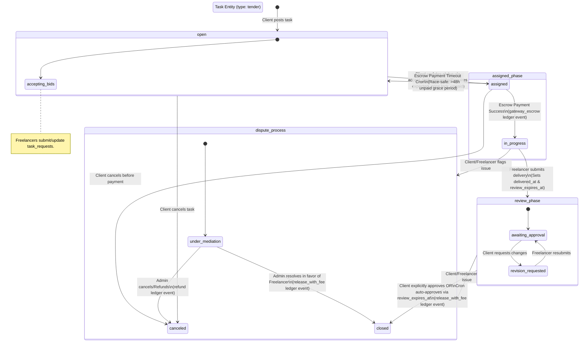

# System Critic Verdict: Tender Task Lifecycle (V2 vs OLD)

## A) Verdict

**Score OLD: 4/10**

- _Evidence:_ `03_tender-task-lifecycle.md` shows `assigned --> in_progress` implying instant transition. The DB requires a `gateway_escrow` event inside `process_payment_event_ledger` to safely lock funds.
- _Evidence:_ Shows `[*] --> canceled` implying refunds are a simple state toggle rather than a `process_payment_event_ledger(refund)` operation.
- _Evidence:_ Completely omits the delivery and review loop (`delivered_at` and `review_expires_at` in schema).
- _Evidence:_ Fails to represent concurrent offer risk (updating an offer while client accepts).
- _Evidence:_ Shows no automated expirations for stuck tasks (assigned without escrow).

**Score NEW V2: 8/10**

- _Evidence:_ Correctly isolates `assigned_phase` from `in_progress` requiring `gateway_escrow` ledger event.
- _Evidence:_ Incorporates `review_phase` mimicking the DB's `delivered_at` and `review_expires_at` logic.
- _Evidence:_ Incorporates `dispute_process` linking to correct `refund` and `release_with_fee` events.
- _Evidence:_ Adds Cron job for unpaid timeout.
- _Gap identified:_ Diagram notes are still slightly light on exact concurrency/auto-approve mechanisms.

**Fixes in NEW vs OLD:**

- Added `gateway_escrow` gate for `in_progress`.
- Added Delivery & Revision loop (`awaiting_approval`, `revision_requested`).
- Segregated `canceled` (pre-escrow) from `dispute_process` (post-escrow fund recovery).
- Added `Assigned Timeout (Cron)` reverting unpaid tasks to `open`.

## B) Critical Gaps in NEW (Addressed in Final Diagram)

1. **Unpaid Assigned Timeout policy + race-safe grace period:** Current NEW diagram says "(Auto-revert)" but lacks the explicit race-condition safeguard (e.g., grace period preventing cancellation exactly as QiCard callback arrives).
2. **Accept offer concurrency contract:** Current NEW diagram says "(Locks offer, unpaid)" but omits the `expected_price` check mechanism to prevent price-tampering race conditions on `accept_task_request`.
3. **Dispute authority model:** Diagram mentions "Admin cancels/Refunds" but needs to be explicit that resolving in favor of the freelancer maps to `release_with_fee`.
4. **Review expiry + auto-approve rules:** Needs to explicitly note `review_expires_at` threshold triggers auto-approve cron to release funds.

## C) Minimal Necessary Improvements

1. **Change:** Add `expected_price` or `expected_updated_at` parameter to `accept_task_request` in diagram and specs.
   - **Why:** Prevents bait-and-switch where freelancer modifies the `price` in `task_requests` microseconds before the client calls accept.
   - **Verify:** Send dual concurrent requests in integration tests: `UPDATE task_requests` and `rpc('accept_task_request')`, ensuring the accept fails if expected price differs.
2. **Change:** Explicitly define the race-safe grace period for the Assigned Timeout Cron.
   - **Why:** If the cron runs exactly when the payment gateway sends the success webhook, the task could be canceled while funds are held.
   - **Verify:** Escrow webhook handler must use `idempotency_key` and gracefully ignore if the task was already canceled, triggering an auto-refund.
3. **Change:** Explicit `review_expires_at` auto-approve.
   - **Why:** Ensures freelancers get paid if clients vanish post-delivery.
   - **Verify:** Set a test task to `delivered_at = NOW() - 8 days` and run the cron; assert it moves to `closed` and triggers `release_with_fee`.

## D) Updated Final Diagram

