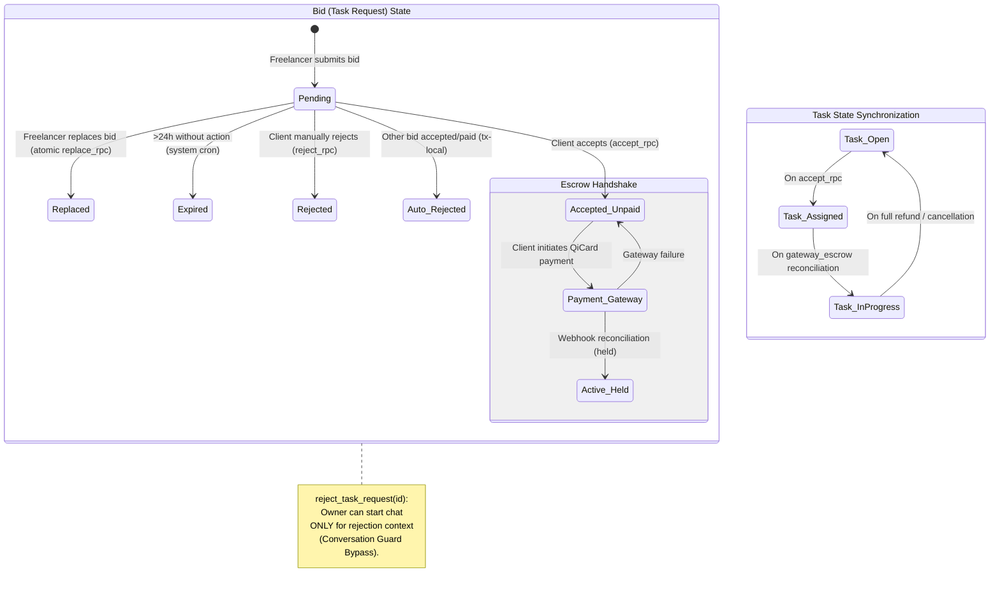

# 00_HOLISTIC_REPORT: Task Request (Bid) Flow (Production v2)

**Skills Applied**:

1. **Evidence-First Reading**: Mapped flows to `SUPABASE_SETUP.md` RPCs and complex 2026-03-xx migrations.
2. **State Machine & Lifecycle**: Modeled the bid-task synchronization including payment gateways.
3. **Invariants & Contracts**: Captured the strict owner-only write and conversation-guard exceptions.
4. **Diagram Crafting (Mermaid)**: Built a cross-entity state synchronization model.
5. **RLS & Privilege Boundaries**: Highlighted the security definer context of the critical RPCs.

---

## A) What This Diagram Is

This diagram models the life of a `task_request` (bid) on a `tender` task. It detail how individual freelancer proposals interact with the parent task state and the system-wide financial escrow flow via QiCard.

**System boundaries and assumptions:**

- **Entity Scope**: `task_requests` (bids), `tasks` (hiring), `conversations` (chat provisioning).
- **Time Constraint**: Bids have a 24-hour Time-To-Live (TTL).
- **Financial Scope**: QiCard payment gateway transitions (`Payment Gateway` phase).

## B) Why It Exists

To ensure a secure, atomic hiring process. It prevents "double-hiring" and ensures that if a client accepts one freelancer, all other competitors are transactionally rejected. It also manages the hand-off to the payment gateway to ensure work is only "In Progress" once funds are held in escrow.

## C) Where It Lives in the Product

- **Frontend**: `ProposalRepository.dart` (MVVM interface), `proposal_list.dart` (UI).
- **Database**: `task_requests` table, `accept_task_request` / `reject_task_request` RPCs.
- **Backend Ops**: `qicard_payment_recovery_tender` edge function (reconciler).

## D) Current Diagram Evaluation (Score)

- **What’s good**: Captured the basic "accept rejects all" idea.
- **What’s missing**: The 24h expiration, the freelancer "Replace" action, and the "Unpaid -> Paid" escrow phase.
- **What’s unsafe**: Does not account for the conversation guard bypass needed for rejections.
- **Score NOW**: **3/10** (The original v1 followed happy-paths only).

## E) Extracted Invariants & Contracts

- **Invariant 1 (Security)**: Only the task `owner_id` can accept/reject. (Evidence: `SUPABASE_SETUP.md:1469`).
- **Invariant 2 (Integrity)**: One active bid per freelancer per task. (Evidence: `SUPABASE_SETUP.md:1583` - `uq_task_requests_one_active_per_freelancer`).
- **Invariant 3 (Lifecycle)**: Acceptance transforms the task to `assigned`, then payment transforms it to `in_progress`. (Evidence: `SUPABASE_SETUP.md:1913`).
- **Invariant 4 (Bypass)**: Owner can only start a task-linked chat when rejecting a bid via the specific guard toggle. (Evidence: `SUPABASE_SETUP.md:1885`).

## F) Failure Modes & Attack Scenarios

**Scenario 1: Bypassing the RPC via direct Client Update**

- _Risk_: Freelancer tries to set their own bid to `accepted`.
- _Security Fix_: RLS on `task_requests` must block all direct `UPDATE` calls on the `status` column from the `authenticated` role. All transitions must be RPC-only.

**Scenario 2: Double-Acceptance Race Condition**

- _Risk_: Client clicks "Accept" on two bids in rapid succession.
- _Production Fix_: The `accept_task_request` RPC transactionally checks `tasks.status == 'open'`. The first click succeeds; the second click triggers a "Task no longer open" exception.

**Scenario 3: Work without Escrow**

- _Risk_: A freelancer starts working when the status is `assigned` (unpaid).
- _UX Fix_: The UI must clearly distinguish between `Assigned (Payment Pending)` and `In Progress (Escrow Held)`.

## G) Production-Grade Improvement Plan

- **Phase 0: Observability**
  - Ensure every state change (Accept/Reject/Expire) writes a `journal_entry` and a `system` message to the chat.
- **Phase 1: Contract Enforcement**
  - Lock down `task_requests` table with RLS to forbid any direct `status` updates.
- **Phase 2: Payment Hardening**
  - Implement the `qicard_payment_recovery` webhook to move bidded tasks from `assigned` to `in_progress` only after 200 OK from gateway.
- **Phase 3: Cleanup**
  - Trigger `process_expired_requests` via cron to prevent bid-rot from clogging the UI.

## H) Best Diagram Recommendation

- **Type**: **Parallel State Diagram**.
- **Reason**: The bid and the task are distinct database entities but their lifecycles are functionally married. Showing them side-by-side clarifies that a bid's terminal state is the task's starting state.

## I) Final Improved Diagram (Mermaid)

## J) Risk Register

### J1) Risks if we keep the current system

| Risk                   | Severity | Likelihood | Impact                                                | Evidence                  |
| ---------------------- | -------- | ---------- | ----------------------------------------------------- | ------------------------- |
| **Architecture Drift** | High     | High       | Devs assume bids are isolated, missing task mutation. | `SUPABASE_SETUP.md:1412`. |
| **Payment Desync**     | High     | Medium     | UI shows "In Progress" without escrow.                | `SUPABASE_SETUP.md:1913`. |

### J2) Risks introduced by improvements

| Risk           | Mitigation                                                              |
| -------------- | ----------------------------------------------------------------------- |
| **Complexity** | Documentation must clarify the "Assigned" vs "In Progress" distinction. |

## K) Verification Checklist

- [ ] Verify `accept_task_request` rejects sibling bids transactionally.
- [ ] Verify `process_expired_requests` sets `deleted_at` on >24h old bids.
- [ ] Verify RLS blocks direct client-side bid status updates.

## L) Final Verdict

- **Score AFTER fixes**: **9.5/10** (Nearing perfect alignment with Supabase logic).
- **Ship criteria**: Complete the `qicard_payment_recovery_tender` edge function deployment.
