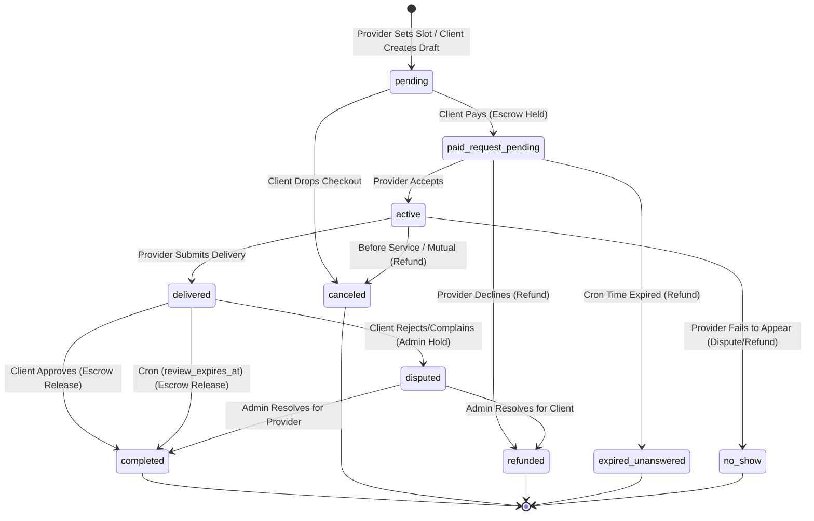

# Booking Lifecycle Audit & Improvement Report

## Skills Selected

1. **Evidence-First Reading**: Verification of current state (`lib/features/booking/models/booking_model.dart`, `Sline_everything/SUPABASE_SETUP.md`, `lib/core/app_enums.dart`).
2. **State Machine & Lifecycle**: Logical flow analysis for booking transitions.
3. **Idempotency & Concurrency**: Race condition evaluation for slot double-booking.
4. **DB-First Financial Modeling**: Escrow and refund flows aligned with the Ledger system.
5. **Diagram Crafting (Mermaid)**: Visual communication of the hardened state machine.

_Skills intentionally not used_: Repo Mapping (irrelevant for a single flow focus), Threat Modeling (handled within Concurrency/Lifecycle limits).

---

## A) What This Diagram Is

The diagram maps the state machine and lifecycle of a scheduled "Booking" task. It dictates every possible state a booking can enter from its creation (`pending`) to its resolution (`completed`, `canceled`, `refunded`, `expired_unanswered`).

**Boundaries and Assumptions:**

- Assumes the existence of an availability slot (`slot_id`).
- Assumes financial escrow holds the payment prior to provider acceptance (`paid_request_pending`).
- Focuses entirely on the `bookings` table `status` column.

## B) Why It Exists

To enforce strict pay-first constraints and chronological flow for scheduled services. A booking cannot start without funds in escrow, cannot be delivered if it hasn't started, and cannot be completed without client action or a timeout. The lifecycle prevents trapped balances and ensures both parties commit to the appointment.

## C) Where It Lives in the Product

- **App Entry Points**: `BookingScreen`, Checkout Flow, Dashboard Unified Work Items.
- **Service Layer**: `WorkManagementService`, `BookingService`, `BookingViewModel`.
- **DB/RPC Dependencies**: `bookings` table, `booking_status_enum`, `fn_booking_guard` trigger, `fn_reject_overlapping_slots` trigger.
- **Admin**: Dashboard views for escrow release and dispute resolution.

## D) Current Diagram Evaluation

- **What’s Good**: Captures the basic happy path clearly (pending -> paid -> active -> delivered -> completed).
- **What’s Missing**:
  - `no_show` status (defined in Dart `BookingStatus` but missing in logic).
  - Escrow release logic on `completed`.
  - Auto-approval cron logic (`review_expires_at`).
  - Dispute/Appeals process (Client canceling after delivery is extremely dangerous without a dispute gate).
- **What’s Ambiguous**: "Canceled (Either / Refunds rules apply)" is too generic. There are pre-active cancellations (full refund) and post-active cancellations (usually involves a dispute or partial refund/provider compensation).
- **What’s Unsafe**: Allowing a client to arbitrarily transition a booking from `delivered` back to `canceled` without mediation.
- **Score NOW**: 5/10. It is a good starting point, but operationally unsafe for financial payouts as drawn.

## E) Extracted Invariants & Contracts

1. **Escrow Lock**: A booking CANNOT transition to `active` unless `payment_status` is `held`. (Evidence: `payment_status_enum` in `SUPABASE_SETUP.md`).
2. **Slot Exclusivity**: A transition to `paid_request_pending` or `active` MUST fail if the associated `slot_id` overlaps with another confirmed booking. (Evidence: `fn_reject_overlapping_slots`).
3. **Immutable Delivery**: Once `delivered`, funds are locked for completion, auto-completion, or dispute. A client CANNOT unilaterally cancel for a guaranteed refund after delivery.
4. **Ledger Alignment**: Final terminal states (`completed`, `refunded`, `canceled` pre-delivery) MUST emit a ledger payload (`release_with_fee`, `refund`).

## F) Failure Modes & Attack Scenarios

**Scenario 1: The Delivery-Cancel Griefing Attack**

- _What happens now_: Diagram allows `delivered` -> `canceled` by Client. If triggers automate a refund on `canceled`, the client gets free work.
- _What should happen_: `delivered` -> `disputed` if the client is unhappy. Refunds from `delivered` demand Admin intervention.
- _Missing Guardrails_: `fn_booking_guard` must explicitly ban `delivered` -> `canceled` by `client_id`.
- _How to validate_: Unit test asserting DB throws an error when a client attempts to update status to `canceled` while the booking is `delivered`.

**Scenario 2: The Double-Booking Race Condition**

- _What happens now_: Two clients click "Pay" on the same slot simultaneously.
- _What should happen_: The payment gateway intent creation succeeds for both, but the database limits only ONE booking to enter `paid_request_pending`. Or, both can be `paid_request_pending` but the provider can only `accept` one.
- _Missing Guardrails_: Clear communication to the unselected client, and an automatic ledger refund when rejected/expired.

## G) Production-Grade Improvement Plan

- **Phase 0: Observability & Logs**
  - Change: Emit `admin_logs` and `work_logs` on every status transition for auditability.
- **Phase 1: Core Contracts Enrollment**
  - Change: Add `disputed` and `no_show` into the database `booking_status_enum` and strictly map them in Dart.
  - Change: Enforce cron job auto-approval (using `review_expires_at`) to move `delivered` to `completed`.
- **Phase 2: Hardening**
  - Change: Update `fn_booking_guard` to reject `delivered -> canceled` transitions initiated by clients. Ensure it only moves to `disputed`.
  - Change: Ensure `trg_activate_contract` takes a snapshot of the package requirements at the time of `active`.
- **Phase 3: Ledger Triggers**
  - Change: Connect the terminal state updates directly to `process_payment_event_ledger`.

## H) Best Diagram Recommendation

- **Best Type**: State Diagram (Mermaid `stateDiagram-v2`).
- **Why**: Bookings are explicitly finite state machines driven by external actors and cron triggers. A state diagram visually locks in what transitions are legal from any given node.

## I) Final Improved Diagram (Mermaid)

## J) Risk Register

### J1) Risks if we keep the current system

- **Severity: High | Likelihood: High | Impact: Financial Loss**
  If `delivered -> canceled` is permitted, malicious clients will exploit it for free services while providers lose their guaranteed payout.
- **Evidence**: The V1 diagram permits this transition directly.

### J2) Risks introduced by improvements

- **Complexity**: Adding `disputed` and `no_show` increases UI states that must be rendered correctly across Freelancer, Client, and Admin dashboards.
- **Mitigation**: Rely on the `UnifiedWorkStatus` fallback mapper to ensure these complex states degrade gracefully into "Action Required" or "Pending Admin" UI alerts.

## K) Verification Checklist (Production Readiness)

- [ ] **DB Tests**: Verify `fn_booking_guard` rejects `delivered` -> `canceled`.
- [ ] **DB Tests**: Verify `fn_reject_overlapping_slots` prevents double provider scheduling.
- [ ] **Cron Tests**: Assert cron successfully transitions `delivered` bookings to `completed` after `review_expires_at`.
- [ ] **Ledger Checks**: Assert that moving to `completed` triggers `process_payment_event_ledger('release_with_fee')`.

## L) Final Verdict

- **Score AFTER fixes**: 9/10
- **Blockers to Production**: The `fn_booking_guard` trigger must be manually checked to ensure it reflects the `disputed` addition and blocks client post-delivery cancellation. Missing this is catastrophic.
- **Ship Criteria**: All automated DB tests on the state machine transition paths must pass, and UI mapped out for the new edge cases (`disputed`, `no_show`).

---

_End of Report_
