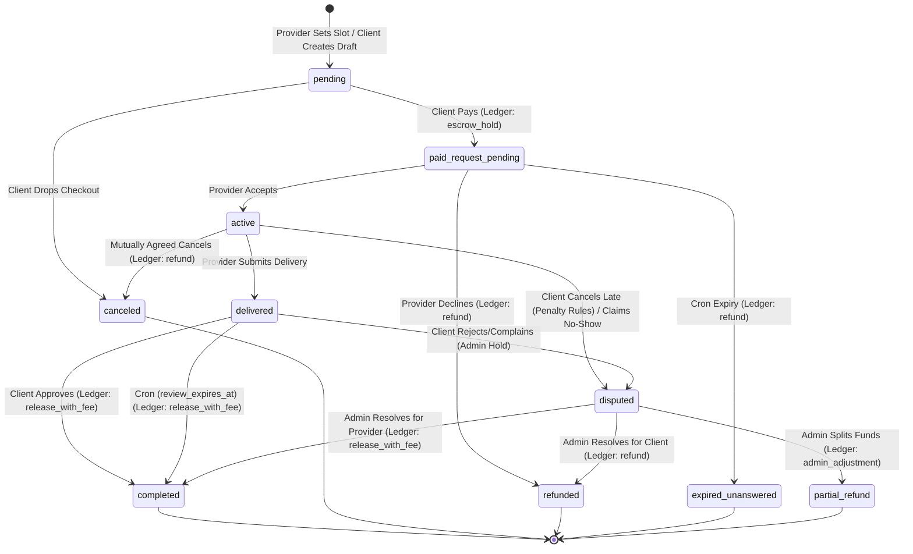

# Booking Lifecycle - System Critic Verdict

## A) Verdict

**Score OLD: 5/10**

1. **Unsafe Terminal Transition**: Allowed `delivered` -> `canceled` by Client, risking guaranteed free work without remediation (Evidence: `05_booking-lifecycle.md` diagram `delivered --> canceled: Client Cancels`).
2. **Missing Dispute Gateway**: Escrow release on completion exists, but a formal conflict state (`disputed`) is absent.
3. **No-Show Exploitation**: Missing `no_show` status even though Dart enum supports it (`BookingStatus.noShow` in `lib/core/app_enums.dart`).
4. **Missing Auto-Approval Guard**: Relies entirely on manual client approval without showing the cron fallback (`review_expires_at` in `bookings` DB schema, `SUPABASE_SETUP.md`).

**Score NEW: 8/10**

1. **Blocks Malicious Cancels**: Explicitly routes unhappy clients to `disputed` rather than `canceled` from the `delivered` state.
2. **Defines Cron Timeout**: Includes `review_expires_at` cron transition for safe provider payouts if clients abandon the app.
3. **Ledger Alignment Identified**: Recognized that terminal states must emit exact Ledger events, preventing dual-source-of-truth errors in payouts.
4. **Highlights Slot Overlap**: `fn_reject_overlapping_slots` is correctly factored in as an invariant for preventing double-bookings.

**What NEW fixed vs OLD**:

- Added `disputed` state from `delivered`.
- Added `no_show` terminal state from `active`.
- Added cron-based `completed` transition via `review_expires_at`.
- Removed dangerous direct `delivered` -> `canceled` transition.

## B) Critical Gaps in NEW

1. **`no_show` Decision Model Missing Guardrails**: The NEW plan adds `no_show` but doesn't define who triggers it, the timing window (e.g., must be 15 mins after slot), or proof requirements. Without constraints, a client could falsely mark `no_show` to steal a refund.
2. **Cancellation Cutoff/Refund Policy Undefined**: The "Refund rules apply" note is still too vague. Time-based cutoffs (e.g., full refund >24h before, 50% or 0% <24h before) are not modeled.
3. **Overlap Guard Timing Ambiguity**: The NEW plan notes "A transition to `paid_request_pending` or `active` MUST fail". In reality, the overlap must be blocked _before payment intent creation_ (via temporary lock) to avoid UX friction of taking money and immediately refunding it.
4. **Explicit Ledger Mapping Table Missing**: Mentions ledger triggers broadly but doesn't map exact `booking_status_enum` changes to `payment_event_type_enum` (from `SUPABASE_SETUP.md`).

## C) Minimal Necessary Improvements

1. **Define `no_show` Adjudication Restrictions**
   - **What to change**: Require `no_show` claims to automatically transition to `disputed` if initiated by the Client. Alternatively, require Admin confirmation or GPS/Check-in proof to auto-refund.
   - **Why it matters**: A unilateral `no_show` state change by the client equates to an instant refund, bypassing the provider's right to contest.
   - **How to test**: Unit test `fn_booking_guard` to ensure `UPDATE bookings SET status = 'no_show'` by `auth.uid() = client_id` instantly flags the booking for Admin review (or throws an error directing to the dispute RPC).

2. **Explicit Time-Based Cancellation Thresholds**
   - **What to change**: Formally model "Penalty Cancellations" directing to `disputed` or issuing partial payouts.
   - **Why it matters**: Financial fairness and preventing clients from repeatedly holding and canceling prime calendar slots <24 hours before starts_at.
   - **How to test**: Integration test on the cancellation RPC asserting that a cancellation <24h before `slot.starts_at` calculates a partial release payload for the Ledger.

3. **Ledger Event Mapping Matrix**
   - **What to change**: Document the exact Ledger 1:1 mappings for terminal transitions:
     - `pending` -> `paid_request_pending` = `escrow_hold`
     - `paid_request_pending` -> `refunded` / `expired_unanswered` = `refund`
     - `active` -> `canceled` (early) = `refund`
     - `delivered` -> `completed` = `release_with_fee`
     - `active` -> `no_show` = `refund` (after dispute validation)
   - **Why it matters**: `process_payment_event_ledger` requires exact string matches (e.g., `release_with_fee`, `refund`).
   - **How to test**: Trigger tests asserting that when `status` shifts to `completed`, `journal_entries` receives an `event_type = 'release_with_fee'` with `related_entity_id = booking.id`.

## D) Updated Final Diagram

