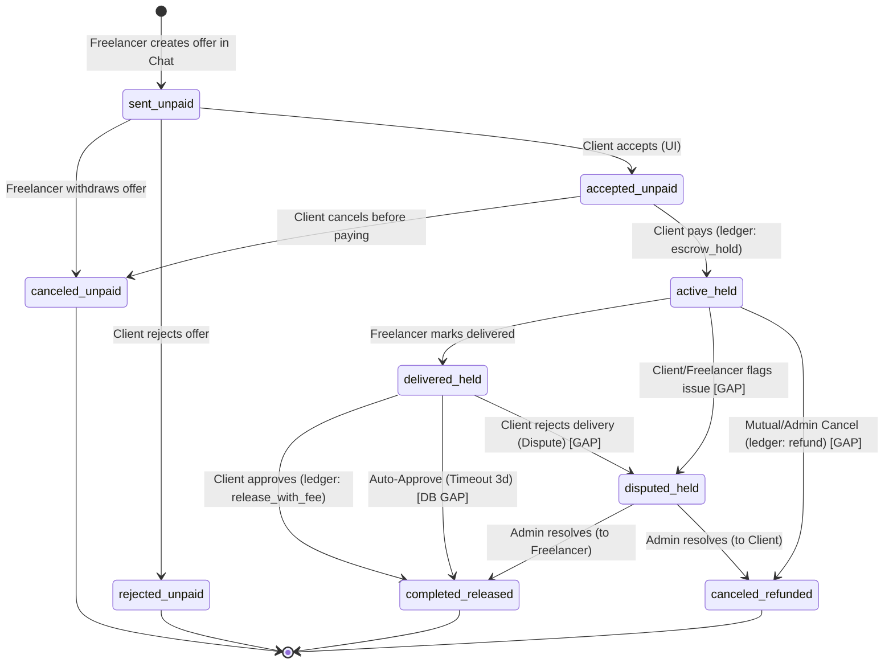

# 00_HOLISTIC_REPORT - Direct Chat Offer Flow

**Skills Applied**:

- **Evidence-First Reading**: To rigorously check diagram states against `SUPABASE_SETUP.md` (line 669) and `DirectOffersService.dart`.
- **State Machine & Lifecycle**: To explicitly map exact DB `status` + `payment_status` rather than vague abstract states.
- **DB-First Financial Modeling**: Direct offers touch the ledger (escrow hold, release, refund). Explicit financial contract mapping is required.
- **Diagram Crafting (Mermaid)**: To build the upgraded composite-state visual flow.

**Skills Intentionally Not Used**:

- _Production Migration Planning_: Because there's no live user migration of data format required yet, just feature additions (timestamps and admin states).
- _Repo Mapping_: The files were clearly stated and discovered via direct search.

---

## A) What This Diagram Is

This diagram visualizes the state machine of the "Direct Hire" feature, natively embedded within chat (Direct Offers). It maps how a freelancer pitches a fixed-price/fixed-time offer directly via a chat message, and how the client accepts, funds, and later releases payment for it.

### System Boundaries & Assumptions

- Operates totally outside the standard public "tender" system (no `tasks` row is strictly required, though `task_id` is optional).
- Requires a ledger operation (`payment_status` shifting from `unpaid` -> `held` -> `released`).
- Assumes the conversation was correctly provisioned (i.e. direct DM requires favorable relationship or tender application).

---

## B) Why It Exists

It provides a high-velocity contracting tool allowing continuous engagement without the friction of recreating a public tender. It separates "Direct Hire" from basic tasks so developers and QA know exactly where the boundaries of the `direct_offers` table end, and the ledger begins.

It prevents out-of-band payment negotiations and ensures all direct work still operates under the app's standard escrow/fee model.

---

## C) Where It Lives in the Product

- **App Entry Points**: Chat UI (Offer Creation Plugin), Notification Action sheet, and Dashboard (Pending Payments / Active Work).
- **Service/Logic Layer**: `lib/features/direct_offers/services/direct_offers_service.dart`.
- **DB/RPC**: `direct_offers` table (v2.17), `fn_direct_offer_guard`, and ledger functions like `process_payment_event_ledger`.

---

## D) Current Diagram Evaluation (Score)

- **What’s good**: The sequence effectively represents the human interaction. It clearly captures that client action triggers the transition into escrow, and client action triggers release.
- **What’s missing**:
  - The database uses `sent`, not `pending`.
  - It totally ignores `payment_status`. Unifying `status` and `payment_status` is required for safe accounting.
  - Freelancers can cancel a sent offer (missing).
  - Clients can cancel an accepted offer before paying (missing).
  - No path is shown for refunds or cancellations on `active` offers.
  - No timeout auto-release mechanism.
- **What’s ambiguous**: Does "accepted" mean paid? (Code says no, it is just an agreement pending payment via `payNow`).
- **What’s unsafe**: The diagram claims `active --> canceled (triggers refund)`, but the Flutter service (`DirectOffersService.dart`) literally has no function allowing a client or freelancer to cancel an active (paid) offer.
- **Score NOW**: **4/10**. Visually helpful for PMs, but financially and technically dangerous for engineers due to missing edge cases and incorrect status names.

---

## E) Extracted Invariants & Contracts

1. **Initial Creation Contract**: A freelancer must be the one initiating the offer (`DirectOffersService.dart:38`). Status MUST be `sent` and `payment_status` MUST be `unpaid`.
2. **Escrow Funding Liability**: An offer can only transition to `active` + `held` via a valid ledger event (`_ledgerService.submitPaymentEvent(eventType: 'escrow_hold')`).
3. **Delivery Lock**: `markDelivered` can only be invoked by the freelancer, AND only if the offer `isActive` (`status == active` and `payment_status == held` in `DirectOffersService.dart:276`).
4. **Approval Ledger Release**: Client completion triggers `release_with_fee`. Status goes to `completed`, payment goes to `released`.

---

## F) Failure Modes & Attack Scenarios

### 1. Permanent Escrow Lock (AFK Client)

- **What happens now**: Freelancer marks an offer `delivered`. Client deletes the app. The freelancer's funds are permanently trapped in `held` status because `direct_offers` has no `review_expires_at` column to trigger the `fn_check_expired_reviews` cron.
- **What should happen in production**: When transitioning to `delivered`, a `review_expires_at` (e.g., +3 days) must be stamped, and cron must auto-release.
- **Missing Guardrails**: Missing DB columns (`delivered_at`, `review_expires_at`) in `SUPABASE_SETUP.md` line 669.

### 2. Active Offer Refund/Dispute Blackhole

- **What happens now**: If a freelancer fails to deliver an active offer, there is no UI mechanism inside `DirectOffersService.dart` for either party to cancel it. The `active -> canceled` refund path is a ghost.
- **What should happen in production**: A dispute mechanism or mutual cancellation request must exist.
- **Missing Guardrails**: `cancelActiveOffer` or dispute hooks in the service layer.

---

## G) Production-Grade Improvement Plan (Step-by-step)

- **Phase 0: Nomenclature Alignment**
  - **What**: Change all references in UI/Diagrams from `pending` to `sent` to precisely mirror DB enum.
- **Phase 1: Escrow Expiration Safety**
  - **What**: Run a migration on `direct_offers` to add `delivered_at` and `review_expires_at`. Update `markDelivered` in service to set `review_expires_at = now() + interval '3 days'`.
  - **Why**: Prevents indefinite escrow lockup.
- **Phase 2: Composite States & Ledger Accuracy**
  - **What**: Ensure UI strictly disables interactions based on `[status, payment_status]` composite logic. A `status=accepted` means nothing without `payment_status=unpaid` or `held`.
- **Phase 3: Active Cancellation & Disputes**
  - **What**: Implement `requestActiveOfferCancellation` (mutual consent) or `raiseOfferDispute()`.
  - **Why**: Without it, support will manually edit DB rows when work fails. Unsafe.

---

## H) Best Diagram Recommendation

- **Type**: **State Diagram (Composite State)**
- **Why**: Financial ledgers dictate that an object has a lifecycle state (sent/delivered) and a financial state (unpaid/held). A composite state diagram perfectly models exactly when money moves.

---

## I) Final Improved Diagram (Mermaid)

---

## J) Risk Register

### J1) Risks If We Keep the Current System

1. **Permanent Escrow Trap**: No timeout on direct offers. (Severity: CRITICAL)
2. **Missing Active Refunds**: No UI for cancelling an active offer. Funds are stuck without manual DB manipulation. (Severity: HIGH)
3. **Misleading Diagram**: Trusting the original diagram leads engineers to believe `active --> canceled` is already implemented. (Severity: MEDIUM)

### J2) Risks Introduced by Improvements

1. **Timeout Abuse**: If we implement auto-approve (`review_expires_at`), malicious freelancers could send empty files and wait 3 days for auto-payout.
   - _Mitigation_: Ensure clients are aggressively notified when an offer is marked delivered. Implement robust dispute logging before timeout.

---

## K) Verification Checklist (Production Readiness)

- [ ] **Tests**: Write `direct_offers_service_test.dart` verifying client cannot call `cancelOffer` and freelancer cannot call `payNow`.
- [ ] **RLS Checks**: Verify `direct_offers` UPDATE policy requires sender/receiver verification.
- [ ] **DB Migrations**: Add `delivered_at` and `review_expires_at`.
- [ ] **Cron**: Update `fn_check_expired_reviews` to explicitly include `direct_offers`.
- [ ] **Disputes**: Extend `disputes` table (`SUPABASE_SETUP.md` 5.24) to accept `direct_offer_id` as a valid resource, not just `task_id`.

---

## L) Final Verdict

- **Score AFTER Fixes**: **9/10** (Once composite states gap and timeout fields are merged).
- **Blockers to Production**: Lack of `review_expires_at`, creating a permanent fund lock risk. Lack of active-offer cancellation UI workflow.
- **Ship Criteria**: Add missing fields, update cron job, and deploy the admin dispute transition for direct offers.
