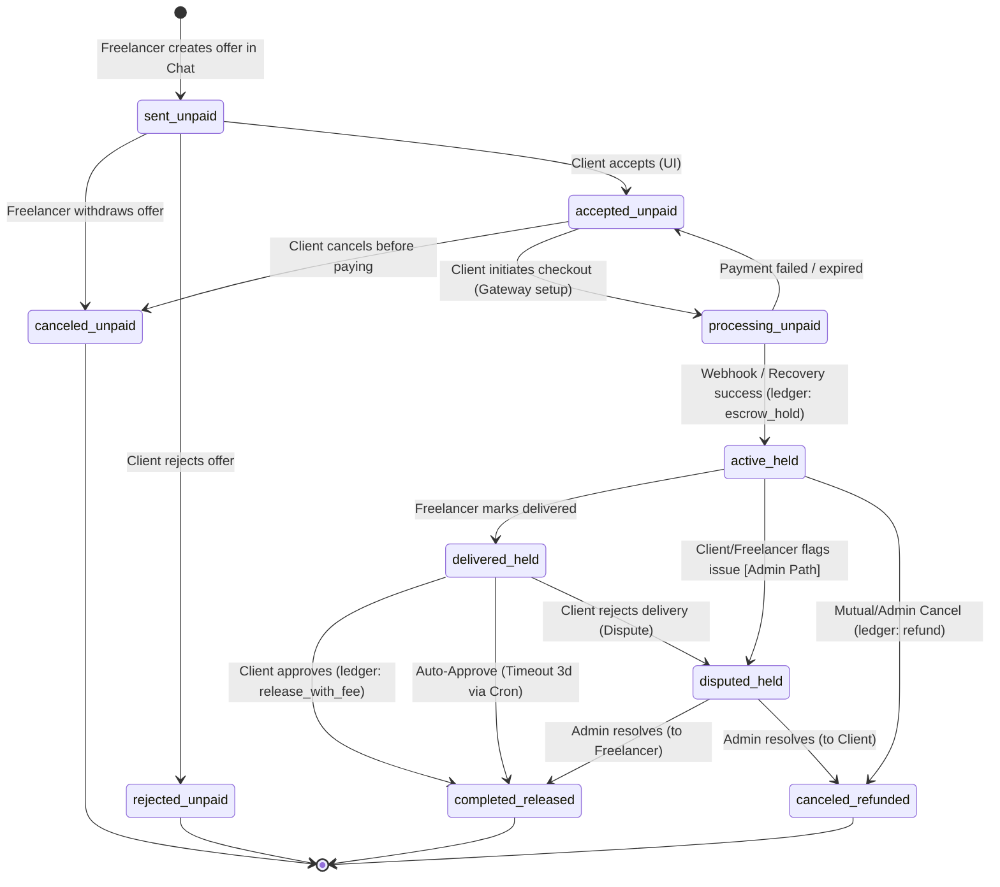

# 07_SYSTEM_CRITIC_VERDICT

You are SLine Payment & Wallet Critic. Here is my verdict on the NEW diagram/system (`00_HOLISTIC_REPORT.md`) versus the OLD diagram (`06_direct-chat-offer-flow.md`).

## A) Verdict: NEW vs OLD

- **Score Delta**: OLD (4/10) ➔ NEW (7/10) ➔ V3 REQUIRED.
- **Why NEW improved**: NEW successfully mapped the business `status` + financial `payment_status` into clear composite states. It correctly identified the critical **"Permanent Escrow Lock"** (missing `review_expires_at` and `delivered_at`) which is fatal for a contracting platform. It also mapped the missing manual/admin cancellation flows for active offers.
- **Why NEW still fails the Wallet Guard**: NEW completely ignored standard payment **traceability**. It assumes `active_held` is a magical state achieved instantly. However, looking at the `direct_offers` table definition (`SUPABASE_SETUP.md:669`), it lacks ALL gateway tracking columns (`payment_request_id`, `payment_gateway_id`, `payment_correlation_id`, `payment_expires_at`, `payment_recovered_at`). By comparison, the `bookings` table has these. Without them, `DirectOffersService.recoverPaymentAfterCallback` has no canonical, database-enforced source of truth for the active checkout intent. A crashed app mid-checkout or a duplicated webhook will cause catastrophic edge cases.

## B) Blockers to production (must-fix)

1. **Missing Gateway Traceability**: `direct_offers` MUST have the exact same payment tracking columns as `bookings`. Relying on transient frontend state or generic JSON blobs for `payment_request_id` means a user rebooting their phone mid-payment loses their money in the void.
2. **Missing `fee_rate_bps_snapshot`**: The direct offer must lock in the platform fee rate at the moment of offer acceptance. If the platform fee changes globally while money is held in escrow, releasing the ledger using the _new_ global rate will desynchronize the ledger lines.
3. **Implicit Currency**: `price` is just `numeric`. It must be explicitly typed with a `currency` column (default 'IQD') to prevent cross-currency ledger anomalies.

## C) V3 Mermaid & Minimal Patch Plan

### Single Composite State Machine (V3)

This diagram adds the critical `processing_unpaid` checkout state, ensuring gateway intent generation is captured safely before escrow holds.



### Minimal Database Patch

```sql
ALTER TABLE direct_offers
-- Financial Traceability & Scaling
ADD COLUMN currency text NOT NULL DEFAULT 'IQD',
ADD COLUMN fee_rate_bps_snapshot integer NOT NULL DEFAULT 1000, -- Locks in the 10% fee
-- Gateway Traceability
ADD COLUMN payment_request_id text,
ADD COLUMN payment_gateway_id text,
ADD COLUMN payment_correlation_id text,
ADD COLUMN payment_expires_at timestamptz,
ADD COLUMN payment_recovered_at timestamptz,
-- Timeout Safety (Identified in NEW)
ADD COLUMN delivered_at timestamptz,
ADD COLUMN review_expires_at timestamptz;

-- Add a partial index to find orphaned checkouts
CREATE INDEX idx_direct_offers_processing
ON direct_offers(status)
WHERE status = 'accepted' AND payment_status = 'unpaid' AND payment_request_id IS NOT NULL;
```

### Minimal Service/API Changes

1. **Checkout Initialization**: Before redirecting to the gateway, `direct_offers` MUST be updated with a securely generated `payment_correlation_id` and the `payment_request_id` returned by QiCard.
2. **Checkout Recovery**: `recoverPaymentAfterCallback` must strictly match the `payment_request_id` on the row, avoiding spoofed callbacks.
3. **Fee Lock**: `create_offer` or `accept_offer` MUST stamp the current global `fee_rate_bps` on the generic row so `release_with_fee` relies on the snapshot, not volatile global state.

## D) Verification checklist (production gate)

- [ ] **Tests (App Crash)**: Mock a process death after gateway redirect but before callback. Ensure polling or next app launch uses `payment_correlation_id` to reliably recover escrow.
- [ ] **Tests (Double Webhook)**: Send two identical webhook payloads for a `direct_offer`. The database trigger/unique index must ensure `journal_entries.idempotency_key` rejects the second payload, locking strictly to the first `payment_gateway_id`.
- [ ] **RLS Checks**: Verify users CANNOT `UPDATE` the `fee_rate_bps_snapshot`, `price`, or `currency` columns once the status is no longer `sent_unpaid`. Any tampering must be blocked by `fn_direct_offer_guard`.
- [ ] **Cron Execution**: Monitor `fn_check_expired_reviews` to guarantee it targets `direct_offers.review_expires_at` accurately, releasing the payout using `fee_rate_bps_snapshot`.
- [ ] **Admin Trace Views**: Ensure the admin dashboard can join `direct_offers` -> `journal_entries` -> `ledger_lines` mapping every single cent from QiCard intent to final user balance.
