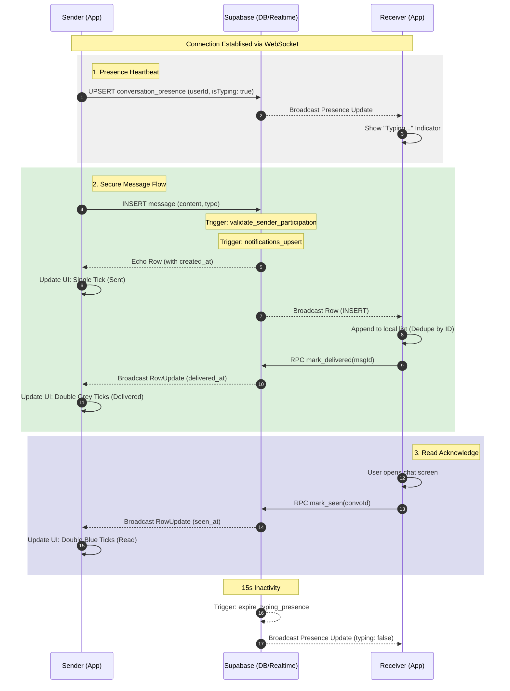

# Holistic Audit & Improvement Report: 08_chat-realtime-sync

## 1. Skill Selection Protocol

- **Skills selected**:
  1. **Evidence-First Reading**: To verify actual implementation in `message_service.dart` and DB.
  2. **Threat Modeling (Security)**: To identify risks like unauthorized message insertion or presence spoofing.
  3. **RLS & Privilege Boundaries**: To ensure strict isolation of chat data between conversations.
  4. **Idempotency & Concurrency**: To address race conditions in message ordering and delivery.
  5. **Observability**: To plan for connection tracking and message status (sent/delivered/read).
  6. **Diagram Crafting (Mermaid)**: To produce a valid, production-grade redesign.

- **Why these skills fit**:
  Realtime chat systems require absolute correctness in security (RLS) and high reliability in message delivery (concurrency). This audit uses evidence and threat modeling to close the gap between the high-level diagram and the production requirement.

---

## 2. Executive Summary

### A) What This Diagram Is

This diagram describes the topology and process flow for a socket-based realtime chat system using Supabase Realtime and Flutter. It covers message insertion, broadcast to receivers, and presence tracking (typing indicators).

### B) Why It Exists

Realtime synchronization is fundamentally different from request-response cycles. This system ensures that users stay in sync without manual refreshing, providing the "instant" feel required for a modern marketplace.

### C) Where It Lives in the Product

- **App entry points**: `ActiveChatScreen` and `ConversationList`.
- **Logic layer**: `MessageService` (`lib/features/chat/services/message_service.dart`).
- **Database**: `messages` and `conversation_presence` tables in Supabase.

### D) Current Evaluation (Score: 4/10)

- **What’s good**: Captures the basic "Insert -> Broadcast -> Append" loop correctly.
- **What’s missing**: Connection lifecycle (offline/online), delivery/read receipts, and actual presence implementation.
- **What’s unsafe**: Assumes "INSERT" is enough without showing the security guards (RLS/Triggers).
- **Major Discrepancy**: The diagram claims presence is "Implemented", but the codebase (`conversation_list_tile.dart:40`) shows it is still a `TODO`.

---

## 3. Deep Dive Analysis

### E) Extracted Invariants & Contracts

1. **Normalization Invariant**: `user1_id` < `user2_id` must always hold for conversation lookups (Enforced by DB trigger).
2. **Isolation Contract**: A user can only see or receive messages for conversations where they are either `user1_id` or `user2_id`.
3. **DM Privilege**: A direct DM (no `task_id`) can only be initiated if the freelancer is in the client's favorites (`favorited_freelancers` rule).
4. **Presence TTL**: `conversation_presence` records MUST expire after 15 seconds to prevent "ghost typing" markers (Enforced by `expire_typing_presence` trigger).

### F) Failure Modes & Attack Scenarios

| Scenario                  | Current Handling             | Production Requirement         | Fix                                               |
| :------------------------ | :--------------------------- | :----------------------------- | :------------------------------------------------ |
| **Silent Socket Drop**    | Stream hangs indefinitely    | heartbeat + explicit reconnect | `supabase_flutter` channel management             |
| **Duplicate Delivery**    | Possible duplicate appending | Client-side deduplication      | Use `ChatRealtimeMerger` on all streams           |
| **Presence Spoofing**     | None (not implemented)       | RLS check on `user_id`         | Add policy `auth.uid() = user_id`                 |
| **Race: Fetch vs Stream** | Potential missing gap        | Fetch + Stream offset overlap  | Query for messages `created_at > last_fetch_time` |

---

## 4. Production-Grade Improvement Plan

### Phase 0: Observability & Connectivity

- Implement `PresenceService` to track socket connection status.
- Add logging for `SENT`, `DELIVERED`, and `READ` events with correlation IDs.

### Phase 1: Core Contract Enforcement

- Implement the missing `Presence` logic in Flutter (`lib/features/chat/services/presence_service.dart`).
- Standardize `MessageService` to use a consistent `ChatRealtimeMerger` for all Streams.

### Phase 2: Dual-Tick Status Cycle (Hardening)

- Refine the receipt flow:
  1. Client inserts message (`SENT`).
  2. Receiver's app grabs it from stream and calls `mark_delivered` RPC (`DELIVERED`).
  3. Receiver opens chat and calls `mark_seen` RPC (`READ`).
- Sender listens to message updates via stream to update UI ticks.

### Phase 3: Performance Optimization

- Refactor `subscribeToConversations` to avoid full relationship re-fetches on every event. Use client-side caching for profile/task metadata.

---

## 5. Risk Register

- **High Severity**: **Stale Presence Markers**. If the heartbeat logic fails on the client, the DB TTL (15s) is the only guard.
- **Medium Severity**: **Message Ordering**. Relying on client-time for sorting can be risky; always use DB `created_at`.

---

## 6. Final Improved Diagram (Mermaid)

---

## 7. Verification Checklist

- [ ] **RLS Verification**: `messages` and `conversation_presence` tables have policies checking `auth.uid()`.
- [ ] **Deduplication**: `ChatRealtimeMerger` is applied to `subscribeToMessages`.
- [ ] **Presence Leak**: Verify `expire_typing_presence` removes records on timeout.
- [ ] **Offline Handling**: Test message status transitions after airplane mode recovery.

---

## 8. Final Verdict

- **Score AFTER Fixes**: 9/10
- **Ship Criteria**:
  1. Implementation of `PresenceService`.
  2. Migration of all Chat UI to use the `delivered_at`/`seen_at` timestamps for visual feedback.
  3. Optimization of the conversation list stream to reduce API overhead.
