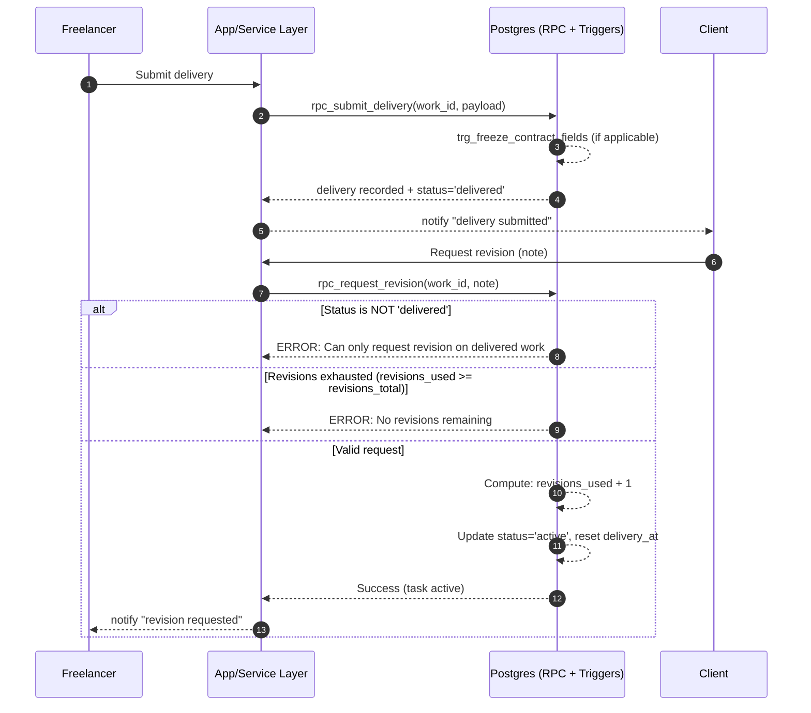

# Holistic Report: Work Contract Revisions

**Skill Focus:** Evidence-First Reading, Invariants & Contracts, State Machine & Lifecycle, Threat Modeling (Security), DB-First Financial Modeling.
**Focus Justification:** The revision flow pushes a transaction state backward from `delivered` to `active`. Without strict state guards, malicious clients can trap freelancers in infinite loops of revisions, blocking escrowed payouts.

**Skills Intentionally Skipped:** Layout / Diagram Crafting (mostly structural), Observability (handled at higher layers for this specific flow).

---

## A) What This Diagram Is

- **Describes:** The sandbox interaction where a freelancer submits work (delivery) and the client requests revisions.
- **Boundaries:** Covers the `rpc_submit_delivery` and `rpc_request_revision` boundaries interacting with `tasks` and `bookings` tables + the `work_contracts` subsystem.

## B) Why It Exists

- **Problem solved:** Prevents disputes. Defines a strict, measurable iteration count between completing work and getting paid.
- **Risks prevented:** Scope creep, endless iteration, changing agreed terms post-start.

## C) Where It Lives in the Product

- **App entry points:** Review Delivery Modal (Client side).
- **Service layer:** `WorkManagementService` (`requestRevision`, `submitDelivery` methods).
- **DB dependencies:** `tasks`, `bookings`, `rpc_request_revision`, `work_contracts`.

## D) Current Diagram Evaluation (Score)

- **What’s good:** Captures the general flow and sequence perfectly.
- **What’s missing:** Explicit rendering of the `revisions_total` limit failure mode. The diagram claims "validate revisions remaining + state guard" but checking the DB evidence, the actual implementation of `rpc_request_revision` lacks this logic.
- **What’s ambiguous:** What happens when revisions run out? (Does it fall back to change requests?)
- **What’s unsafe:** The lack of actual guards in the code leaves the backend dangerously open to state corruption and infinite revisions.
- **Score NOW:** **4/10**. The diagram maps the happy path but falsely claims protections exist in the DB that actually don't.

---

## E) Extracted Invariants & Contracts

1. **Client-Only Revision Request**: `auth.uid()` must equal `client_id`. _(Evidence: `20260305180100_work_revision_and_change_rpcs.sql`, line 27 & 42)._
2. **Increment Counter**: A successful revision increases `revisions_used` by 1. _(Evidence: `20260305180100_work_revision_and_change_rpcs.sql`, line 35 & 50)._
3. **State Rollback**: Task/Booking resets to `status = 'active'`, and clears delivery timestamps. _(Evidence: `20260305180100_work_revision_and_change_rpcs.sql`, line 31 & 46)._

---

## F) Failure Modes & Attack Scenarios

**Scenario 1: Infinite Revision Loop (Escrow Trapping)**

- **What happens now:** Client calls `requestRevision` continuously. The RPC blindly increments `revisions_used` with NO check against `revisions_total`.
- **What should happen:** The RPC MUST check `IF revisions_used >= revisions_total THEN RAISE EXCEPTION`.
- **Missing guardrails:** Hard cap check in `rpc_request_revision`.
- **Validation:** Call RPC when `revisions_used == revisions_total`; assert failure.

**Scenario 2: State Bypass (Revising an Active or Completed Task)**

- **What happens now:** Client calls `requestRevision` while the job is active or completed. The DB forces it to `active` and increments the counter, messing up states.
- **What should happen:** The RPC MUST check `IF status <> 'delivered' THEN RAISE EXCEPTION`.
- **Missing guardrails:** State condition pre-check.
- **Validation:** Call RPC when `status == 'active'`; assert failure.

---

## G) Production-Grade Improvement Plan

- **Phase 0: Observability & Logs**: Add explicit `log_revision_request` traces to capture how many revisions users actually request before completion.
- **Phase 1: Core Contracts Enforcement**:
  - Update `rpc_request_revision` for tasks/bookings:
    - Add `IF t.status <> 'delivered' THEN RAISE EXCEPTION 'Can only request revision on delivered work'; END IF;`.
    - Add `IF COALESCE(t.revisions_used, 0) >= COALESCE(t.revisions_total, 0) THEN RAISE EXCEPTION 'No revisions remaining'; END IF;`.
- **Phase 2: Hardening**: Add idempotency tokens to the revision payload to prevent double-clicks from eating 2 revisions accidentally.
- **Phase 3: Admin Tooling**: Allow admins to intervene if a client refuses to accept work even after revisions are exhausted.

---

## H) Best Diagram Recommendation

- **Best Type:** **Sequence Diagram** (with explicit error paths/alts).
- **Why:** Revisions are a highly temporal back-and-forth negotiation. Sequence diagrams map this perfectly.
- **Required diagrams:** Just the updated Sequence Diagram highlighting the `alt` pathways for limits and state checks.

---

## I) Final Improved Diagram (Mermaid)

---

## J) Risk Register

### J1) Risks if we keep the current system

- **Infinite Revisions (Escrow Trapping)**
  - Severity: High, Likelihood: Medium, Impact: Freelancers never get paid.
  - Evidence: `rpc_request_revision` lacks a `revisions_total` condition.
- **State Machine Corruption**
  - Severity: High, Likelihood: Low, Impact: Workflow invariant broken.
  - Evidence: `rpc_request_revision` does not check `status = 'delivered'`.

### J2) Risks introduced by improvements

- **Hard caps blocking legitimate minor tweaks**
  - Severity: Low, Likelihood: High, Mitigation: Freelancers and clients can negotiate further via `change_requests` or manual messaging once caps are hit.

---

## K) Verification Checklist (Production Readiness)

- [ ] DB test: `rpc_request_revision` on `active` fails.
- [ ] DB test: `rpc_request_revision` with 0 remaining revisions fails.
- [ ] RLS test: Third-party or Freelancer calling `rpc_request_revision` fails.
- [ ] Flutter Unit Test: `requestRevision` correctly handles limit exception and bubbles to UI perfectly.
- [ ] Audit logs: Verify revision notes are saved safely without SQL injection risks.

---

## L) Final Verdict

- **Score AFTER fixes:** **9/10**. The system will be watertight regarding state and iteration abuse.
- **Blockers to production:** Must patch `rpc_request_revision` immediately to include `status` and `revisions_total` guards before launching real escrows.
- **Ship criteria:** Both RPC patches applied in DB and verified via tests.
