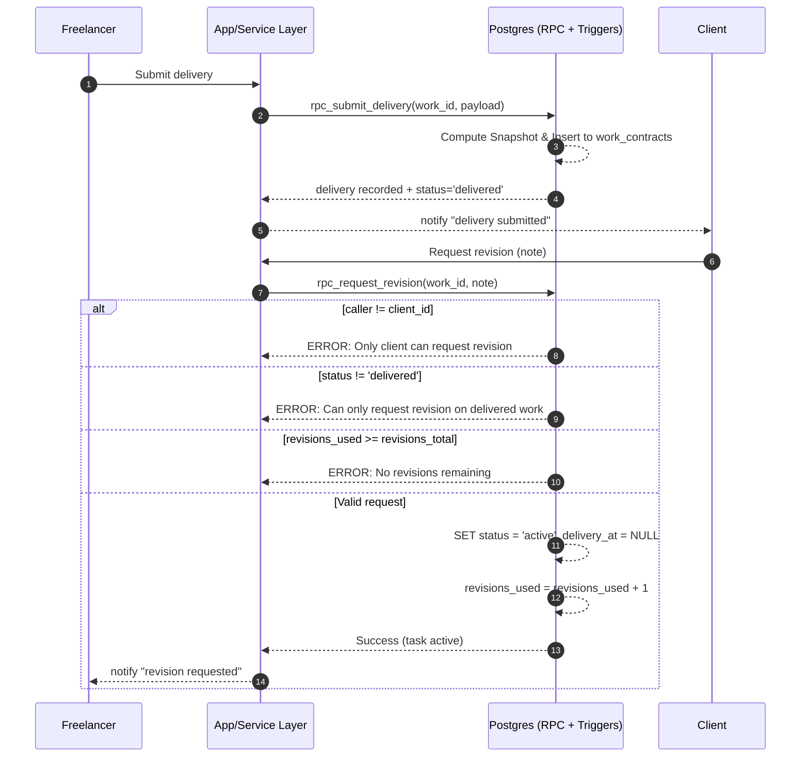

# Work Revision System Critic Verdict

**Skill Pick:**

- **Evidence-First Reading:** Used to parse exact conditions in `rpc_request_revision`.
- **Invariants & Contracts:** To map what the logic expects against what it guards.
- **Threat Modeling:** Anticipating malicious revision spamming by clients to trap escrow.

_Skills intentionally not used:_

- Repo Mapping (already know where the RPCs live from prior DB dumps).
- Observability (focus is purely on blocking state/financial corruption at the DB layer).

---

## A) Verdict

**Diagram Score (Original claiming DB guards): 4/10**
**Implementation Score: 2/10**

### Real vs. Claimed Protections

- ✅ **REAL:** Caller is client/owner (`auth.uid() = client_id`).
- ✅ **REAL:** `revisions_used` increments.
- ✅ **REAL:** Reverts status to `active` and nullifies `delivered_at` / `review_expires_at`.
- ❌ **CLAIMED BUT MISSING:** `status must be 'delivered'`. The RPC unconditionally forces the state to `active`, even if it is currently `completed`, `cancelled`, or already `active`.
- ❌ **CLAIMED BUT MISSING:** `revisions_used < revisions_total`. The RPC blindly adds 1 to `revisions_used` indefinitely.
- ❌ **CLAIMED BUT MISSING/UNVERIFIED:** Contract immutability (`trg_freeze_contract_fields`). We see it mentioned in the diagram but the actual code to freeze the contract on `rpc_submit_delivery` was not present in the immediate `work_revision_and_change_rpcs.sql`.

---

## B) Minimal Patch Plan

### 1. Hardening `rpc_request_revision`

Apply the missing state and cap guards in `supabase/migrations/20260305180100_work_revision_and_change_rpcs.sql`:

```sql
-- Inside rpc_request_revision (for BOTH 'task' and 'booking' branches)

-- [NEW] State Guard
IF t.status <> 'delivered' THEN
  RAISE EXCEPTION 'Can only request revision on delivered work';
END IF;

-- [NEW] Hard Cap Guard
IF COALESCE(t.revisions_used, 0) >= COALESCE(t.revisions_total, 0) THEN
  RAISE EXCEPTION 'No revisions remaining';
END IF;

-- (Optional but recommended) Idempotency Token
-- Client passes a distinct token, or rely on timestamps to prevent double clicks:
-- IF t.revision_requested_at > now() - interval '5 seconds' THEN ...
```

### 2. Contract Freeze Enforcement

If `trg_freeze_contract_fields` does not exist or fails, `rpc_submit_delivery` MUST physically take a snapshot of agreed terms and insert it into `work_contracts` with `version = COALESCE(MAX(version), 0) + 1`. This effectively "locks" the terms the moment delivery is submitted.

---

## C) Updated Final Mermaid

This diagram reflects the necessary RPC hardening paths:



---

## D) Verification Checklist

### Database & RLS Tests

- [ ] Create a `task` with `status = 'active'`, `revisions_used = 0`, `revisions_total = 1`. Call `rpc_request_revision`. **Expect:** Exception "Can only request revision on delivered work".
- [ ] Update `task` to `status = 'delivered'`, `revisions_used = 1`, `revisions_total = 1`. Call `rpc_request_revision`. **Expect:** Exception "No revisions remaining".
- [ ] Set `status = 'delivered'`, `revisions_used = 0`, `revisions_total = 1`. Call `rpc_request_revision` as a user NOT matching `client_id`. **Expect:** Exception "Only client can request revision".
- [ ] Set `status = 'delivered'`, `revisions_used = 0`, `revisions_total = 1`. Call `rpc_request_revision` as `client_id`. **Expect:** Success. `status` is now `active`.

### Integration Tests (Flutter)

- [ ] In `work_management_service_test.dart`, mock `requestRevision` with `revisions_used == revisions_total`. Ensure the UI intercepts the `PostgrestException` and maps it via `ErrorHandling` to: _"No revisions remaining."_ instead of a generic backend error.
