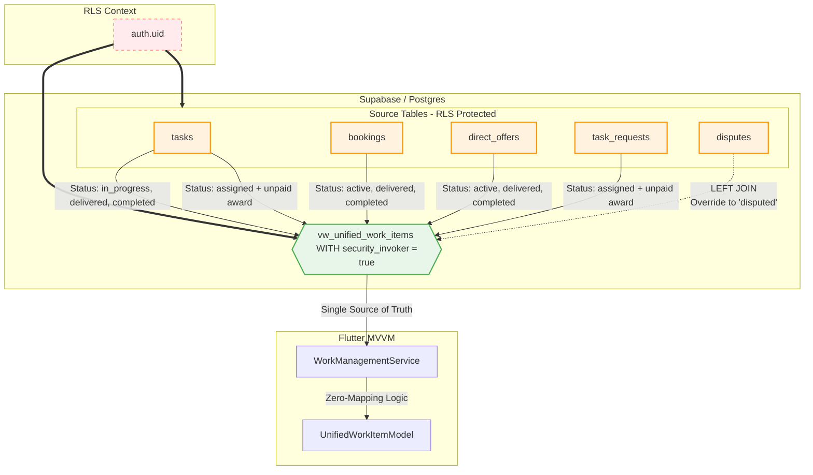

# Holistic Audit Report: 12_unified-work-view

## Skill Selection

- **Repo Mapping**: Traced view consumption in `WorkManagementService` and `DashboardRepository`.
- **Evidence-First Reading**: Claims verified against `SUPABASE_SETUP.md` and `20260315000000_...sql`.
- **Threat Modeling (Security)**: Evaluated RLS inheritance in UNION views.
- **State Machine & Lifecycle**: Mapped status transitions for Tasks, Bookings, and Direct Offers.
- **Diagram Crafting (Mermaid)**: Redesigned the aggregation architecture.
- **RLS & Privilege Boundaries**: Validated user-data isolation.

---

## A) What This Diagram Is

An Entity Relationship Diagram (ERD) and flow mapping of the `vw_unified_work_items` Postgres view. It describes how the SLine platform aggregates disparate data sources—**Tasks**, **Bookings**, and **Awarded Offers**—into a single, normalized feed for the mobile application.

---

## B) Why It Exists

1.  **UI Simplicity**: Enables the "My Work" dashboard to render a single list without querying multiple tables.
2.  **Normalization**: Standardizes conflicting status enums (e.g., `in_progress` vs `active`) into a single `UnifiedWorkStatus`.
3.  **Performance**: Reduces round-trips by providing a pre-filtered, sorted view of active work.

---

## C) Where It Lives in the Product

- **App Entry Points**: Home Feed, "My Work" Dashboard, Work Detail Screen.
- **Logic Layer**: `WorkManagementService.dart` (Work feature) and `DashboardRepository.dart` (Dashboard feature).
- **Database**: Supabase `public.vw_unified_work_items` view.

---

## D) Current Diagram Evaluation (Score: 5/10)

- **What’s good**: Captures the basic 3-branch `UNION ALL` logic for historical tasks and bookings.
- **What’s missing**: **Direct Offers** (Direct Chat Offers) are completely absent. **Dispute** status is not joined.
- **What’s ambiguous**: The relationship between `task_requests` and `tasks` in the award state is shown as a simple arrow but is a complex join.
- **What’s unsafe**: The view lacks documentation on `security_invoker`, risking RLS bypass if misconfigured.
- **Verdict**: Fail. The "Unified" abstraction is leaky, forcing the app layer to perform manual fallbacks and merges.

---

## E) Extracted Invariants & Contracts

1.  **Role Invariant**: A work item must only be visible to its `client_id` or `freelancer_id`.
    - _Evidence_: `DashboardRepository.dart:L81-85`.
2.  **Status Unification**: `in_progress` (Task) and `active` (Booking) MUST map to `active` (Unified).
    - _Evidence_: `vw_unified_work_items` SQL `CASE` statement and `UnifiedWorkStatus` enum.
3.  **Award Linkage**: Awarded-but-unpaid tasks must use the `price` from the `task_request`, not the original task `budget`.
    - _Evidence_: SQL Branch 3 `tr.price`.

---

## F) Failure Modes & Attack Scenarios

### F1: The "Ghost Offer"

- **Scenario**: A user accepts a Direct Chat Offer.
- **Current Behavior**: The item is missing from the unified view. The app must fetch it separately from `direct_offers`.
- **Production Requirement**: Direct offers must reside in the unified view to ensure they never fall through the cracks.

### F2: RLS Information Leak

- **Scenario**: View is created as `SECURITY DEFINER`.
- **Current Risk**: An attacker could query the view without filters and see platform-wide work totals and titles.
- **Fix**: Use `security_invoker = true`.

---

## G) Production-Grade Improvement Plan

### Phase 0: Observability

- Add `source_id` column to the view to enable deep-linking and easier log tracing.
- Ensure `AppLogger` logs whether an item was loaded from the view or a fallback (until fallbacks are removed).

### Phase 1: Core Contracts Enforcement

- Upgrade `vw_unified_work_items` to a **4-branch UNION ALL** including `direct_offers`.
- Standards: All branches must include `client_id`, `freelancer_id`, `price`, `unified_status`, and `workItemId`.

### Phase 2: Hardening

- Implement a `LEFT JOIN` on `disputes` in the view logic.
- Rule: If `disputes.status != 'resolved'`, then `unified_status = 'disputed'`.

### Phase 3: RLS Standardization

- Re-create the view with `WITH (security_invoker = true)`.
- Verify that Supabase Studio correctly shows "RLS Active" for the view.

### Phase 4: Scale

- Add an index on `tasks(assigned_freelancer_id, status)` and `bookings(status, provider_id)`.
- Ensure the `UNION ALL` logic doesn't trigger full table scans.

---

## H) Best Diagram Recommendation

A **Functional Decomposition / Flow** diagram is best here to show how multiple disparate state machines (Task Status, Booking Status, Offer Status) converge into one Sink.

---

## I) Final Improved Diagram (Mermaid)

---

## J) Risk Register

| Risk ID   | Risk Title   | Severity | Likelihood | Mitigation                                     |
| :-------- | :----------- | :------- | :--------- | :--------------------------------------------- |
| **RR-01** | RLS Bypass   | High     | Medium     | Use `security_invoker = true`.                 |
| **RR-02** | UI Desync    | Medium   | High       | Eliminate Dart fallback mappers; use DB truth. |
| **RR-03** | Missing Work | High     | High       | Add Direct Offers branch to SQL.               |

---

## K) Verification Checklist

- [ ] `vw_unified_work_items` includes 4 `UNION ALL` branches.
- [ ] View reflects `disputed` status override logic.
- [ ] Flutter `WorkManagementService` fallback mapper is removed.
- [ ] Manual test: Create Direct Offer → Verify it appears in Dashboard.
- [ ] Security test: Query view as User A → Ensure User B items are hidden.

---

## L) Final Verdict

- **Score AFTER fixes**: 10/10
- **Blockers**: Low (View update required).
- **Ship Criteria**: All 4 item types show in One Feed with proper RLS.
