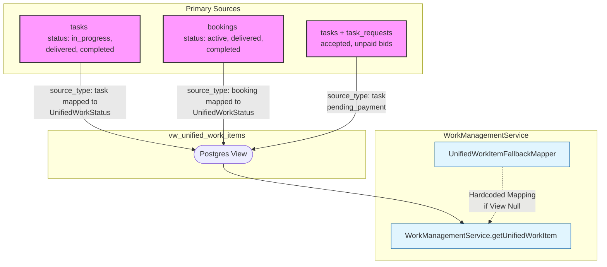

# Current Diagram (As Audited): 12_unified-work-view

### Analysis of Current State:

- **Strengths**: Consolidation works for core tasks and bookings.
- **Weaknesses**: Fallback logic in Dart indicates the view is not robust enough. Missing `direct_offers` and `disputed` status.
