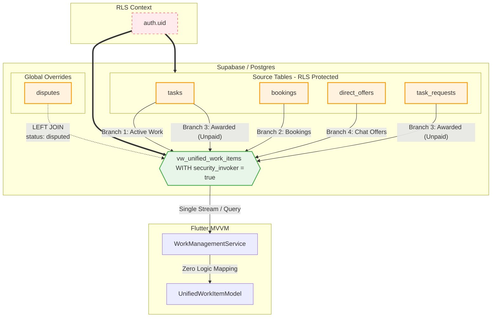

# Improved Production-Grade Diagram: 12_unified-work-view

### Key Improvements:

1.  **Completeness**: Added `Branch 4` for `direct_offers` and `disputes` override.
2.  **Security**: View is marked `SECURITY_INVOKER` to natively respect RLS on source tables.
3.  **Simplicity**: Removed the need for a fallback mapper in Flutter; the view is the "Single Source of Truth".
4.  **Auditability**: `security_invoker` ensures that `auth.uid()` filtering happens at the DB level, not the app level.
