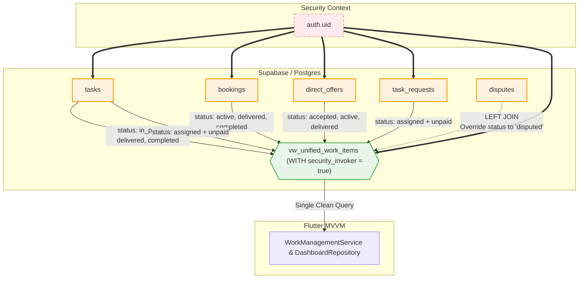

# Patch Plan: 12_unified-work-view

## Phase 1: Database Migration (SQL)

**Context**: We must replace the existing view to include `direct_offers`, handle `disputes`, and enforce `security_invoker`.

**Action**: Create `supabase/migrations/20260307000000_upgrade_unified_work_view.sql`.

```sql
BEGIN;

DROP VIEW IF EXISTS public.vw_unified_work_items;

CREATE OR REPLACE VIEW public.vw_unified_work_items WITH (security_invoker = true) AS

-- Branch 1: Tasks in progress (already assigned)
SELECT
    t.id,
    'task'::text AS source_type,
    t.status AS source_status,
    CASE
        WHEN d.id IS NOT NULL AND d.status NOT IN ('resolved', 'closed') THEN 'disputed'
        WHEN t.status = 'in_progress' THEN 'active'
        WHEN t.status = 'delivered' THEN 'delivered'
        WHEN t.status = 'completed' THEN 'completed'
        WHEN t.status = 'canceled' THEN 'canceled'
        ELSE t.status
    END AS unified_status,
    t.title,
    COALESCE(t.budget, 0)::numeric AS price,
    t.deadline,
    COALESCE(t.client_id, t.owner_id) AS client_id,
    t.assigned_freelancer_id AS freelancer_id,
    t.delivered_at,
    t.review_expires_at,
    COALESCE(t.revisions_total, 3) AS revisions_total,
    COALESCE(t.revisions_used, 0) AS revisions_used,
    ('task:' || t.id::text) AS work_item_id,
    GREATEST(t.updated_at, t.delivered_at) AS last_activity_at,
    (t.status = 'delivered') AS needs_review,
    4 AS sort_rank,
    NULL::uuid AS awarded_request_id,
    NULL::timestamptz AS payment_deadline
FROM public.tasks t
LEFT JOIN public.disputes d ON d.related_entity_id = t.id AND d.related_entity_type = 'task'
WHERE t.assigned_freelancer_id IS NOT NULL
  AND t.status IN ('in_progress', 'delivered', 'completed')

UNION ALL

-- Branch 2: Bookings
SELECT
    b.id,
    'booking'::text AS source_type,
    b.status::text AS source_status,
    CASE
        WHEN d.id IS NOT NULL AND d.status NOT IN ('resolved', 'closed') THEN 'disputed'
        ELSE b.status::text
    END AS unified_status,
    (COALESCE(t.title, 'Session') || ' - Session') AS title,
    b.price,
    av.starts_at AS deadline,
    b.client_id,
    b.provider_id AS freelancer_id,
    b.delivered_at,
    b.review_expires_at,
    COALESCE(b.revisions_total, 3) AS revisions_total,
    COALESCE(b.revisions_used, 0) AS revisions_used,
    ('booking:' || b.id::text) AS work_item_id,
    COALESCE(b.delivered_at, b.created_at) AS last_activity_at,
    (b.status = 'delivered') AS needs_review,
    CASE b.status
        WHEN 'active' THEN 4
        WHEN 'delivered' THEN 5
        ELSE 6
    END AS sort_rank,
    NULL::uuid AS awarded_request_id,
    NULL::timestamptz AS payment_deadline
FROM public.bookings b
LEFT JOIN public.tasks t ON b.task_id = t.id
LEFT JOIN public.availability_slots av ON b.slot_id = av.id
LEFT JOIN public.disputes d ON d.related_entity_id = b.id AND d.related_entity_type = 'booking'
WHERE b.status IN ('active', 'delivered', 'completed')

UNION ALL

-- Branch 3: Awarded pending payment
SELECT
    t.id,
    'task'::text AS source_type,
    'assigned'::text AS source_status,
    'pending_payment'::text AS unified_status,
    t.title,
    tr.price,
    t.deadline,
    COALESCE(t.client_id, t.owner_id) AS client_id,
    COALESCE(tr.freelancer_id, tr.bidder_id) AS freelancer_id,
    NULL::timestamptz AS delivered_at,
    NULL::timestamptz AS review_expires_at,
    3 AS revisions_total,
    0 AS revisions_used,
    ('task:' || t.id::text) AS work_item_id,
    COALESCE(tr.updated_at, t.updated_at) AS last_activity_at,
    false AS needs_review,
    2 AS sort_rank,
    tr.id AS awarded_request_id,
    tr.payment_deadline
FROM public.tasks t
JOIN public.task_requests tr ON tr.task_id = t.id
  AND tr.status = 'accepted'
  AND tr.payment_status = 'unpaid'
WHERE t.status = 'assigned'
  AND t.assigned_freelancer_id IS NULL

UNION ALL

-- Branch 4: Direct Offers (NEW)
SELECT
    do.id,
    'direct_offer'::text AS source_type,
    do.status AS source_status,
    CASE
        WHEN d.id IS NOT NULL AND d.status NOT IN ('resolved', 'closed') THEN 'disputed'
        WHEN do.status = 'accepted' AND do.payment_status = 'unpaid' THEN 'pending_payment'
        ELSE do.status
    END AS unified_status,
    COALESCE(do.title, 'Direct Offer') AS title,
    do.price,
    (do.created_at + (do.days || ' days')::interval) AS deadline,
    do.client_id,
    do.freelancer_id,
    CASE WHEN do.status = 'delivered' THEN do.updated_at ELSE NULL END AS delivered_at,
    NULL::timestamptz AS review_expires_at,
    0 AS revisions_total,
    0 AS revisions_used,
    ('direct_offer:' || do.id::text) AS work_item_id,
    do.updated_at AS last_activity_at,
    (do.status = 'delivered') AS needs_review,
    CASE
        WHEN do.status = 'accepted' AND do.payment_status = 'unpaid' THEN 2
        WHEN do.status = 'active' THEN 4
        WHEN do.status = 'delivered' THEN 5
        ELSE 6
    END AS sort_rank,
    NULL::uuid AS awarded_request_id,
    NULL::timestamptz AS payment_deadline
FROM public.direct_offers do
LEFT JOIN public.disputes d ON d.related_entity_id = do.id AND d.related_entity_type = 'direct_offer'
WHERE do.status IN ('accepted', 'active', 'delivered', 'completed');

COMMENT ON VIEW public.vw_unified_work_items IS
  'Unified work items: tasks, bookings, and direct_offers. Uses security_invoker for native RLS compliance.';

COMMIT;
```

---

## Phase 2: Code Deletion & Cleanup (Flutter)

**Action 1**: Delete the fallback mapper logic.

- Target: `lib/features/work/models/unified_work_item_fallback_mapper.dart`
- Step: **DELETE FILE**.

**Action 2**: Clean `WorkManagementService.dart`.

- Remove: `_getTaskUnifiedWorkItemFallback`
- Remove: Imports to `UnifiedWorkItemFallbackMapper`.
- Update: `getUnifiedWorkItem` to return `null` if view returns no data (no manual fallback).

**Action 3**: Clean `DashboardRepository.dart`.

- Remove: `_fetchAwardedPendingPaymentFallback` and its invocation block.
- Remove: `_fetchDirectOffers` and its merging logic, since the view handles it purely now.
- Remove: `UnifiedWorkItemFallbackMapper` imports.

---

## Phase 3: Verification Steps

### 1) RLS Adversary Test (DB Level)

**Script**:

```sql
-- Login as User A
SET SESSION AUTHORIZATION 'user-a-uid';
SELECT id, sourceType FROM vw_unified_work_items;
-- Assert: Returns ONLY tasks/bookings/offers connected to user A.

-- Login as User B
SET SESSION AUTHORIZATION 'user-b-uid';
SELECT id, sourceType FROM vw_unified_work_items;
-- Assert: NEVER returns user A's IDs.
```

### 2) Feature Verification (UI)

- **Direct Offers**: Start a chat, create a direct offer, accept it. Navigate to the "My Work" tab. Assert it appears under "Waiting Payment".
- **Disputes**: Open a task currently in "Active". File a dispute. Refresh the dashboard. Assert status bubble turns to "Disputed".

### 3) Regression Coverage

- Run `flutter analyze` to guarantee removal of `UnifiedWorkItemFallbackMapper` broke nothing else.
- Check `unified_status` parsing in `UnifiedWorkItemModel._mapStatus` properly receives `'disputed'` and `'pending_payment'`.

---

## Redesigned Mermaid Flow


