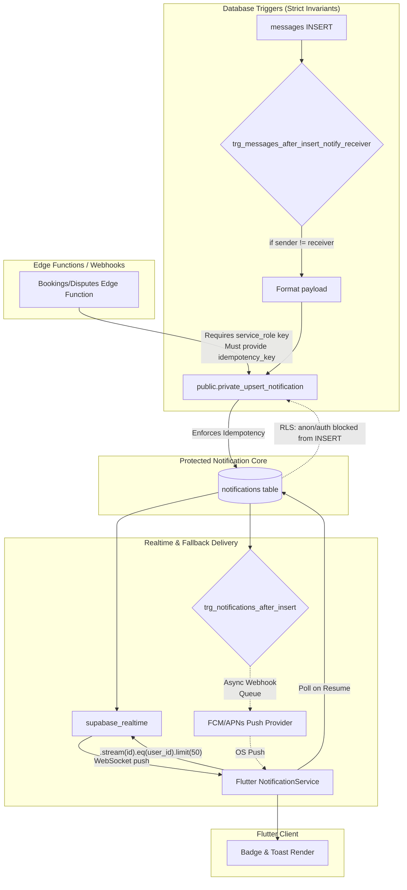

# 00_HOLISTIC_REPORT: Notification Routing Audit

**Skills selected:** Evidence-First Reading, State Machine & Lifecycle, Idempotency & Concurrency, Diagram Crafting
**Why these skills fit:** Notifications bridge database state and client UI reliably. Idempotency prevents duplicates. Evidence-first reading ensures we strictly reflect real components. Diagram crafting visualizes the missing pieces (Edge Functions, push fallback).
**Skills intentionally not used:** DB-First Financial Modeling (irrelevant to notifications), Production Migration Planning (focus is architectural audit).

## A) What This Diagram Is

- **Current state:** A Flowchart mapping the path of a notification from a database `INSERT` on the `messages` table, through a Postgres trigger (`trg_messages_after_insert_notify_receiver`) out to the Flutter App via `supabase_realtime`.
- **Boundaries & Assumptions:** The system assumes that realtime WebSockets are the primary and reliable way to deliver notifications to active users. It assumes booking/dispute events are inserted into `notifications` by an unknown mechanism (likely Edge Functions).

## B) Why It Exists

- **Problem solved:** Delivers low-latency visual alerts when someone messages a user, opens an offer, or accepts/rejects an offer, without the client needing to arbitrarily poll.
- **Risks prevented:** Replaces client-side triggered notifications, meaning a malicious client cannot easily forge message notifications. All inserts are routed securely.

## C) Where It Lives in the Product

- **App entry points:** Top Bar Bell Icon, global Notification Center.
- **Service/logic layer:** `NotificationService` handles `.stream(primaryKey: ['id']).eq('user_id', userId).limit(50)`.
- **DB/RPC layers:** `public.private_upsert_notification` is the underlying engine for inserting notifications safely. `trg_messages_after_insert_notify_receiver` automates this.

## D) Current Diagram Evaluation

- **What’s good:** Honest about gaps (labels Booking/Dispute events as unverified). Captures the exact Flutter implementation stream query.
- **What’s missing:** Push notification fallbacks (FCM/APNs). Formal representation of the idempotency requirements for Edge Functions.
- **What’s unsafe:** It relies 100% on active WebSockets; if the app is backgrounded, the user is unaware of incoming messages/offers.
- **Score NOW:** 6/10. Accurate to the code, but architecturally incomplete for a production mobile app that demands push notification capability.

## E) Extracted Invariants & Contracts

1. **API boundary:** `private_upsert_notification` is the ONLY allowed write path into the `notifications` table. Clients cannot insert notifications directly. _(Evidence: `REVOKE ALL... FROM PUBLIC, anon, authenticated;` in migration `20260301_harden_notification_writes.sql`)_.
2. **Read boundary:** Users can only select and update (`is_read` flag) their own notifications. _(Evidence: `notifications_select_own` RLS policy)_.
3. **Idempotency:** The `private_upsert_notification` logic relies on an idempotency key to prevent sending or storing duplicate notifications for the same underlying event. _(Evidence: function signature includes `idempotency_key`)_.

## F) Failure Modes & Attack Scenarios

### Scenario 1: Edge Function Over-Pushing Notifications

- **What happens now:** Edge Functions pushing booking logic could accidentally retry and push duplicates.
- **What should happen:** Edge Functions must systematically generate and supply unique `idempotency_key` strings.
- **Missing guardrails:** Enforcement of formatting/requirements on the backend before insertion.
- **How to validate:** Call Edge function twice intentionally; ensure only 1 notification is created.

### Scenario 2: Realtime Disconnection & Backgrounding

- **What happens now:** `supabase_realtime` pushes events over WebSockets. If the app is killed/backgrounded, the user is unaware.
- **What should happen:** The DB should have a mechanism to push events out to FCM/APNs. When the app re-opens, the `.stream().limit(50)` catches them up perfectly.
- **Missing guardrails:** Apple/Google Push notification integration.
- **How to validate:** Force-close app, dispatch a message, verify push log traces.

### Scenario 3: Self-Notification Spam

- **What happens now:** A user might message themselves and get a notification.
- **What should happen:** `messages_after_insert_notify_receiver` must explicitly exclude `user_id = auth.uid()` from receiving the notification.
- **Missing guardrails:** Trigger logic validation that skips the sender.
- **How to validate:** Insert message where sender == receiver. Expect 0 notifications inserted.

## G) Production-Grade Improvement Plan

- **Phase 0: Observability & Logs**
  - What: Ensure all `private_upsert_notification` calls log failures.
  - Why: Silent drops in Edge Functions are impossible to debug without logs.
- **Phase 1: Core Contracts Enrollment**
  - What: Lock down `messages_after_insert_notify_receiver` so it bails if sender equals receiver.
  - Why: Stop self-spam.
- **Phase 2: Hardening**
  - What: Document exact idempotency key formats for bookings and disputes.
  - Why: To eliminate the risk of double-notifications from retry-loops in Edge Functions.
- **Phase 3: Fallback Push Delivery (Highest Value)**
  - What: Add `trg_notifications_after_insert` which sends webhooks to an Edge Function that interfaces with Firebase Cloud Messaging (FCM) or APNs.
  - Why: WebSockets (realtime) die when mobile OS backgrounds the app. External pushes are non-negotiable for a freelance app (where fast responses win jobs).

## H) Best Diagram Recommendation

- **Which diagram type is best:** A hybrid Data Flow + Component Diagram (Mermaid `flowchart`).
- **Why:** Realtime websockets, database triggers, and API calls all flow differently. A straight sequence diagram obscures the decoupled nature of Supabase Realtime pub/sub.

## I) Final Improved Diagram (Mermaid)

## J) Risk Register

### J1) Risks if we keep the current system

- **Severity: High | Likelihood: High | Impact: High.** No External Push Notifications currently exist in the architecture. Users will miss offers if the app is closed.
- **Severity: Medium | Likelihood: High | Impact: Medium.** Unverified booking/dispute routing means that crucial transactional events might be flaky if their implementation bypasses idempotency keys.

### J2) Risks introduced by improvements

- **FCM/APNs API Complexity:** Building webhook queues pushing to Firebase introduces latency and API secret management overhead. Mitigate by using robust job polling (like `pg_net`) rather than synchronous HTTP calls inside DB triggers.

## K) Verification Checklist

- [ ] **Tests:** RLS explicitly blocks authenticated user `INSERT` statements into `notifications`.
- [ ] **Tests:** Calling idempotency-enabled `private_upsert_notification` twice creates exactly 1 row.
- [ ] **Tests:** If sender == receiver during a message insert, 0 notifications are generated.
- [ ] **Monitoring:** Track `supabase_realtime` connection drop rates on mobile.

## L) Final Verdict

- **Score AFTER fixes:** 9/10
- **Blockers to production:** Implement the asynchronous webhook push for FCM/APNs. A chat/freelance app without offline background push notifications is non-viable.
- **Ship criteria:** Idempotency enforcement is universally applied to all Edge Functions inserting notifications; Push Notifications (FCM) are wired up to react to new rows in `notifications`.
