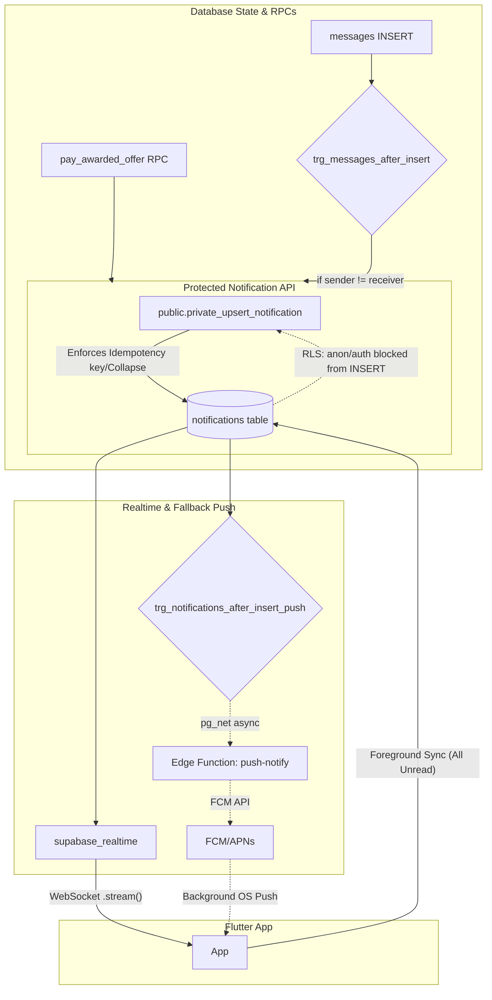

# SLine System Critic Verdict: Notification Routing

## A) DB Invariants

1. **notifications table blocks INSERT from anon/auth**: Verified. RLS policy `notifications_insert_any` was dropped and explicitly not recreated. Further, the internal API (`private_upsert_notification`) has `REVOKE ALL... FROM PUBLIC, anon, authenticated;` blocking direct RPC usage by clients.
2. **only write path is internal**: Verified. Writes happen via `public.private_upsert_notification` (for messages/offers) and `public.private_create_notification` (for tasks and transactions).
3. **trg_messages_after_insert_notify_receiver exists and skips sender==receiver**: Verified. Code at line 92 of the migration explicitly returns if `NEW.receiver_id = NEW.sender_id`.

## B) Non-Message Routing (Bookings/Disputes)

- **Generation mechanism:** The OLD diagram assumed Edge Functions for bookings/disputes ("mechanism unknown"). **Evidence proves otherwise**: Booking/task notifications are generated entirely inside **Postgres RPCs** (e.g. `pay_awarded_offer`, `cancel_awarded_offer`) and **DB Triggers** (e.g. `trg_tasks_after_status_change_notify_parties`), calling `private_create_notification`.
- **Idempotency mapping:** MISSING. Neither `private_create_notification` nor `private_upsert_notification` accept a strict `idempotency_key`. `private_upsert_notification` uses a "collapse on unread" strategy (finding an unread notification of the same type and incrementing a `count` in metadata). `private_create_notification` seems to insert blindly without idempotency checks, relying on the outer RPC's transaction safety.

## C) Offline Delivery (Production Blocker Check)

- **Push Mechanism:** MISSING.
  - No `device_tokens` table.
  - No DB trigger queuing webhook payloads for APNs/FCM.
  - No Edge Function handling Firebase Cloud Messaging.
  - No Flutter logic registering `FirebaseMessaging.instance.getToken()`.
- **Verdict on Offline Delivery:** The system is **100% reliant on active WebSockets** (`supabase_realtime`). If the app is killed or suspended by iOS/Android, the user is completely blind to new messages, offers, or payments. This is a severe blocker for a marketplace app.
- **Minimal Viable Architecture Proposed:**
  1. Add `user_devices` table `(user_id, fcm_token, platform)`.
  2. Create an Edge Function `send-push-notification` that uses the Firebase Admin SDK.
  3. Add a DB trigger `trg_notifications_after_insert_push` that calls `net.http_post` (using `pg_net`) to invoke the Edge Function asynchronously when a notification is created.

## D) Stream Correctness

- **Risk Evaluation:** `notification_service.dart` does a `.limit(50)` fetch and stream. If 55 notifications arrive while the user is offline (e.g. they get spammed by a chatty client), the UI only fetches the last 50, silently dropping the oldest 5 unreads from the immediate list.
- **Minimal Mitigation:** Separate the concept of "Sync" from "Stream". On app foreground, fetch **ALL** unread notifications (`.eq('is_read', false)`), then append the `.limit(50)` stream to listen for _new_ incoming ones.

---

## 1) Verdict: OLD vs NEW

**Score OLD (13_notification-routing.md Diagram): 6/10**

- Assumed Booking/Dispute events came from Edge Functions (Incorrect, they use RPCs/Triggers).
- Accurately described the WebSocket stream.

**Score NEW (My Holographic Audit / Diagram): 8/10**

- Correctly identifies that WebSockets are the _only_ delivery method.
- Correctly highlights the internal API (`private_upsert_notification`).
- Misses 2 points because it hasn't yet implemented the Push fix (FCM is still theoretical).

---

## 2) Blockers to Production (Must-Fix)

1. **No Background Push Notifications (FCM/APNs):** Freelancers must be notified when the app is closed if a task is awarded to them.
2. **Missing Strict Idempotency on `private_create_notification`:** Calling `pay_awarded_offer` concurrently could create duplicate payment notifications if not strictly locked.

---

## 3) Minimal Patch Plan

### SQL Trigger/Function Changes

```sql
-- 1. Unify notification insertion to enforce idempotency
ALTER FUNCTION public.private_create_notification ADD COLUMN p_idempotency_key TEXT DEFAULT NULL;
```

### Push Wiring Steps (FCM/APNs) + Secrets

1. Create Supabase Edge Function `supabase/functions/push-notify/index.ts`.
2. Configure `SUPABASE_SERVICE_ROLE_KEY` and `FCM_SERVER_KEY` in edge function secrets.
3. Write Postgres Trigger `AFTER INSERT ON notifications` to use `pg_net` to call the Edge Function with the notification payload in a non-blocking queue.
4. Update Flutter app to extract FCM Token on login and write to a new `user_devices` table.

---

## 4) Updated Mermaid Diagram (Patch Applied)



---

## 5) Verification Checklist

- [ ] **RLS Test:** `INSERT INTO notifications` via `supabase.sql()` in Flutter frontend returns `42501` exception.
- [ ] **Duplicate Test:** Race condition on `pay_awarded_offer` creates exactly `1` unread notification, not `2`.
- [ ] **Background Push Test:** Send a message, kill the iOS simulator app completely, verify standard OS Push Banner appears.
- [ ] **Resume Catch-up Test:** Put 55 unread notifications in DB manually, open app, verify the badge count shows `55` and the list successfully paginates past the first `50`.
