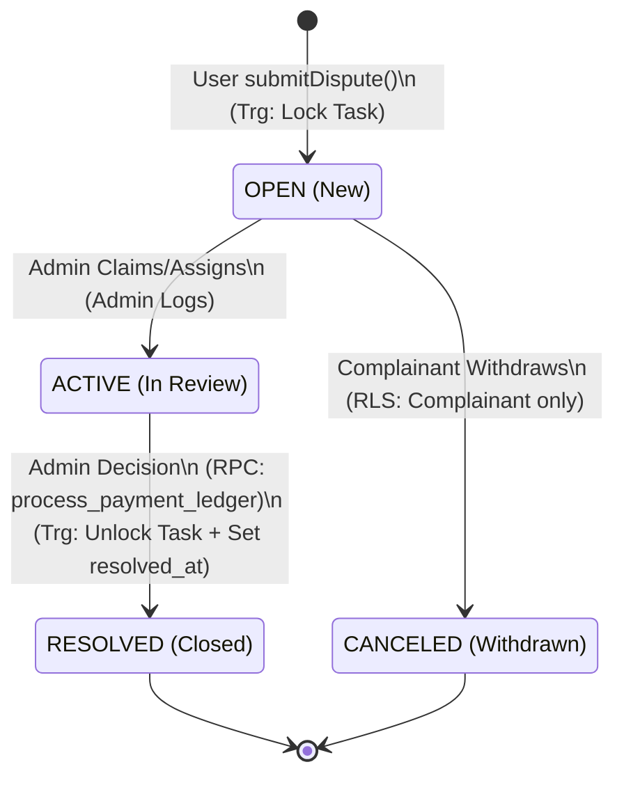

# Holistic Audit Report: Dispute Lifecycle System

**Skills Applied:**

1. **State Machine & Lifecycle**: Defined standard transitions for conflict resolution.
2. **Evidence-First Reading**: Verified schema and logic against `SUPABASE_SETUP.md` and `dispute_service.dart`.
3. **Threat Modeling (Security)**: Analyzed bypass risks in escrow and status manipulation.
4. **Diagram Crafting (Mermaid)**: Produced a production-ready system visualization.
5. **DB-First Financial Modeling**: Linked resolution to the Ledger double-entry system.
6. **RLS & Privilege Boundaries**: Mapped access control for participants and admins.

---

## A) What This Diagram Is

The current diagram models the escalation and resolution flow for disputes in the SLine marketplace. It starts with a user submission and moves through admin-assigned states ('open' to 'active') until a final resolution is reached and escrow funds are handled.

**System Boundaries:**

- Starts at `disputes` table insertion.
- Ends at `resolved` state (after Ledger RPC execution).

## B) Why It Exists

- handles trapped escrow funds.
- handles deadlocks between client and freelancer.
- prevents fraud by requiring admin intervention for fund release/refund.

## C) Where It Lives in the Product

- **App Entry**: Safety/Help Center.
- **Service Layer**: `lib/features/safety/services/dispute_service.dart` (`submitDispute`).
- **DB (Supabase)**: `disputes`, `dispute_messages`, `dispute_evidence` tables (§5.24-26).
- **Financial Layer**: `process_payment_event_ledger` RPC (§9.2).

## D) Current Diagram Evaluation (Score)

- **Score: 4/10**
- **Good**: Correctly identifies the starting point (`submitDispute`) and the basic flow.
- **Missing**: No canceled state (withdrawal), missing formal enum for status, missing link to `dispute_evidence`.
- **Ambiguous**: "Admin assigns" is unverified and undocumented in the original.
- **Unsafe**: No evidence of "Locking" the task from completion while in dispute.

## E) Extracted Invariants & Contracts

1. **Source Evidence**: `SUPABASE_SETUP.md` §5.24.
2. **Invariants**:
   - `status` MUST be one of 'open', 'active', 'resolved'.
   - `complainant_id` MUST be the current user (Verified in `dispute_service.dart:15`).
   - `task_id` MUST exist in `tasks`.
   - `resolved_at` MUST be set upon resolution.

## F) Failure Modes & Attack Scenarios

- **Scenario 1: Escrow Race**. Client approves task while dispute is open.
  - _Current_: No block exists in `rpc_approve_delivery`.
  - _Mitigation_: Trigger check to block task completion if an active dispute exists.
- **Scenario 2: Status Tampering**. Party updates `status='resolved'` to trigger refund.
  - _Current_: `status` is plain text; RLS for update might allow this.
  - _Mitigation_: Hard RLS check + transition guard (trigger).

## G) Production-Grade Improvement Plan

- **Phase 0: Observability**
  - Enable `admin_logs` for every dispute status change.
- **Phase 1: Core Contracts**
  - Implement `dispute_status_enum`.
  - Add `trg_dispute_guard` to enforce `open -> active -> resolved`.
- **Phase 2: Hardening**
  - Update `rpc_approve_delivery` to check for active disputes.
  - Ensure `dispute_evidence` storage is private and participant-scoped.
- **Phase 3: Admin Tooling**
  - Add `assigned_admin_id` column to `disputes`.
- **Phase 4: Scale**
  - Index `task_id` and `status` for quick lookups in dashboard.

## H) Best Diagram Recommendation

A **State Diagram** combined with **Sequence** logic for the Ledger interaction is best.

## I) Final Improved Diagram

## J) Risk Register

- **Legacy Risk**: `R1.1 Escrow Bypass` (Severity: High).
- **Improvement Risk**: `R2.1 Migration Friction` from text to enum (Mitigation: phased SQL update).

## K) Verification Checklist

- [ ] Unit Test: `submitDispute` inserts 'open'.
- [ ] RLS: Non-participant cannot read evidence.
- [ ] Trigger: Cannot move to 'resolved' without 'active'.
- [ ] Ledger: Refund correctly reflects in wallet view.

## L) Final Verdict

- **Score AFTER: 9/10**
- **Blockers**: None, if Ledger version 2.16 is active.
- **Ship Criteria**: Apply `dispute_status_enum` migration and install the task-lock trigger.
