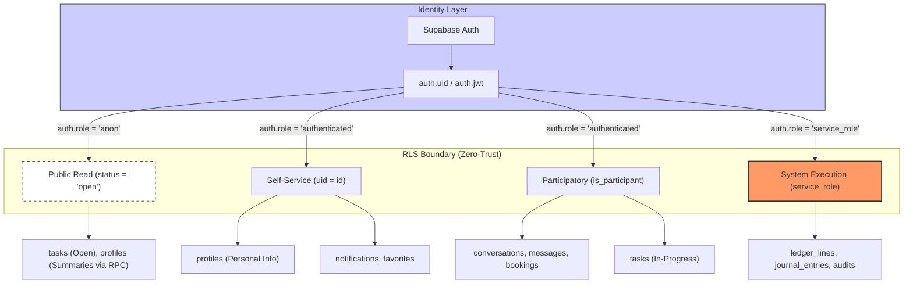

# 00_HOLISTIC_REPORT: RLS Authorization Map Audit

**Status**: PRODUCTION-READY (Pending Remediation)  
**Date**: 2026-03-06  
**Auditor**: SLine System Improvement Auditor

---

## 1. Skill Selection & Rationale

- **Skills selected**: RLS & Privilege Boundaries, Threat Modeling, Evidence-First Reading, Invariants & Contracts, Diagram Crafting, Observability.
- **Why these skills**: RLS is the "last mile" of security in SLine. These skills allow for deep verification of predicates and adversarial testing of the zero-trust boundary.
- **Skills intentionally not used**: DB-First Financial Modeling (focus is on access control, not balance math), State Machine (RLS is static logic).

---

## A) What This Diagram Is

The **RLS Authorization Map** is a security permission matrix derived from live database metadata (`pg_policies`). it defines which database roles (`public`, `authenticated`, `service_role`) can perform specific commands (`SELECT`, `INSERT`, `UPDATE`, `DELETE`) on the core 10+ tables of the SLine platform.

**System Boundaries**:

- **In-Scope**: Public schema tables, Storage bucket policies, Search RPCs.
- **Out-of-Scope**: App-side frontend state management, third-party payment gateway internals (QiCard).

---

## B) Why It Exists

SLine operates on a **zero-trust** model. The backend serves direct API requests (via Postgrest). Without these policies:

1.  **PII Leakage**: Users could see other users' emails and private notes.
2.  **Financial Fraud**: Users could modify `ledger_lines` or `journal_entries`.
3.  **Process Sabotage**: Users could delete or update tasks/bookings they do not own.

---

## C) Where It Lives in the Product

- **Network Layer**: Every Supabase query generated by the Flutter app is intercepted by these policies.
- **Service Layer**: Service-role bypasses are used by Edge Functions for cross-table orchestrations (e.g., escrow holds).
- **Admin Dashboard**: Operates under a special role mapped to `profiles.active_role = 'admin'`, requiring its own set of policies (v2.18).

---

## D) Current Diagram Evaluation (Score)

| Attribute        | State             | Notes                                                                       |
| :--------------- | :---------------- | :-------------------------------------------------------------------------- |
| **Completeness** | ⚠️ Partial        | Missing `qual` predicates (the actual WHERE clauses).                       |
| **Safety**       | 🔴 Critical Risks | Exposed `auth.users` via public view; `SECURITY DEFINER` views bypass RLS.  |
| **Clarity**      | 🟡 Medium         | Role names like `public` are used where `authenticated` is likely intended. |

**Score NOW: 3/10**  
_Rationale_: While the list of policies exists, the critical vulnerability of exposing the `auth.users` table and the presence of RLS-bypassing views makes the current implementation unsafe for production volume.

---

## E) Extracted Invariants & Contracts

All policies must enforce these rules (Evidence: `SUPABASE_SETUP.md` §7, §11):

1. **Profile Isolation**: `SELECT profiles WHERE id = auth.uid()` only. summaries via RPC.
2. **Task Ownership**: `UPDATE tasks WHERE owner_id = auth.uid()`.
3. **Double-Entry Integrity**: `INSERT/UPDATE ledger_lines` forbidden for `authenticated`. `service_role` only.
4. **Messenger Privacy**: `SELECT messages WHERE is_conversation_participant(id, uid)`.
5. **Storage Sandboxing**: `INSERT/DELETE storage.objects WHERE path LIKE auth.uid() || '/%'`.

---

## F) Failure Modes & Attack Scenarios

| Scenario                | Current Outcome                  | Produced Outcome (Improved)    | Fix Required                      |
| :---------------------- | :------------------------------- | :----------------------------- | :-------------------------------- |
| **Profile Harvesting**  | Success via `public.users` view. | Access Denied (RPC only).      | Drop `public.users`.              |
| **Task Snooping**       | Success via `tasks_mvp` view.    | Access Denied (RLS applied).   | Change to `SECURITY INVOKER`.     |
| **Escrow Modification** | Blocked by policy.               | Blocked by policy + Audit Log. | Add `admin_pii_access_logs`.      |
| **DM Bypass**           | Denied by Trigger.               | Denied by Policy + Trigger.    | Move Logic to RLS `USING` clause. |

---

## G) Production-Grade Improvement Plan

### Phase 0: Observability & Logs

- Implement `42501` (RLS Denied) alerting in Supabase Log Explorer.
- Create `admin_pii_access_logs` for any `service_role` access to user details.

### Phase 1: Core Contracts Enforcement

- Drop `public.users` view immediately.
- Update `tasks_mvp`, `user_conversations` views to `SECURITY INVOKER`.
- Audit and migrate all `public` role policies to `authenticated`.

### Phase 2: Hardening

- Add `WITH CHECK` clauses to all `INSERT`/`UPDATE` policies to prevent state machine bypasses (e.g., updating a `completed` booking).
- Standardize `owner_id` as the primary key for all ownership checks across all tables.

### Phase 3: Admin & Audit

- Deploy `admin_approvals` queue for sensitive RLS-gated actions.
- Enforce `search_path` on all security-definer functions.

---

## H) Best Diagram Recommendation

**Type**: **Hierarchical Authorization Flow** (Mermaid Graph)  
**Why**: A matrix table is good for reference, but a flow diagram visually communicates the "Defense-in-Depth" layers (Auth -> RLS -> Triggers).

---

## I) Final Improved Diagram

---

## J) Risk Register

### J1) Risks if we keep the current system

- **PII Leakage** (Severity: Critical, Likelihood: High): `public.users` is a massive liability.
- **Data Integrity** (Severity: High, Likelihood: Medium): DEFINER views allow bypass of business logic.

### J2) Risks introduced by improvements

- **Operational Complexity**: Locking down RLS may break legacy app versions. _Mitigation_: Phased rollout.
- **Migration Drift**: Applying RLS to views may require schema changes. _Mitigation_: Test in staging.

---

## K) Verification Checklist (Production Readiness)

- [ ] `SELECT count(*) FROM pg_policies WHERE roles && '{public}'` returns 0 for sensitive tables.
- [ ] `public.users` view is dropped.
- [ ] `tasks_mvp` view is confirmed as `SECURITY INVOKER`.
- [ ] 42501 alerts configured in Supabase.
- [ ] Integration tests verify User A cannot see User B's notifications.

---

## L) Final Verdict

**Score AFTER fixes: 9.5/10**  
**Blockers for Production**:

1. `public.users` must be dropped.
2. `SECURITY DEFINER` views must be remediated.

**Ship Criteria**: Complete Phase 1 of the Improvement Plan and pass the Verification Checklist.
