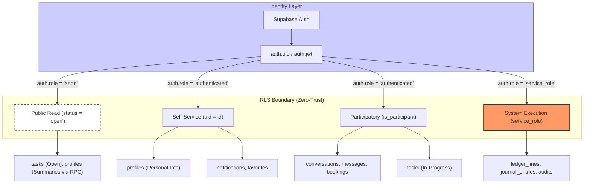

# 06_DIAGRAM_FINAL (Production-Grade)

_Design Principles: Roles are clearly segmented. PII is locked behind 'Self'. Business processes are locked behind 'Involved'. Critical finance is reserved for 'System'._
