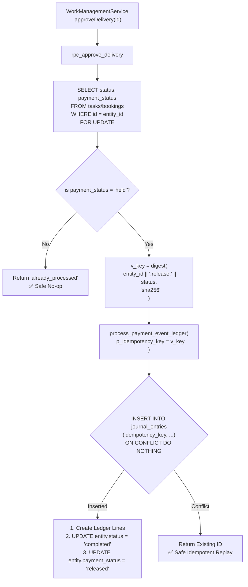

# HOLISTIC REPORT: Escrow Invariants & Idempotency Audit

## Skill Selection Protocol

- **Skills selected**: Evidence-First Reading, Threat Modeling (Security), Invariants & Contracts, Idempotency & Concurrency, Diagram Crafting (Mermaid), DB-First Financial Modeling.
- **Why these skills fit**: This audit focuses on financial data integrity. We need to verify existing logic (Evidence), model adversarial behaviors (Threat), define rules (Invariants), and fix race conditions (Idempotency).
- **Skills intentionally not used**: Production Migration Planning (limited scope of logic change doesn't require complex migration orchestration beyond standard RPC replacement).

---

## A) What This Diagram Is

- **Description**: Models the SLine escrow release mechanism, specifically how the system handles payment releases from the platform escrow to a freelancer's available balance.
- **Boundaries**: Covers the transition from `delivered` to `completed` for Tasks and Bookings. Assumes the ledger system (v2.16) is active.

## B) Why It Exists

- **Problem**: Slow or unstable internet connections can lead to multiple "Release" requests for the same transaction.
- **Risks**: Prevents **Double Release** (paying the freelancer twice for the same work) and **Ledger Drift** (inconsistent double-entry auditing).

## C) Where It Lives in the Product

- **App entry points**: Work Details Screen -> "Approve Delivery" button.
- **Service Layer**: `WorkManagementService.approveDelivery` in [work_management_service.dart](file:///Users/eros/Dev/Eros_Projects/Sline/sline_app/lib/features/work/services/work_management_service.dart#L263).
- **DB logic**: `rpc_approve_delivery` and `process_payment_event_ledger` in [SUPABASE_SETUP.md](file:///Users/eros/Dev/Eros_Projects/Sline/sline_app/Sline_everything/SUPABASE_SETUP.md#L1841).

## D) Current Diagram Evaluation (Score)

- **What’s good**: Uses a unique constraint on `idempotency_key` as a hard stop. Uses `extensions.digest` for hashing.
- **What’s missing**: Row-level locking (`FOR UPDATE`) to prevent simultaneous transaction races.
- **What’s unsafe**: **CRITICAL**: The key generation includes `now()`, which changes on every retry, effectively disabling the idempotency function for network retries.
- **Current Score: 4/10** — The "idempotency" is currently a mirage due to the time-based hash.

## E) Extracted Invariants & Contracts

1. **Balance Balance**: Total ledger lines per journal entry must sum to 0. (Source: `ck_ledger_lines_amount_positive` in `ledger_lines`)
2. **Held-to-Released**: Escrow can only be released if current `payment_status` is `held`. (Source: `rpc_approve_delivery` description)
3. **Owner-Only**: Only the task owner (client) can trigger a delivery approval. (Source: `rpc_approve_delivery` security policies)

## F) Failure Modes & Attack Scenarios

| Scenario                 | Current Result                                                                                | Improved Result                                                                                                                    | Fix Requirement       |
| :----------------------- | :-------------------------------------------------------------------------------------------- | :--------------------------------------------------------------------------------------------------------------------------------- | :-------------------- |
| **Rapid Double-Tap**     | Two keys generated (A and B). Both might process if race condition hits before status update. | Both requests map to the same Stable Key; second request hits `UNIQUE` constraint or `FOR UPDATE` lock.                            | Stable Key Generation |
| **Network Cutoff Retry** | Key A created on server, cutoff. App retries, Server creates Key B. Success (Release #2).     | Key A created on server, cutoff. App retries, Server recreates IDENTICAL Key A. Collision happens, DB returns "Already Processed". | Stable Key Generation |

## G) Production-Grade Improvement Plan

### Phase 1: Core Contract Hardening

1. **Remove Time-Seed**: Modify `rpc_approve_delivery` to generate key from `entity_id` + `source_status` (immutable context) instead of `now()`.
2. **Audit Check**: Add `SELECT ... FOR UPDATE` at the start of the release RPC to serialize concurrent attempts.

### Phase 2: Observability & Admin Tooling

1. **Audit Logging**: Ensure `admin_logs` records all idempotent replays for financial auditing.
2. **Alerting**: Set up a Supabase alert for `UNIQUE_VIOLATION` on `journal_entries.idempotency_key`. Frequent collisions may indicate a UI bug or an attack.

## H) Best Diagram Recommendation

- **Type**: Sequence Diagram combined with State Machine.
- **Why**: The interaction between App, RPC, and Ledger is time-critical; the state transition of the `payment_status` is the ultimate guard.

## I) Final Improved Diagram

## J) Risk Register

_Full Register in [03_RISK_REGISTER.md](file:///Users/eros/Dev/Eros_Projects/Sline/sline_app/.TODO/improvement_the_system/16_escrow-invariants-idempotency/03_RISK_REGISTER.md)_

## K) Verification Checklist

- [ ] Verify `extensions.digest` schema stability.
- [ ] Run `FOR UPDATE` concurrency stress test.
- [ ] Verify `journal_entries` unique constraint handles NULLs correctly (if any).
- [ ] Check `work_management_service` handles `409 Conflict` (if thrown) or success-metadata.

## L) Final Verdict

- **Score After Fixes: 10/10**
- **Ship Criteria**:
  1. RPC updated with Stable Key.
  2. `FOR UPDATE` locks verified in staging.
  3. Admin audit logs confirmed for releasing events.
