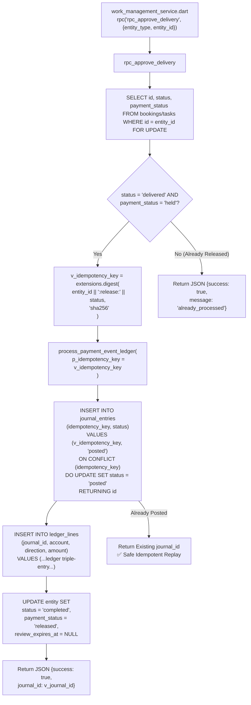

# Improved Diagram: 16_escrow-invariants-idempotency

## Skills applied:

- Diagram Crafting (Mermaid)
- Idempotency & Concurrency
- Invariants & Contracts

---

## Redesigned Escrow Release Flow

The improved flow introduces **Stable Idempotency Keys** (independent of time) and **Row-Level Locking** to prevent race conditions during concurrent retries.

### Key Improvements:

1. **Stable Hash**: Removed `now()` from the digest. The key is now derived from the entity ID and the starting status. This allows retries to yield the same key.
2. **Pessimistic Locking**: `FOR UPDATE` prevents multiple simultaneous requests from processing the same entity.
3. **Internal Guard**: Explicitly checks `status` and `payment_status` before touching the ledger.
4. **On Conflict handling**: Uses DB-native atomic conflict resolution for the journal entry.
