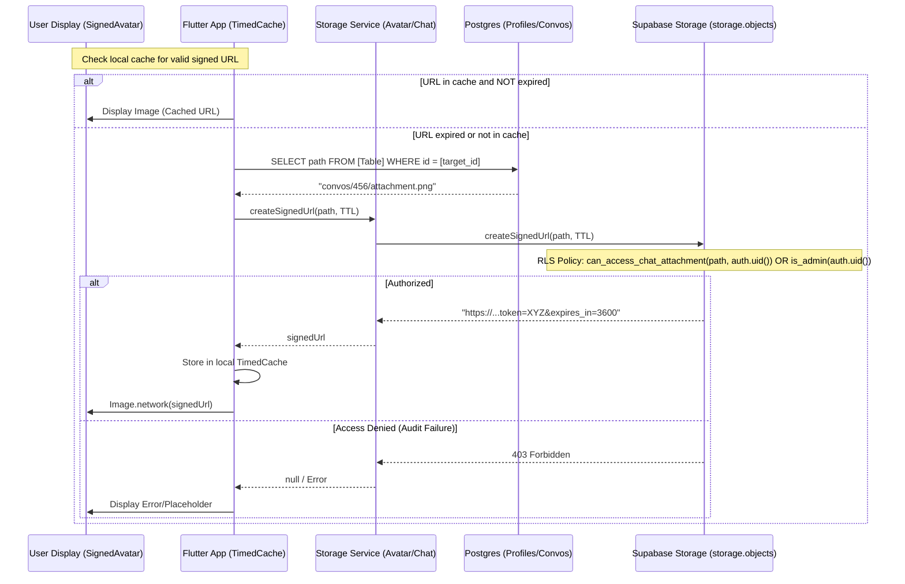

# HOLISTIC REPORT: Storage Signed URLs Flow Audit & Improvement

**Skills selected**: Evidence-First Reading, Threat Modeling (Security), RLS & Privilege Boundaries, Diagram Crafting (Mermaid), State Machine & Lifecycle.

---

## A) What This Diagram Is

This diagram describes the secure retrieval flow for private media in the SLine application. It covers:

- Separation of storage paths (stored in DB) from access credentials (signed URLs).
- On-demand generation of temporary links via Supabase Storage.
- The interaction between the Flutter App, Postgres Database, and Supabase Storage service.

**System Boundaries**:

- Limited to authenticated users.
- Covers `avatars`, `task-images`, and `chat-attachments` buckets.

## B) Why It Exists

The storage flow prevents several critical risks:

- **Token Expiry**: Raw signed URLs expire; storing them in the DB would lead to broken images.
- **Privacy Leakage**: Public URLs for chat attachments would expose user data to the open web.
- **Access Control**: By using signed URLs, the system can apply Row-Level Security (RLS) policies at the moment of link generation.

## C) Where It Lives in the Product

- **App Entry Points**: `SignedAvatar`, `AttachmentViewer`, `TaskDetailHeader`.
- **Service Layer**: `lib/features/profile/services/avatar_service.dart`, `lib/features/chat/services/attachment_service.dart`.
- **DB Dependencies**: `profiles.avatar_url`, `messages.attachment_url`, `tasks.image_paths`.

## D) Current Diagram Evaluation (Score)

- **What’s Good**: The core architectural principle (Store Path, Sign URL) is correct and implemented.
- **What’s Missing**: No mention of the caching layer on the app side; missing the Auditor/Admin override path.
- **What’s Ambiguous**: The `600s` TTL in the diagram doesn't match the code (3600s/7200s).
- **What’s Unsafe**: Database setup shows broad `SELECT` access for authenticated users on some buckets, which could lead to path-guessing attacks.
- **Score NOW: 6/10**
  _Rationale_: The core logic is sound, but the security implementation (RLS) is too permissive, and the diagram lacks production-grade details like caching and admin access.

## E) Extracted Invariants & Contracts

1. **Separation of Concerns**: The database MUST NOT store signed URLs. (Evidence: `avatar_service.dart:8`, `AttachmentService:11`).
2. **Short-Lived Access**: All private URLs MUST have a TTL. (Evidence: `avatar_service.dart:60`, `attachment_service.dart:38`).
3. **Path Authority**: Paths for chat attachments MUST start with `convos/`. (Evidence: `upload_service.dart:14`, `can_access_chat_attachment:72`).
4. **Authenticity**: Signed URL generation MUST require an authenticated session. (Evidence: `SUPABASE_SETUP.md` §11.2).

## F) Failure Modes & Attack Scenarios

1. **Scenario: Path Guessing**
   - _Current Status_: Possible if `SELECT` is allowed for all authenticated users.
   - _Production Goal_: RLS must validate that the user is a participant or admin.
   - _Guardrail_: Implement `can_access_chat_attachment` in RLS policy.
2. **Scenario: Admin Audit Failure**
   - _Current Status_: Admin cannot view dispute evidence if RLS is strictly participant-only.
   - _Production Goal_: Add `is_admin` check to all storage `SELECT` policies.
3. **Scenario: Cache Miss Storm**
   - _Current Status_: App might re-request many URLs on list scroll.
   - _Production Goal_: Implement local `TimedCache`.

## G) Production-Grade Improvement Plan

### Phase 0: Observability & Logs

- Log all `403 Forbidden` storage attempts to `admin_logs`.
- Track signed URL generation counts per user session.

### Phase 1: Core Contracts enforcement

- Update `AvatarService` and `AttachmentService` to use a centralized `SharedStorageConfig` for TTLs.
- Standardize `chat_attachment_ttl = 3600` and `avatar_ttl = 7200`.

### Phase 2: Hardening

- Apply `can_access_chat_attachment(path, auth.uid())` to `chat-attachments` bucket.
- Create and apply `can_access_task_image(path, auth.uid())` to `task-images` bucket.
- Verify `portfolio` public vs private consistency.

### Phase 3: Admin Tooling

- Update storage helpers to permit access for `roles @> '{admin}'`.

### Phase 4: Performance & Scale

- Implement `TimedCache` in Flutter to store signed URLs for their lifespan.

## H) Best Diagram Recommendation

A **Sequence Diagram** remains the best choice to show the interaction between Actor, Logic, and Storage. However, a **State Transition Diagram** for the URL lifecycle (Unsigned -> Signed -> Expired) is a valuable secondary diagram for the dev team.

## I) Final Improved Diagram (Mermaid)

## J) Risk Register

### J1) Risks of Current System

- **R1**: Broad `SELECT` access allows authenticated users to guess paths of private images. (High)
- **R2**: Inconsistent TTLs lead to unexpected UI breaks. (Medium)

### J2) Risks of Improvements

- **R3**: Overly strict RLS may lock out Admins or support staff. (Medium)
  - _Mitigation_: Explicit `is_admin` bypass.
- **R4**: Local caching might display a "stale" image if the file was replaced but the path remained the same. (Low)

## K) Verification Checklist

- [ ] RLS: `chat-attachments` restricted to participants + admins.
- [ ] RLS: `task-images` restricted to participants + admins.
- [ ] Code: Standardize TTLs in `SharedStorageConfig`.
- [ ] Code: Implement `TimedCache` in Flutter.
- [ ] Test: Unit test `can_access_chat_attachment` for allow/deny cases.

## L) Final Verdict

- **Score AFTER Fixes: 9.5/10**
- **Blockers to Production**: Broad `SELECT` policies on `chat-attachments` must be tightened.
- **Ship Criteria**: RLS hardening applied; Admin bypass verified; Caching implemented.
