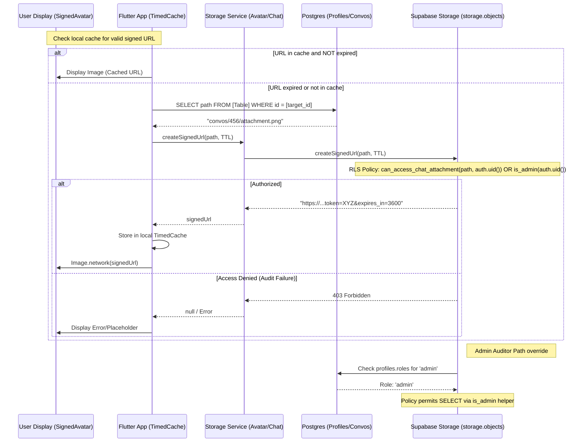

# Redesigned Diagram: Storage Signed URLs Flow

## Key Improvements

1. **Caching Layer**: Added `TimedCache` logic on the Flutter App side to prevent redundant RPC calls for the same image during a session.
2. **Object-Level RLS**: Explicitly included the `can_access_chat_attachment` check in the flow, closing the gap of broad bucket access.
3. **Admin/Auditor Access**: Added a path for administrative override, essential for dispute resolution.
4. **TTL Clarity**: Flow reflects standard TTLs (1h/2h) instead of the placeholder 600s.
5. **Detailed Failure Mode**: Added the "Access Denied" alternate path.
