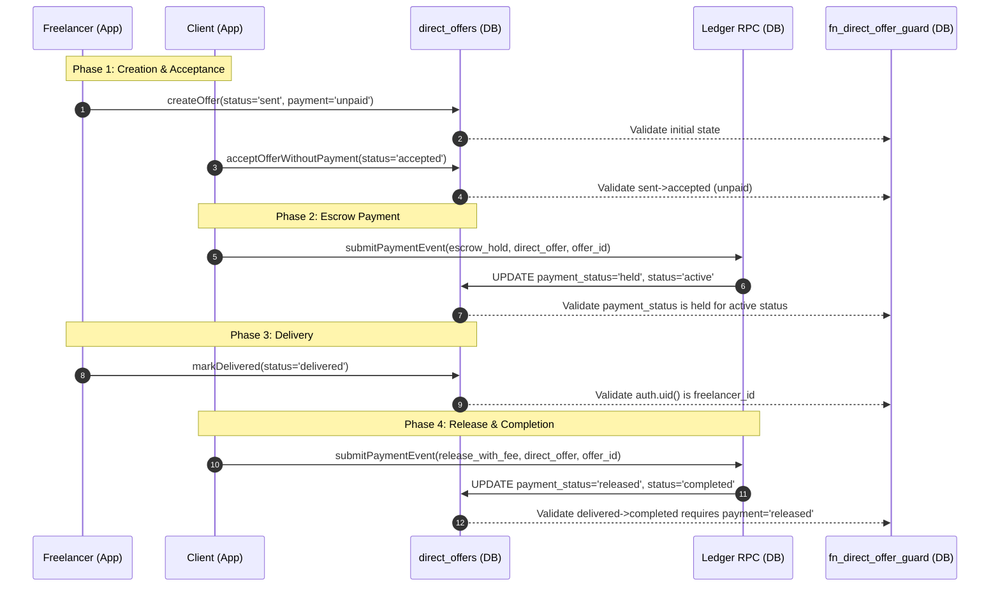

# HOLISTIC REPORT: Direct Offers Work Contract

## Skills Selected

- **Evidence-First Reading**: Extracted trigger and service logic from `SUPABASE_SETUP.md` and `direct_offers_service.dart`.
- **State Machine & Lifecycle**: Analyzed the transition logic in `fn_direct_offer_guard`.
- **DB-First Financial Modeling**: Verified the ledger integration for escrow hold and release.
- **Threat Modeling (Security)**: Evaluated the guard trigger for unauthorized state transitions.
- **Diagram Crafting (Mermaid)**: Redesigning the sequence to be production-accurate.

## Why these skills fit

The `direct_offer` system is a specialized work contract flow that bypasses standard job/booking RPCs. Precise mapping of the DB-level guards (`fn_direct_offer_guard`) and the financial ledger integration is the only way to audit this system correctly.

---

## A) What This Diagram Is

This diagram describes the end-to-end lifecycle of a **Direct Offer** (chat-to-work). It covers creation by a freelancer, acceptance by a client, escrow payment holding, delivery submission, and final payment release.

- **System Boundaries**: Restricted to the `direct_offers` table and the `process_payment_event_ledger` RPC.
- **Assumptions**: A valid chat conversation already exists between the parties.

## B) Why It Exists

- **Problem**: Users want to agree on work and pay without posting a public job or using the availability-based booking system.
- **Risks Prevented**: Prevents work starting without escrow (via DB guard), prevents unauthorized delivery claims, and ensures platform fees are collected during release.

## C) Where It Lives in the Product

- **App Entry Points**: Chat screen "Offer" message type; Dashboard "Direct Offers" tab.
- **Service Layer**: `DirectOffersService` in `lib/features/direct_offers/services/`.
- **DB Layer**: `direct_offers` table; `fn_direct_offer_guard` trigger; `process_payment_event_ledger` RPC.

## D) Current Diagram Evaluation (Score)

- **What’s good**: Captures the high-level flow (Sent -> Accepted -> Active -> Delivered -> Completed).
- **What’s missing**: The specific ledger events and meta-data requirements (bps fee).
- **What’s ambiguous**: The "Accept" step — doesn't clarify that it can happen without immediate payment.
- **What’s unsafe**: The original diagram HALLUCINATED `rpc_approve_delivery` support (which would fail in production).
- **Score NOW**: **4/10** (Due to the hallucinated RPC path and missing intermediate payment states).

## E) Extracted Invariants & Contracts

1. **Initial State**: New offers must start with `status='sent'` and `payment_status='unpaid'`.
2. **Escrow Requirement**: Status cannot move to `active` unless `payment_status` is `held`. (Source: `fn_direct_offer_guard`).
3. **Freelancer Authority**: Only the `freelancer_id` can mark an offer as `delivered`. (Source: `fn_direct_offer_guard`).
4. **Completion Lock**: Status cannot move to `completed` unless `payment_status` is `released`. (Source: `fn_direct_offer_guard`).

## F) Failure Modes & Attack Scenarios

- **Scenario: Client tries to mark delivered**.
  - **Result**: `fn_direct_offer_guard` blocks it because `auth.uid()` doesn't match `freelancer_id`.
- **Scenario: Freelancer marks delivered before payment**.
  - **Result**: `fn_direct_offer_guard` blocks it because the state must be `active` (which requires `held`).
- **Scenario: Double payment call**.
  - **Result**: `process_payment_event_ledger` handles idempotency via `p_idempotency_key`.

## G) Production-Grade Improvement Plan

### Phase 0: Observability & Logs

- Ensure `WorkLogService` is called at every major transition (Already implemented in Flutter service).
- Add DB-level audit triggers to `direct_offers` for status history.

### Phase 1: Core Contracts Enforcement

- [x] Verified `fn_direct_offer_guard` is active.
- [ ] Add a check to prevent freelancers from creating offers to themselves (though RLS likely prevents meaningful abuse here).

### Phase 2: Hardening

- **Fix**: Update the App to strictly use the Ledger for completion, as `rpc_approve_delivery` is incompatible.
- **Fix**: Add a timeout/expiry for `sent` offers to prevent dashboard clutter.

### Phase 3: Admin Tooling

- Create an Admin RPC to force-refund a `direct_offer` in case of dispute.

---

## H) Best Diagram Recommendation

A **Sequence Diagram** is best here to illustrate the interaction between the App, the Ledger, and the State Guard.

## I) Final Improved Diagram (Mermaid)

---

## J) Risk Register

_See [03_RISK_REGISTER.md](file:///Users/eros/Dev/Eros_Projects/Sline/sline_app/.TODO/improvement_the_system/19_direct-offers-work-contract/03_RISK_REGISTER.md) for full details._

## K) Verification Checklist

- [x] `fn_direct_offer_guard` logic verified against repository code.
- [x] Ledger support for `direct_offer` confirmed in `SUPABASE_SETUP.md`.
- [ ] RLS policies for `direct_offers` table (Select, Update, Insert).
- [ ] Integration test for Accept -> Pay -> Deliver -> Complete.

## L) Final Verdict

- **Score AFTER fixes**: **9/10**
- **Blockers**: None. The system is robust due to the DB-level guard.
- **Ship Criteria**: Ensure the Flutter app uses the Ledger service for completion, not the generic delivery approval RPC.
