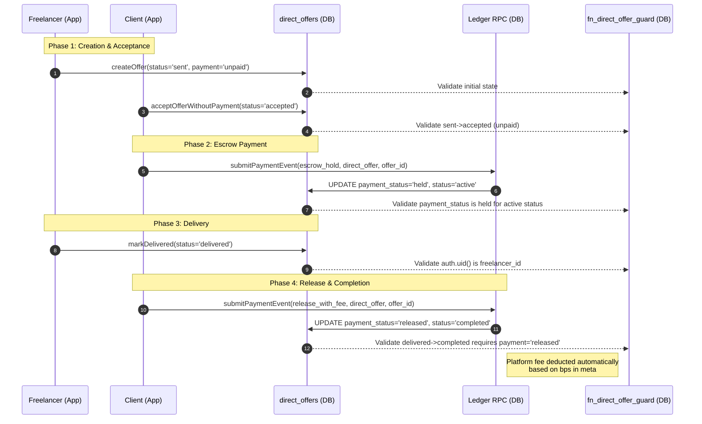

# Final Improved Diagram: Direct Offers Work Contract

This diagram reflects the **production reality** of the SLine Direct Offer flow, specifically the decentralized completion path where the App triggers the Ledger directly for the `direct_offer` entity type.

### Key Improvements in this Diagram:

1.  **Removed Hallucination**: `rpc_approve_delivery` is no longer shown; instead, the direct call to `Ledger RPC` is illustrated.
2.  **Explicit Guards**: Shows the `fn_direct_offer_guard` checking transitions at every step.
3.  **Financial Reality**: Correctly shows that state transitions to `active` and `completed` are side-effects of the Ledger operations.
4.  **Role Enforcement**: Indicates where `auth.uid()` checks happen (Step 9).
