# 00_COMPLETE_WALLET_SYSTEM_MASTER_FILE

Date: 2026-03-07

_This master document consolidates the entirety of the Wallet System Audit, Implementation Readiness Report, Strategic Integration Master Plan, and the final System Improvement Directives into one single source of truth. It also provides the ultimate, refined lifecycle diagram for the entire wallet flow._

---

## SECTION 1: Exhaustive Wallet System Audit Report

### 1.1 Executive Summary

An exhaustive audit of SLine's Wallet System, Wallet Feature, Dashboard Overviews, and related backend/frontend mechanisms reveals a highly sophisticated and secure **Double-Entry Ledger Architecture**. The platform operates on a strict "Pay-First" escrow system, ensuring all financial movements are ledger-recorded, atomic, and idempotent. While the foundation is remarkably robust, some user-facing elements—notably explicit UI for held/pending funds and Admin Dashboards—remain in a "planned" or "partially implemented" state, despite their backend data structures being perfectly established.

### 1.2 System Coverage Scanned

- **Frontend (Flutter)**: `WalletTab`, `OverviewTab`, `WalletService`, `LedgerService`, `WalletViewModel`, models (activity/balance), and dashboard repositories.
- **Backend (Supabase)**: `SUPABASE_SETUP.md`, ledger RPCs (`process_payment_event_ledger`), aggregation views (`vw_wallet_balances_user`, `vw_wallet_activity_user`).

### 1.3 Current Wallet-Related Implementation

- **Fully Implemented**: Double-Entry Ledger Backend (`journal_entries` / `ledger_lines`), Pay-First Escrow & Release (`rpc_approve_delivery`), and Wallet Data Aggregation Views.
- **Partially Implemented**: Withdrawals (`WalletService.requestWithdrawal()` locks funds correctly backend-side, but the UI correctly disables execution to prevent stuck external gateways).
- **Planned but missing**: Admin Dashboard Financial Engine (views currently missing from DB).

### 1.4 Business Rules and Financial Safety Analysis

- **Balance Calculation**: Secure. Balances derived dynamically off immutable double-entry ledger lines.
- **Negative Balances Risk**: Prevented by ledger constraints (`ERR_INSUFFICIENT_FUNDS`) and UI clamping (`_clamp(0.0)`).
- **Separation of Money States**: Very strict. `held_balance`, `available_balance`, and `pending_withdrawal_balance` are distinctly separated at the database level.

---

## SECTION 2: Wallet Tab Implementation Readiness & Gap Analysis

### 2.1 Reusable Existing Pieces

The Wallet Tab has a massive head start because the core financial engine is already implemented.

- **Existing Backend Logic**: The `vw_wallet_balances_user` correctly provisions `available`, `held`, and `pending` arrays.
- **Existing Frontend Shell**: `wallet_tab.dart` and the `WalletViewModel` are already wired and layout-stable.

### 2.2 Missing Pieces (The Gap)

Before the Wallet Tab can be considered fully transparent and correct:

- **Missing UI for Escrow/Pending**: The UI currently ignores `heldBalance` and `pendingWithdrawalBalance` despite having them available in the ViewModel. This causes visual anomalies (Ghost Money) when balances shift states.
- **Missing Explicit Centralized Math**: Calculation of `Total Balance` must be localized to the `WalletViewModel` as `totalBalance = availableBalance + heldBalance + pendingWithdrawalBalance`.
- **Misleading Taxonomy**: Escrow events (`escrow_hold`) are currently rendered neutrally or negatively as "Spent", which is factually incorrect and harms user trust since the money is merely reserved (Held), not lost.

### 2.3 What the Wallet Tab Can Truthfully Show Today

- **Available Balance**: Money fully cleared and owned by the user.
- **Held in Escrow**: Money locked against active bookings/tasks.
- **Pending Withdrawals**: Money requested for payout but not yet cleared.
- **Transaction History**: A 100% accurate, paginated ledger history.

### 2.4 Final Verdict

We do **not** need to "build" the Wallet Tab from scratch. The backend ledger is production-grade. We only need to **patch the existing UI and ViewModel** to explicitly render `heldBalance` and `pendingWithdrawalBalance` so that the user's financial picture is transparent and mathematically sound. We must leave the "Withdraw" button disabled.

---

## SECTION 3: Strategic Integration Master Plan

### 3.1 Goal & Scope

- **Goal**: Fully integrate the existing ledger backend into the Wallet Tab and Dashboard Overview, ensuring 100% financial transparency.
- **Scope**: Update `WalletViewModel` to map and centralize missing balances. Update `wallet_tab.dart` and `overview_tab.dart` to explicitly display 4 financial states. Fix transaction visual taxonomy to respect escrow holding patterns.

### 3.2 System Impact Map

- **UI**: `WalletTab`, `OverviewTab` (`WalletSnapshotCard`).
- **MVVM/App Logic**: `WalletViewModel` (mapping adjustments + centralized math), `transaction_label_helper.dart` (label taxonomy polish).
- **Database / RLS**: No changes needed. Views are secure via `security_invoker`.

### 3.3 Phased Execution Checklist

1. **Phase 1: App Layer (MVVM)**
   - Architect must centralize `totalBalance = availableBalance + heldBalance + pendingWithdrawalBalance` directly inside `WalletViewModel`. No math in widgets.
2. **Phase 2: UI Taxonomy & Rendering**
   - Bind "Total balance" to `vm.totalBalance`.
   - Render `_buildHeldCard` showing "Held in Escrow".
   - Render `_buildPendingWithdrawalCard` showing "Pending Withdrawal" (only if > 0).
   - Ensure Dashboard `WalletSnapshotCard` always reflects Held and Pending implicitly to match.
   - Restyle `escrow_hold` events neutrally ("Held for Task" / Amber/Neutral) instead of Red "Spent".
3. **Phase 3: Deep QA Validation**
   - Test UI stability when entering/exiting escrows, verifying no UI totals drift and no ghost money appears.

---

## SECTION 4: System Improvement Audit (The Verdict)

### 4.1 Threat Modeling & Failure Modes

| Attack/Failure Scenario       | What happens now                   | What should happen in production                                                            |
| :---------------------------- | :--------------------------------- | :------------------------------------------------------------------------------------------ |
| **Double Click Withdrawal**   | N/A (Disabled)                     | Idempotency-Key generated locally by ViewModel before sending the API request.              |
| **Negative DB Value Anomaly** | UI renders native `< 0`            | UI clamps to 0 and logs a massive silent telemetry spike (Sentry) for admin review.         |
| **Missing Escrow State UI**   | User assumes money is stolen/lost. | User sees explicitly that funds moved from 'Available' down to the 'Held in Escrow' bucket. |

### 4.2 The Golden Path

All financial motions follow an unbreakable chain:

1. Intent captures locking request.
2. Event captures authorization.
3. `process_payment_event_ledger()` maps debits and credits atomically.
4. Aggregation Views stream mathematically proven sums to ViewModel.
5. ViewModel adds sums without arbitrary assumptions.
6. UI renders states blindly.

---

## SECTION 5: Master Unified Wallet Lifecycle Diagram (Refined & Complete)

_This state-machine and flow-diagram hybrid represents the absolute truth of the SLine Wallet engine. It maps the ledger origin, ViewModel translation layer, rigid financial rules, and the final state presentations._

```mermaid
flowchart TB
    subgraph Ledger Backend["Ledger Backend (Existing Source of Truth)"]
        JE[(journal_entries & ledger_lines)]
        VB[vw_wallet_balances_user view]
        VA[vw_wallet_activity_user view]

        JE --> VB
        VA -->|Derived Audit| JE
    end

    subgraph ServiceLayer["Service Layer API"]
        WS[WalletService]
        WS -->|Fetches| VB
        WS -->|Pagination| VA
    end

    subgraph ViewModelLayer["ViewModel / Presentation Mapping"]
        VM[WalletViewModel]
        WS --> VM
        VM -->|"MATH ORACLE"| TG[Total Balance = Available + Held + Pending]
        VM -->|"TAXONOMY"| MAP[Map transaction types to UI-safe labels]
    end

    subgraph WalletFlow["Universal Financial State Flow"]
        P1[User funds Booking/Task] --> E1[Ledger writes escrow_hold]
        E1 --> H1[Held Balance goes UP]
        E1 --> T1[History Taxonomy: 'Moved to Escrow' Neutral Warning, NO RED DEDUCTION]

        H1 --> A1{Task Outcome}
        A1 -- Approved --> R1[Ledger writes release]
        R1 --> AV1[Available Balance goes UP]
        R1 --> T2[History Taxonomy: 'Money Released' Green Credit]

        A1 -- Ongoing --> H2[Funds stay locked in escrow]

        AV1 --> W1{Withdrawal requested?}
        W1 -- No --> S1[Stay available indefinitely]
        W1 -- Yes --> PEND1[Pending Withdrawal goes UP]
        PEND1 --> T3[History Taxonomy: 'Withdrawal Requested']

        PEND1 --> G1{Gateway Integration / Webhook}
        G1 -- Success --> C1[Withdrawal Completed]
        C1 --> T4[History Taxonomy: 'Payout Finalized' Red Deduction]

        G1 -- Failed --> RF1[Ledger Refund Correction]
        RF1 --> T5[History Taxonomy: 'Payout Failed / Refunded' Green Reversal]
    end

    subgraph UI["Frontend Presentation Shell"]
        WT[Wallet Tab]
        OV[Dashboard Overview]

        VM --> WT
        VM --> OV

        WT --> WT1[Show Total]
        WT --> WT2[Show Available]
        WT --> WT3[Show Held explicitly to prevent Ghost Money]
        WT --> WT4[Show Pending Withdrawal ONLY IF > 0]
        WT --> WT5[Show Transaction History Feed]
        WT --> WT6[Withdraw button kept disabled visually]

        OV --> OV1[Primary Focus: Available]
        OV --> OV2[Subtle Secondary: Held if > 0]
        OV --> OV3[Subtle Secondary: Pending if > 0]
    end

    subgraph Rules["Immutable Integrity Constraints"]
        RUL1[Wallet totals must never appear visually negative]
        RUL2[Escrow entries are reservations, not final spending]
        RUL3[Pending withdrawals must never vanish from the UI during transit]
        RUL4[No duplicated floating balance math inside UI templates]
    end

    Rules --> UI
    WalletFlow -.-> UI
```

