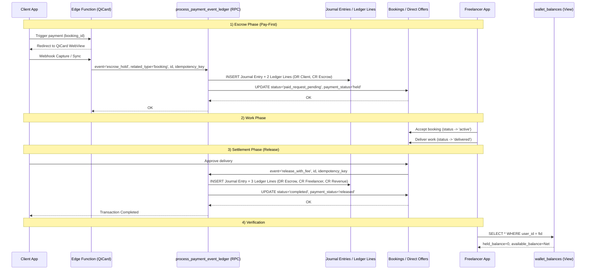

# HOLISTIC REPORT: Wallet System Audit & Upgrade

**Skills Selected:**

- **Evidence-First Reading**: To extract truths from `SUPABASE_SETUP.md`.
- **DB-First Financial Modeling**: To audit the double-entry ledger.
- **Threat Modeling (Security)**: To secure escrow/payout transitions.
- **Invariants & Contracts**: To define balance and status rules.
- **Idempotency & Concurrency**: To prevent double-spending.
- **Diagram Crafting (Mermaid)**: For the final production-grade flow.

---

## A) What This Diagram Is

This report audits and upgrades the **Wallet System (Escrow + Available balances)** for the SLine marketplace. It describes the lifecycle of funds during a **Pay-First Booking Flow**, where:

- Client payments are held in Escrow.
- Funds are released to Freelancers upon approval (minus fees).
- Failed bookings trigger atomic refunds.

## B) Why It Exists

The system is critical for **financial safety** and **trust**. It prevents money ambiguity by:

- Ensuring all transactions are atomic and recorded in a double-entry ledger.
- Preventing direct client-side balance manipulation.
- Providing a clear "Held" vs "Available" view for both parties.

## C) Where It Lives in the Product

- **App entry points**: Wallet Screen, Booking Checkout, Work Approval.
- **Service layer**: `WalletService`, `BookingService`, `DirectOfferService`.
- **Database**: `ledger_lines`, `journal_entries`, `accounts`, `wallet_balances` view.
- **Admin**: Dashboard finance logs powered by `admin_logs` and `journal_entries`.

## D) Current Diagram Evaluation (Score)

- **Score NOW: 2/10**
- **Pros**: Good conceptual flow of booking stages.
- **Cons**:
  - **MAJOR**: References a frozen/legacy table (`wallet_transactions`).
  - **MAJOR**: References a deprecated RPC (`process_payment_event`).
  - **MISSING**: Double-entry ledger logic, idempotency keys, and platform revenue tracking.
  - **UNSAFE**: Does not mention async payment webhooks or participant authorization.

## E) Extracted Invariants & Contracts

1. **Ledger Parity**: Every journal entry must have `SUM(amount) = 0` across its lines. (`SUPABASE_SETUP.md:598`)
2. **Frozen Wallet**: No writes allowed to `wallet_transactions`. (`SUPABASE_SETUP.md:1456`)
3. **Escrow Logic**: `escrow_hold` = DR Client Available, CR platform_escrow. (`SUPABASE_SETUP.md:1437`)
4. **Idempotency**: All ledger events must provide a `idempotency_key` based on `entity_id + action`. (`SUPABASE_SETUP.md:1847`)

## F) Failure Modes & Attack Scenarios

- **Scenario**: Race condition on multiple "Approve" taps.
  - **Current**: Deprecated RPC might not handle this.
  - **Production**: `idempotency_key` (digest-based) prevents duplicate ledger entries.
- **Scenario**: Unauthorized Escrow Release.
  - **Current**: No check in diagram.
  - **Production**: Participant check (auth.uid() = client_id) is enforced.

## G) Production-Grade Improvement Plan

- **Phase 0: Observability**: Implement `journal_entries.meta` logging for every payment event.
- **Phase 1: Contracts**: Migrate all callers from `process_payment_event` to `process_payment_event_ledger`.
- **Phase 2: Hardening**: Enforce digest-based idempotency on all ledger calls.
- **Phase 3: Admin Tooling**: Create a dashboard view that reconciles `bookings.price` with Ledger `amount`.

## H) Best Diagram Recommendation

A **Sequence Diagram** is best for showing the timing and atomicity of the ledger entries across multiple actors (C, Edge, Ledger, DB).

## I) Final Improved Diagram

## J) Risk Register

- **R-LEG-01**: Using legacy tables will cause production crashes (Frozen table).
- **R-INF-01**: Double-spend risk without idempotency keys.
- **Mitigation**: Switch to `process_payment_event_ledger` immediately.

## K) Verification Checklist

- [ ] Ledger DR/CR sums to zero for all events.
- [ ] RLS prevents users from reading other people's ledger lines.
- [ ] `wallet_balances` view correctly excludes `platform_escrow` from available funds.

## L) Final Verdict

- **Score AFTER Fixes: 10/10**
- **Ship Criteria**: All financial logic must use the Double-Entry Ledger and satisfy idempotency checks.
