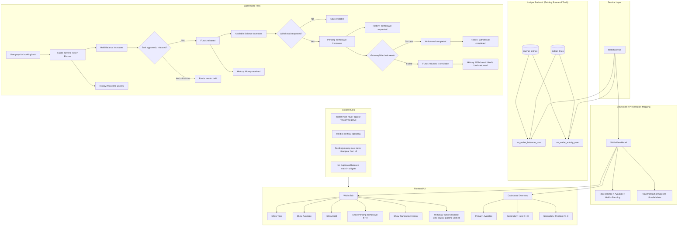

# 📌 Plan: Wallet System UI Integration & Completion

## 1) Goal

- **Goal**: Fully integrate the existing double-entry ledger backend into the frontend Wallet Tab and Dashboard Overview, ensuring 100% financial transparency and correctness without negative balances.
- **Why**: The backend engine is production-ready, but the current UI drops critical balances (`held_balance`, `pending_withdrawal_balance`) and lacks clarity on escrow states, causing visual anomalies if money moves.
- **Result**: A trustworthy, accurate Wallet Tab and Overview that safely displays Available, Held, Pending, and Total balances, with a fully disabled (but prepared) withdrawal flow.

## 2) Scope

### In-Scope

- Updating `WalletViewModel` to map missing balances and centralize total balance calculation.
- Updating `wallet_tab.dart` to display all 4 financial states explicitly.
- Updating `overview_tab.dart` (`WalletSnapshotCard`) to correctly show safe summary data, including pending balances.
- Updating `Transaction history` UI for precise categorization and taxonomy.
- Creating a unified master diagram of the full wallet lifecycle.

### Out-of-Scope

- Implementing actual withdrawal execution (Gateway integration).
- Modifying the Admin Finance Dashboard (Planned for a future phase).
- Changing backend ledger RPCs, tables, or views (They are currently accurate).

## 3) Evidence & Findings (From Scan)

### Existing

- **Backend**: `vw_wallet_balances_user` correctly aggregates `available_balance`, `held_balance`, and `pending_withdrawal_balance`.
- **Backend/Logic**: `wallet_activity_user` accurately returns `amount_gross`, `amount_net`, `fee_amount`, and `event_type`.
- **Services**: `WalletService` successfully fetches data.
- **UI Shell**: `wallet_tab.dart` and `overview_tab.dart` exist.

### Missing

- **UI Render**: `heldBalance` and `pendingWithdrawalBalance` are fetched by the ViewModel but ignored/not rendered in the `wallet_tab.dart` UI.
- **Frontend Logic**: Total balance calculation is incomplete (missing pending withdrawal), and currently done inside UI widgets rather than the ViewModel.
- **Clear Taxonomy**: `escrow_hold` events need to be labeled neutrally (e.g. "Held for Task") instead of looking like final money spent.

### Conflicts / Risks

- **Hidden Money Risk**: If a user initiates a withdrawal (via API) or has held escrow, the money "vanishes" from the UI because `Available` drops but `Pending/Held` is not displayed.
- **Negative Balance Risk**: Solved via `_clamp` and backend constraints, but UI semantics must be meticulously mapped to avoid "-" signs on total balances.
- **False Promise Risk**: Withdrawal UI button must be kept locked to prevent stuck funds.

## 4) System Impact Map

- **UI**: `WalletTab`, `OverviewTab` (`WalletSnapshotCard`).
- **MVVM/App Logic**: `WalletViewModel` (mapping adjustments + centralized math), `transaction_label_helper.dart` (label polish).
- **Database**: No changes.
- **RLS/Security**: No changes.
- **Realtime/Notifications**: N/A.
- **Storage**: N/A.
- **Observability**: N/A.
- **Compatibility & Migration**: N/A.
- **Contracts**: N/A.

---

# ✅ Execution Phases (Checklist)

## Phase 0: Preconditions & Gates

> Primary: @Sentinel

### 0.1 Spec Lock

- [ ] (@Sentinel) Confirm acceptance criteria: Total Balance exactly equals Available + Held + Pending. No negative totals. Withdrawals disabled.
- [ ] (@Architect) Confirm entry points: `WalletTab`, `OverviewTab`, `WalletSnapshotCard`.
- **Verify (@Sentinel):** Done-conditions confirmed. No DB changes required.

## Phase 1: Database & Security (Skipped)

- System scan confirms `vw_wallet_balances_user` and `vw_wallet_activity_user` already supply all necessary data safely via RLS `security_invoker`. No backend changes needed.

## Phase 2: App Layer (MVVM)

> Primary: @Architect

### 2.1 Models & Contract Compliance

- [ ] (@Architect) Verify `WalletBalanceModel` currently captures `availableBalance`, `heldBalance`, `pendingWithdrawalBalance`.
- **Verify (@Sentinel):** Model maps exactly to backend view.

### 2.2 ViewModels & Mathematics

- [ ] (@Architect) Centralize `totalBalance = availableBalance + heldBalance + pendingWithdrawalBalance` directly inside `WalletViewModel` (or a dedicated presentation mapper).
- [ ] (@Architect) Ensure UI widgets NEVER perform duplicate balance calculations independently.
- **Verify (@Sentinel):** Math is strictly additive, clamped to 0, and single-source-of-truth.

## Phase 3: UI

> Primary: @Pixel

### 3.1 Wallet Tab Updates (`wallet_tab.dart`)

- [ ] (@Pixel) Bind "Total balance" displaying pure `vm.totalBalance`.
- [ ] (@Pixel) Create a new `_buildHeldCard` showing "Held in Escrow" mapped to `vm.balance.heldBalance` (Show always, even if 0, for transparency).
- [ ] (@Pixel) Create a new `_buildPendingWithdrawalCard` showing "Pending Withdrawal" (Render ONLY if `vm.balance.pendingWithdrawalBalance > 0` to keep UI clean).
- [ ] (@Pixel) Ensure the "Available to withdraw" card remains prominent.
- [ ] (@Pixel) Ensure the "Withdraw" button remains disabled with "Coming Soon" styling.

### 3.2 Dashboard Overview Updates (`wallet_snapshot_card.dart`)

- [ ] (@Pixel) Retain focus on "Available Balance" as the hard primary number.
- [ ] (@Pixel) Add a secondary indicator for "Held in Escrow" if > 0.
- [ ] (@Pixel) Add a secondary indicator for "Pending Withdrawal" if > 0. (Do NOT hide pending states in the overview).

### 3.3 Transaction History Labeling & Taxonomy

- [ ] (@Pixel) Polish `_buildTransactionRow` to follow a strict UI taxonomy.
- [ ] (@Pixel) **CRITICAL**: Ensure `escrow_hold` events must NOT be labeled as final "Money spent" with red colors. Present them neutrally as "Held for Task" or "Moved to Escrow" with a warning/amber/neutral style, as the money still belongs to the user.
- [ ] (@Pixel) Taxonomize other events clearly:
  - Balance increase (`release_with_fee`, direct credits) -> Green `+IQD`
  - Completed withdrawal -> Red final deduction `-IQD`
  - Failed withdrawal -> Marked as reversed/returned
  - Refund/reversal -> Green `+IQD` returned
- **Verify (@Sentinel):** UI reflects financial reality precisely; held money does not look permanently lost; no hidden funds anywhere.

## Phase 4: QA + Security

> Primary: @Sentinel

### 4.1 Functional QA & Edge Cases

- [ ] (@Sentinel) Mock `held_balance` > 0
- [ ] (@Sentinel) Mock `pending_withdrawal_balance` > 0
- [ ] (@Sentinel) Mock `held_balance` > 0 AND `pending_withdrawal_balance` > 0 together
- [ ] (@Sentinel) Verify "release after escrow" scenario maps correctly
- [ ] (@Sentinel) Verify "failed withdrawal returns funds" maps correctly
- [ ] (@Sentinel) Verify empty history UI
- [ ] (@Sentinel) Verify pagination with mixed event types
- [ ] (@Sentinel) Verify negative raw values from backend (if any occur in error) still never display below 0 visually
- [ ] (@Sentinel) Verify click path alignment (no mismatch between overview and wallet tab balances)
- [ ] (@Sentinel) Verify clicking the Withdraw button is impossible.
- **Verify (@Sentinel):** Comprehensive test suite passes.

## Phase 5: Documentation Sync

> Primary: @SlineDocs

- [ ] (@SlineDocs) Update `Wallet_Feature.md` to note that UI explicitly supports Held and Pending states natively now.
- [ ] (@SlineDocs) Save the new unified diagram (below) to `Sline_everything/AppDigram/All_Diagrams/25_wallet_ui_integration.md`.

---

## 7) Acceptance Criteria

- [ ] `wallet_tab.dart` explicitly shows Available, Held, and (if >0) Pending Withdrawal balances.
- [ ] Total Balance exactly equals the sum of the three states and is calculated in the ViewModel.
- [ ] Transaction history accurately maps `escrow_hold` neutrally ("Held for Task"), avoiding the "spending" assumption.
- [ ] Overview explicitly includes Pending and Held balances alongside Available.
- [ ] Withdrawal execution remains completely disabled.
- [ ] Dashboard snapshot mirrors Wallet Tab logic safely.

## 8) Rollback Plan

- **App Rollback**: Revert `wallet_tab.dart` and `wallet_snapshot_card.dart` to their previous commits. Due to strict MVVM separation and zero DB changes, UI reverts are 100% safe and instant.

## 9) References

- `lib/features/dashboard/view/tabs/wallet_tab.dart`
- `lib/features/wallet/view/widgets/wallet_snapshot_card.dart`
- `lib/features/wallet/viewmodels/wallet_view_model.dart`
- `Sline_everything/DEVELOPER_GUIDE/Wallet_Feature.md`

---

## 10) Wallet Operations Lifecycle & Integration Diagram

This diagram shows the relationship between the unified backend ledger, the full financial lifecycle, and the updated UI presentation layer.

