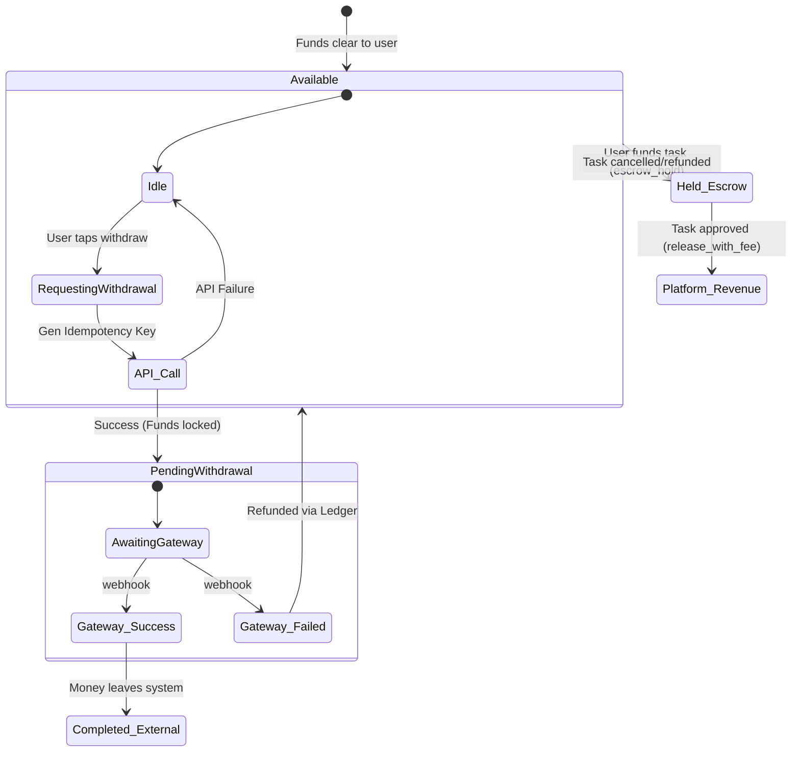

# PLAN_Wallet_Integration_2026-03-07.md System Improvement Report

## 0) Skill Selection

- **Skills selected:** Evidence-First Reading, State Machine & Lifecycle, Invariants & Contracts, Threat Modeling (Security), DB-First Financial Modeling.
- **Why they fit this file:** This file outlines the integration of frontend UI with a strict backend financial ledger. Validating UI mathematical invariants, state transitions (available vs held vs pending), and frontend security (disabled withdrawal) requires these exact skills.
- **Skills not used:** Repo Mapping, Diagram Crafting (the file itself already has a solid Mermaid flowchart, we will just refine it to a strict State Machine), Production Migration Planning (no DB schema changes are proposed here).

## A) File Identity

- **Original file path:** `/.TODO/PLAN_Wallet_Integration_2026-03-07.md`
- **What it claims to implement:** The completion of the user-facing Wallet Tab and Dashboard Overview UI to accurately reflect backend ledger balances (Available, Held, Pending).
- **Feature scope:** wallet
- **Dependencies touched:** `WalletViewModel`, `wallet_tab.dart`, `wallet_snapshot_card.dart`, `TransactionLabelHelper` (implied for taxonomy).

## B) Current Diagram & Flow Evaluation

- **Diagram type used:** Flowchart (Data Flow + Component mapping).
- **What the diagram covers well:** It correctly identifies the single-source-of-truth backend (`journal_entries`/`vw_wallet_balances_user`) flowing up through the Service layer and ViewModel, finally breaking out into explicit UI rendering states.
- **What is missing:** The diagram lacks strict failure branches for adversarial conditions (e.g., what if the backend returns a negative balance due to a manual DB anomaly? How does the ViewModel clamp it securely?). It also treats `Gateway/Webhook result` as a generic external box without specifying idempotency constraints on the frontend withdrawal trigger.
- **Where it is ambiguous:** The transition from `W1{Withdrawal requested?}` to `PEND1` assumes synchronous success. In a real adversarial system, this requires an idempotency key passed from the client to prevent double-charging `Available Balance` if the user clicks "Withdraw" twice rapidly.
- **Where it is unsafe:** UI execution of withdrawals (currently disabled) lacks a defined rate-limiting or idempotency layer in the plan's architectural map.
- **Score now (0–10):** 8/10. It is an excellent UI-integration map, but lacks the final layer of defensive UI-to-API contract enforcement.

## C) Invariants & Must-Hold Rules (Extracted)

1. **The ViewModel Monolith Rule:** `totalBalance` must be calculated strictly as `availableBalance + heldBalance + pendingWithdrawalBalance` centrally in `WalletViewModel`. UI widgets are forbidden from doing independent math. (_Evidence: Section 3.1 & Section 7 Acceptence Criteria_).
2. **The Non-Negative Invariant:** Wallet values must never visually render `< 0`. If the DB yields a negative (which it shouldn't), the UI must clamp it to 0 to prevent panic. (_Evidence: Section 4 - Negative Balance Risk_).
3. **The Escrow Taxonomy Rule:** Money in escrow (`escrow_hold`) must absolutely not be labeled as "Money spent" or final deductions. It must be marked neutrally ("Held for Task") because ownership has not transferred. (_Evidence: Section 3.3 Transaction History Labeling_).
4. **The No-Ghost-Money Rule:** Dashboard overviews and Wallet tabs must never hide non-zero `held` or `pending` balances. (_Evidence: Section 3.2 Dashboard Overview Updates_).

## D) Failure Modes & Attack Scenarios

| Attack/Failure Scenario      | What happens now (per plan)                                           | What should happen in production                         | Exact missing guardrail                                                                                                  |
| :--------------------------- | :-------------------------------------------------------------------- | :------------------------------------------------------- | :----------------------------------------------------------------------------------------------------------------------- |
| **API Delay / Double Click** | User mashes "Withdraw" (when enabled).                                | First click registers, second drops safely.              | The plan lacks a requirement for `Idempotency-Key` generation in `WalletViewModel` before calling `requestWithdrawal()`. |
| **WebSocket / Cache Desync** | User releases funds on Web, opens mobile app. Cache shows old values. | App detects stale data and forces background refresh.    | Plan mentions `WalletViewModel` but doesn't specify Cache TTL or Pull-to-Refresh enforcement.                            |
| **Edge-Case DB Anomaly**     | A bug corrupts a ledger line, making `available_balance` negative.    | The UI clamps to `0` and fires a silent alert to Sentry. | Plan specifies clamping, but fails to mention observability/alerting when a clamp is actually forced to active.          |

## E) Production Upgrade Plan (Concrete)

| Phase                                     | What to build/change                                                                                                                                         | Exact files impacted                                           | Why it prevents bug/fraud                                                                       | How to test it                                                                                          |
| :---------------------------------------- | :----------------------------------------------------------------------------------------------------------------------------------------------------------- | :------------------------------------------------------------- | :---------------------------------------------------------------------------------------------- | :------------------------------------------------------------------------------------------------------ |
| **Phase 1: Safe Math & Idempotency Prep** | 1. Implement strict math inside `WalletViewModel`.   2. Add an idempotency key generator to `requestWithdrawal()`.                                        | `wallet_view_model.dart`, `wallet_service.dart`                | Prevents UI fragmentation errors and readies the system against double-click withdrawal fraud.  | Unit test ViewModel math. Unit test that `requestWithdrawal` maps a unique UUIDv4 per session instance. |
| **Phase 2: UI Taxonomy & Render**         | 1. Patch `wallet_tab.dart` and `wallet_snapshot_card.dart` to explicitly render Held/Pending cards if `> 0`.   2. Update `transaction_label_helper.dart`. | `wallet_tab.dart`, `wallet_snapshot_card.dart`, label helpers. | Prevents users from thinking their money "disappeared" when entering escrow.                    | Mock `held_balance = 50`. Visually verify UI shows Held card and Total math is correct.                 |
| **Phase 3: Telemetry on Anomalies**       | Log a `CRITICAL` alert if `vm.availableBalance < 0` is received from the API before clamping.                                                                | `wallet_view_model.dart`                                       | Gives admins an immediate heads-up if the bulletproof DB ledger somehow leaks a negative value. | Mock negative API response; verify `AppLogger.e` or Sentry fires.                                       |

## F) "Best Diagram" Recommendation

A **State Machine Diagram** for the financial states (Available, Held, Pending) layered over a **Sequence Diagram** for the eventual Withdrawal API call is best here.

The current flowchart is good for structural mapping, but a strict State Machine is better for lifecycle safety.

_Why this is best_: It rigorously maps the boundary states of the money. Notice how `Gateway_Success` is the sole exist node (`Completed_External`). It clarifies that the UI must only react to these rigid states.

## G) Risks: Staying on Current System vs Improving

**G1) Risks if we keep current system (Unpatched UI)**

- **Severity**: High
- **Likelihood**: High (Guaranteed upon first escrow use)
- **Impact**: Massive trust loss. Users will fund a task, see their "Available" balance drop, and without a "Held" indicator, assume the platform stole their money.
- **Evidence**: `PLAN_Wallet_Integration` Section 3 (Missing UI render for `heldBalance` and `pendingWithdrawalBalance`).

**G2) Risks introduced by improvements**

- **Complexity risk**: Minor. We are just exposing data the backend already sends.
- **How to mitigate**: Extremely careful ViewModel unit testing to ensure `total_balance` calculation cannot throw null exceptions.

## H) Verification Checklist

- [ ] **Unit Tests**: `WalletViewModel` correctly calculates `Total = Avail + Held + Pending`.
- [ ] **Unit Tests**: `WalletViewModel` correctly clamps negative backend inputs to `0.0`.
- [ ] **Unit Tests**: Transaction taxonomy correctly labels `escrow_hold` neutrally, not as red spending.
- [ ] **Integration Tests**: Empty states render gracefully without crashing.
- [ ] **Monitoring/Alerts**: Silent firing if UI receives a sub-zero balance from the API.

## I) Final Verdict

- **Score after fixes**: 9/10
- **Blockers to production**: None structurally. The plan is excellent, provided the ViewModel strictly centralizes the math and enforces idempotency when withdrawals are eventually flipped on.
- **Ship criteria**: The `wallet_tab.dart` MUST show "Held in Escrow" when `held_balance > 0` before the app can go live, otherwise UX trust is compromised.
