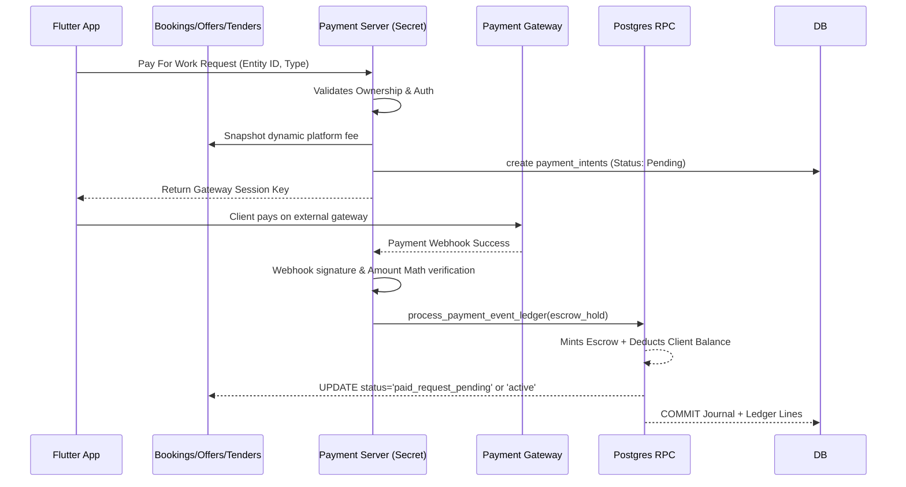

# 04 GOLDEN PATH SYSTEM

This document defines the unified, single-source-of-truth "Golden Path" for all financial events occurring within SLine. Regardless of HOW work is initiated (Tender, Booking, or Direct Offer), money MUST flow through this exact constrained pipeline.

## The Rule of One

To prevent fragmentation and race conditions, the SLine platform operates under the "Rule of One":

- **One Entry Point to Escrow**: The Payment Webhook (via `process_payment_event_ledger`).
- **One Exit Point from Escrow**: Client Approval (via `rpc_approve_delivery`).
- **One Method of Record**: The Double-Entry Ledger (`journal_entries` + `ledger_lines`).

## Golden Payment Flow

## Immutable Invariants

1. **Append-Only History**: Entries in `ledger_lines` are immutable. Modifications can exclusively be made via an offsetting adjustment entry approved by Ops.
2. **Deterministic Idempotency**: `Idempotency_keys` must be provided from a state-aware frontend or derived from a deterministic grouping of DB state factors `(entity_id + target_status)`. They MUST NEVER use clock time such as `now()`.
3. **Escrow Balance >= Liability**: The combined balance of the `Platform Escrow` account across all valid entries must never be negative or less than the total sum of `gross_amount` actively held in pending workflows.
4. **Fees Are Snapshots**: Commission percentage is read from `platform_settings` at the precise second `escrow_hold` runs, securely snapshotting into `fee_rate_applied_bps` on the entity table. Releasing funds calculates entirely locally referencing the table's snapshot, oblivious to current global settings.

## Exception State: Orphan Quarantine

If a webhook fires holding funds, but the server is unable to confidently derive the matching entity ID, amounts, or signature—the webhook must NOT silently crash.
The system routes the unmatched payload to an **Orphan Payments** table for Operations Team investigation. It does NOT enter Escrow or update App logic until manually reconciled.
