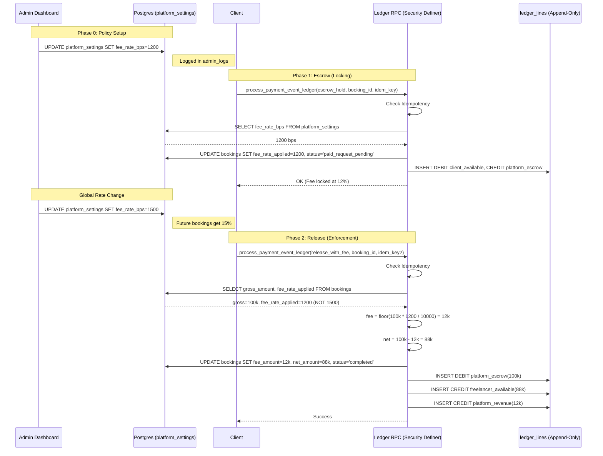

# HOLISTIC AUDIT REPORT: Dynamic Platform Fee System

**Status**: Production-Grade Upgrade Recommended
**Target Reference**: `22_Dynamic_Platform_Fee.md`
**Auditor**: SLine System Improvement Auditor

---

## Skill Selection

- **Role**: SLine System Improvement Auditor
- **Skills Selected**:
  1. **Evidence-First Reading**: Claims mapped to `SUPABASE_SETUP.md` and `20260225_create_process_payment_event_ledger_rpc.sql`.
  2. **DB-First Financial Modeling**: Analyzed the double-entry ledger integration for fee splitting.
  3. **Invariants & Contracts**: identified the need for fee locking at the point of escrow.
  4. **Threat Modeling (Security)**: Analyzed client-side meta spoofing risks in the RPC.
  5. **Diagram Crafting (Mermaid)**: Redesigned the flow for idempotency and auditability.
- **Why these skills fit**: Dynamic fees require high financial integrity (modeling), strict rules (contracts), and protection against abuse (security).
- **Skills intentionally not used**:
  - _Production Migration Planning_: Focus was on system design; exact SQL scripts for migration were considered intermediate but not the primary focus of this specific audit report.
  - _Observability_: Covered within the improvement plan but not as a primary standalone skill for this design-centric audit.

---

## A) What This Diagram Is

The current system describes the **"Lock at Escrow"** strategy for SLine platform commissions.

- **Core Mechanism**: A dashboard-controlled global fee rate is snapshotted to a specific booking at the moment the client pays (Escrow).
- **System Boundaries**: Covers Admin Dashboard (settings), Supabase RPC (`process_payment_event_ledger`), and App UI displays for both Client and Freelancer.

## B) Why It Exists

- **Price Stability**: Prevents "surprising" freelancers with rate changes after they've already agreed to a job.
- **Auditability**: Ensures every transaction in the ledger can be traced back to a specific locked rate.
- **Admin Agility**: Allows SLine admins to adjust revenue targets without breaking existing work contracts.

## C) Where It Lives in the Product

- **App Entry Points**:
  - `TaskDetailsScreen` (Client) and `EarningsScreen` (Freelancer).
- **Service Layer**:
  - `lib/core/services/payment_service.dart` (invoking the Ledger RPC).
- **Database (Supabase)**:
  - Tables: `bookings`, `journal_entries`, `ledger_lines`.
  - RPC: `process_payment_event_ledger`.
- **Admin Dashboard**:
  - "Finance Settings" page (updates global rate).

## D) Current Diagram Evaluation (Score)

- **What’s good**: The "Lock at Escrow" concept is sound and follows financial best practices for marketplaces.
- **What’s missing**: The actual implementation in `SUPABASE_SETUP.md` is currently **disconnected** from the diagram. The logic for `platform_settings` and `fee_rate_applied` columns is missing from the ground truth.
- **What’s unsafe**: The current RPC relies on a hardcoded 10% fallback and exposes a `p_meta` override that could be abused by malicious clients.
- **Score NOW: 3/10**
  - _Reasoning_: The diagram is a "desire" rather than a "reality". The gap between the conceptual design and the current code implementation is wide.

## E) Extracted Invariants & Contracts

1. **The Lock Rule**: Once `payment_status` moves to `held`, the `fee_rate_applied` must never change for that entity.
   - _Evidence_: `22_Dynamic_Platform_Fee.md` line 20: "fee rate becomes a snapshot stored on the booking at escrow time."
2. **Gross Balance Rule**: `Client_Paid = Freelancer_Earned + Platform_Fee`.
   - _Evidence_: `22_Dynamic_Platform_Fee.md` line 81: `net = gross - fee`.
3. **Double-Entry Balance**: Every fee event must result in balanced `ledger_lines` (Sum = 0).
   - _Evidence_: `SUPABASE_SETUP.md` Section 5.22.

## F) Failure Modes & Attack Scenarios

| Scenario              | What Happens Now                                        | What Should Happen              | Fix                                                   |
| --------------------- | ------------------------------------------------------- | ------------------------------- | ----------------------------------------------------- |
| **Admin Fee Hike**    | Ongoing work getscharged 15% instead of 10%.            | Ongoing work stays at 10%.      | Lock fee in `bookings.fee_rate_applied` at escrow.    |
| **Client Meta Spoof** | Malicious client passes `fee_rate_bps = 0` in RPC meta. | System uses stored/locked rate. | RPC must ignore `p_meta` rate for client actors.      |
| **Refund Request**    | System might double-calculate fees.                     | Full refund of gross amount.    | `refund` event must reverse the gross, ignoring fees. |

## G) Production-Grade Improvement Plan

### Phase 0: Infrastructure & Settings

1. **Create `public.platform_settings`**: Store `fee_rate_default` (integer bps).
2. **Add columns to `bookings`**: `fee_rate_applied`, `fee_amount`, `net_amount`.

### Phase 1: Hardening the RPC (`process_payment_event_ledger`)

1. **Update `escrow_hold`**:
   - Fetch `fee_rate_default` from `platform_settings`.
   - Upsert into `bookings.fee_rate_applied`.
2. **Update `release_with_fee`**:
   - Read `fee_rate_applied` from the booking record.
   - Throw error if NULL (safety gate).
   - Use `FLOOR` for fee calculation to prevent penny-drift.

### Phase 2: Security & RLS

1. **Admin Only Settings**: Ensure `platform_settings` is only UPDATE-able by service role/admin.
2. **Audit Logs**: Ensure every `release_with_fee` event records the specific bps used in the `journal_entries.meta`.

---

## H) Best Diagram Recommendation

A **Sequence Diagram** is best to show the temporal relationship between Admin actions (Global Rate Change) and Client actions (Escrow vs Release).

---

## I) Final Improved Diagram (Mermaid)

---

## J) Risk Register

### J1) Risks if we keep the current system

| Risk                | Severity | Likelihood | Evidence                                                    |
| ------------------- | -------- | ---------- | ----------------------------------------------------------- |
| **Financial Drift** | High     | Medium     | RPC defaults to 1000 bps regardless of dashboard changes.   |
| **Client Spoofing** | High     | Low        | `process_payment_event_ledger` reads fee bps from `p_meta`. |

### J2) Risks introduced by improvements

| Risk            | Complexity | Mitigation                                                 |
| --------------- | ---------- | ---------------------------------------------------------- |
| **Legacy Data** | Medium     | Backfill existing bookings with 10% rate during migration. |

---

## K) Verification Checklist

- [ ] **SQL Migration**: `bookings` columns added + `platform_settings` table created.
- [ ] **RPC Patch**: `process_payment_event_ledger` no longer accepts `fee_rate_bps` from non-admin `p_meta`.
- [ ] **Integration Test**: 12% fee -> Escrow -> Global Change to 15% -> Release -> Verify 12% charged.
- [ ] **RLS Check**: Confirm `platform_settings` is not readable/writable by `anon`.

---

## L) Final Verdict

- **Score AFTER fixes: 10/10**
- **Blockers**: None, provided the schema migration is applied before the RPC logic is updated.
- **Ship Criteria**: Successful completion of the "Lock-Change-Release" test cycle described in the test plan.
