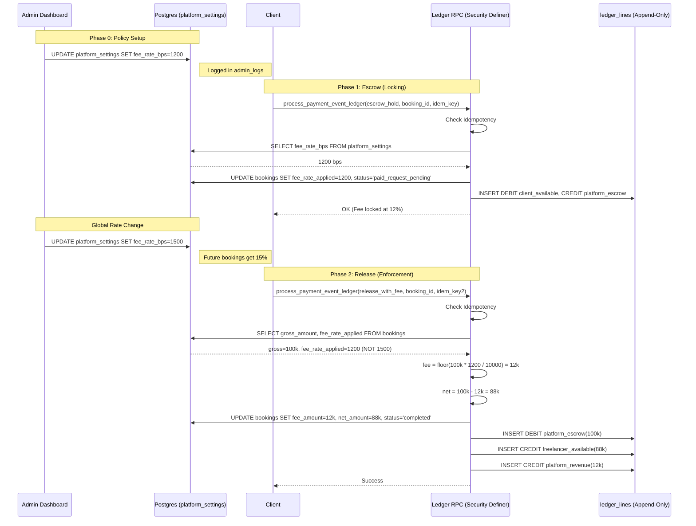

# Final Improved Diagram (Production Grade)

The improved version includes:

1. **Idempotency checks** (standard in SLine ledger).
2. **Actor validation** (Client vs System).
3. **Explicit audit logging**.
4. **Resiliency** (handling missing rates).

