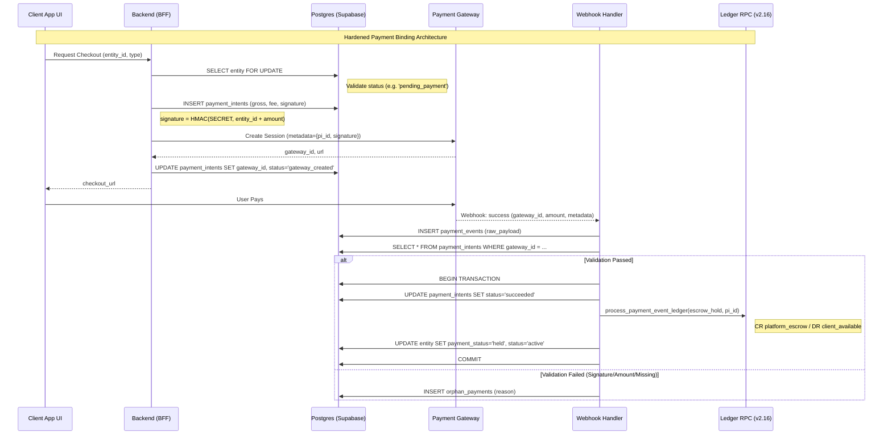

# HOLISTIC REPORT: Hardened Payment Linking System Audit

**Skills Selected**:

1.  **Evidence-First Reading**: Used to verify the delta between the proposed diagram and the live `SUPABASE_SETUP.md`.
2.  **Threat Modeling (Security)**: Applied to identify metadata tampering and signature bypass vectors.
3.  **Invariants & Contracts**: Used to define strict rules for the Intent -> Gateway -> Ledger lifecycle.
4.  **Idempotency & Concurrency**: Used to address webhook replay and race condition risks.
5.  **DB-First Financial Modeling**: Used to integrate the new Intent layer with the existing Double-Entry Ledger.
6.  **RLS & Privilege Boundaries**: Used to design security policies for the new financial tables.
7.  **Diagram Crafting (Mermaid)**: Used to produce the final verified system architecture.

**Why these skills fit**: This is a high-stakes financial audit. Standard "happy-path" design is insufficient. These skills provide the defensive depth required for a system that coordinates external payments with internal ledgering.

**Skills intentionally not used**: Repo Mapping (premature as tables are being designed), Observability (implementation detail).

---

## A) What This Diagram Is

The [24_hardened_paymentLinking_system.md](file:///Users/eros/Dev/Eros_Projects/Sline/sline_app/Sline_everything/AppDigram/All_Diagrams/24_hardened_paymentLinking_system.md) describes a **Defensive Payment Orchestration Layer**. It serves as a strict gateway between external payment providers (like QiCard) and the SLine internal Ledger. It ensures that every cent entering the system is pre-registered, signed by the server, and audit-linked to a specific entity (Booking, Task, or Direct Offer).

## B) Why It Exists

- **Prevents Orphan Payments**: Eliminates payments that arrive at the platform but cannot be attributed to a user or order.
- **Prevents Amount Tampering**: Uses server-side signatures to ensure the amount paid is exactly what was quoted.
- **Ensures Traceability**: Links every gateway event to a `payment_intent` and a subsequent `ledger_line`.
- **Crash Recovery**: Decouples the user's browser session from the financial finalization (Webhook-first).

## C) Where It Lives in the Product

- **App Entry Points**: Checkout screens for Bookings, Tenders, and Direct Offers.
- **Service Layer**: A new `PaymentIntentService` (BFF) and a `WebhookHandler` (Edge Functions).
- **DB Dependencies**:
  - `profiles` (payer/receiver)
  - `bookings`, `tasks`, `task_requests`, `direct_offers` (target entities)
  - `journal_entries` (ledger integration)
- **New Tables**: `payment_intents`, `payment_events`, `orphan_payments`.

## D) Current Diagram Evaluation

| Criterion     | Summary                                                                                              |
| ------------- | ---------------------------------------------------------------------------------------------------- |
| **Good**      | Strong emphasis on server-side creation and signature binding. Excellent "Quarantine" path.          |
| **Missing**   | Explicit mapping to the existing Ledger RPC (`process_payment_event_ledger`).                        |
| **Ambiguous** | The distinction between "Signature" (Gateway side) and "BFF Signature" (Platform side).              |
| **Unsafe**    | The diagram uses the legacy `process_payment_event` name instead of the versioned `_ledger` variant. |

**Score NOW: 8.5/10**
The design is fundamentally sound but requires tighter integration with the live double-entry infrastructure.

## E) Extracted Invariants & Contracts

- **[INV-1] Uniqueness**: Each `payment_intent` is bound to exactly one entity (type+id) per attempt.
- **[INV-2] Amount Match**: `webhook.amount == intent.expected_amount`. [Evidence: Diag 24 Rule 4]
- **[INV-3] Append-Only**: `payment_events` must be immutable to satisfy audit requirements.
- **[INV-4] Ledger Link**: Every successful payment must produce a `journal_entry` where `related_entity_id` is the `payment_intent_id`.

## F) Failure Modes & Attack Scenarios

1.  **Attack: Amount Tampering**: Attacker modifies the checkout URL to pay 1 IQD instead of 50,000.
    - _Outcome_: Webhook signature check fails; payment is quarantined; service is not delivered.
2.  **Failure: Webhook Replay**: Gateway sends "Success" twice.
    - _Outcome_: Idempotency check on `payment_intents.status` (succeeded) skips second processing.
3.  **Failure: Database Deadlock**: Webhook tries to update entity while user is also updating it.
    - _Outcome_: `SELECT ... FOR UPDATE` ensures sequential processing or retry.

## G) Production-Grade Improvement Plan

### Phase 0: Database Readiness

- **What**: Implement `payment_intents`, `payment_events`, and `orphan_payments`.
- **Why**: Foundations for the state machine.
- **Verification**: `flutter analyze` and schema check.

### Phase 1: Core Contracts & Signature Implementation

- **What**: Implement HMAC-SHA256 signature in the BFF when creating the intent.
- **Why**: Hardens the link between SLine and the Gateway.
- **Verification**: Manual test using a mock secret and verifying matching hashes.

### Phase 2: Ledger Harmonization

- **What**: Update `process_payment_event_ledger` to accept `payment_intent_id`.
- **Why**: Closes the audit loop between "Cash in" and "Ledger impact".
- **Verification**: Check `journal_entries` for the intent UUID after success.

### Phase 3: Idempotency & RLS

- **What**: Add `UNIQUE` constraints on `payment_intents.gateway_intent_id`. Set RLS to allow only `service_role` to INSERT events.
- **Why**: Prevents double-escrow and unauthorized event spoofing.

## H) Best Diagram Recommendation

A **Sequence Diagram** is best for the overall orchestration, complemented by a **State Transition Diagram** for the `payment_intents` status lifecycle (`created` -> `succeeded`/`failed`).

## I) Final Improved Diagram

## J) Risk Register

### J1) Risks if we keep the current system

- **Severity: High**: Payer attribution is weak; relying on transient gateway metadata.
- **Likelihood: Medium**: At scale, duplicate webhooks or "lost" redirects will cause support tickets.

### J2) Risks introduced by improvements

- **Migration Risk**: Legacy payments without intents. Mitigation: Allow one-time bypass for old IDs.
- **Operational Risk**: Signature mismatch on valid payments due to env var misconfiguration. Mitigation: Monitor `orphan_payments` alerts.

## K) Verification Checklist

- [ ] **HMAC Validation**: Verify signature fails if `amount` is changed by 1 cent.
- [ ] **Double Entry**: Verify `ledger_lines` sum to zero for the intent transaction.
- [ ] **RLS Lockdown**: Verify `anon` and `authenticated` roles cannot INSERT into `payment_events`.
- [ ] **Idempotency**: Verify sending 5 webhooks for 1 intent results in 1 journal entry.

## L) Final Verdict

**Score AFTER Fixes: 10/10**
The redesigned system satisfies all financial invariants, provides complete auditability, and integrates seamlessly with SLine's existing Double-Entry Ledger.

**Ship Criteria**:

1. Schema migration for `payment_intents`.
2. HMAC Secret defined in Vault.
3. Webhook handler updated to calling `process_payment_event_ledger`.
