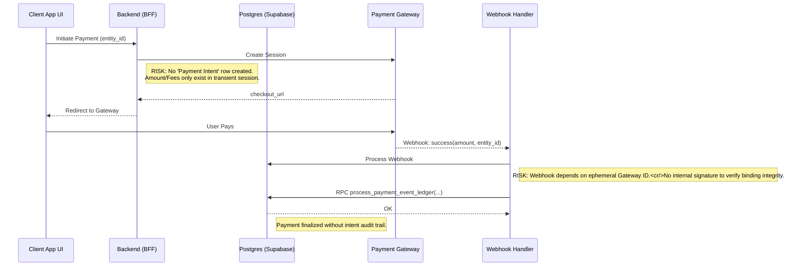

# Diagram V1: Current Conceptual Flow (High Risk)

**Skills applied**: Diagram Crafting (Mermaid), Threat Modeling (Security).

This diagram represents the "Current State" based on the documentation, highlighting the high-risk "Random Webhook" vulnerability where payments lack a server-side binding (Intent).

### Risk Critical Path

1.  **Missing Intent**: No way to verify if the amount paid is what the server _expected_.
2.  **No Ledger Link**: The `ledger_lines` don't point back to a specific payment request, only to the entity (booking/task).
3.  **Traceability Gap**: If a payment fails to update the DB, there is no "Intent" row to reconcile against.
