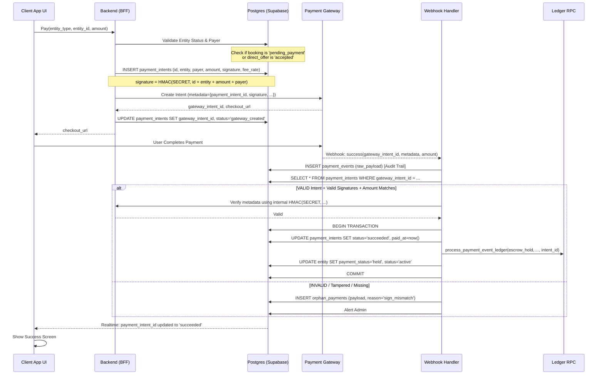

# Diagram Final: Production-Grade Hardened Flow

**Skills applied**: Diagram Crafting (Mermaid), Threat Modeling (Security), Idempotency & Concurrency, DB-First Financial Modeling.

This diagram represents the "End State" with all hardening guards in place.

### Key Improvements

1.  **HMAC Metadata Binding**: Prevents an attacker from modifying the amount or target entity in the gateway URL (if the gateway allows modification) and ensures we only process webhooks we "signed" for.
2.  **Atomic State Machine**: Status transitions for both the intent and the entity are wrapped in a single database transaction.
3.  **Audit-First Webhook**: Every raw payload is saved to `payment_events` BEFORE processing logic.
4.  **Realtime Feedback**: Eliminated the need for manual polling.
5.  **Quarantine Path**: Formalized the `orphan_payments` table for unmatched gateway events.
