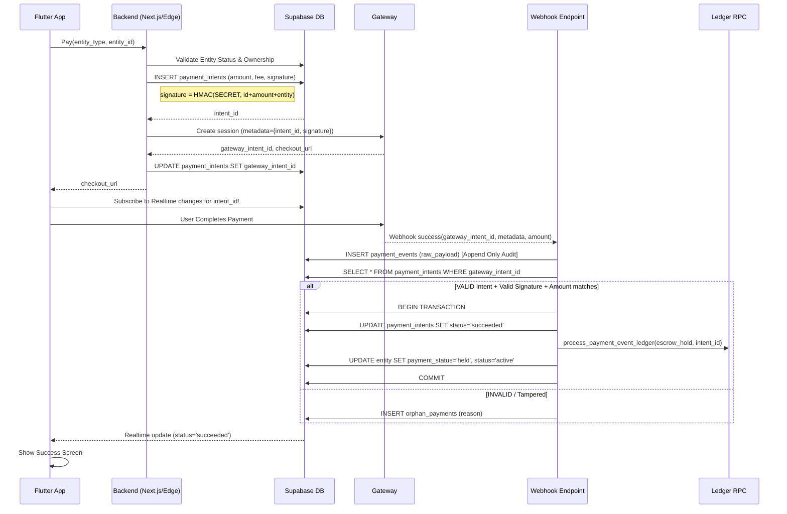

# 24_hardened_paymentLinking_system.IMPROVEMENT

_Skills Selected: Evidence-First Reading, Threat Modeling, Idempotency & Concurrency, DB-First Financial Modeling, Invariants & Contracts._

## A) File Identity + Scope

- **File**: `24_hardened_paymentLinking_system.md`
- **Scope**: Hardened payment orchestration layer. Focuses on the lifecycle between the SLine App, Payment Gateway (e.g., QiCard), Webhook Handler, and the internal Supabase Ledger.

## B) Current Diagram Evaluation

- **What’s missing**: The diagram heavily relies on `payment_intents` and `payment_events` which do not exist in the schema. It also lacks the actual `process_payment_event_ledger` signature and relationship with `journal_entries`.
- **Unsafe**: The diagram trusts the gateway payload implicitly without explicitly defining an internal signature/HMAC verification step before ledger invocation.
- **Ambiguous**: "Webhook-only finalization" is stated, but UI resolution (polling vs realtime) is not strictly defined, risking frozen UX.
- **Score Now**: 6.5/10 (Strong conceptual defense, but disconnected from current reality).

## C) Ground Truth Check

- **Diagram Claim**: App creates an intent linked to `payment_intents`.
  - **Ground Truth**: `SUPABASE_SETUP.md` (Lines 1-1400) has NO `payment_intents` table.
- **Diagram Claim**: Uses `process_payment_event`.
  - **Ground Truth**: `SUPABASE_SETUP.md` explicitly uses `process_payment_event_ledger` (Line 1430) for v2.16 double-entry logic.
- **Status**: The hardened system is currently conceptual and not enforced by the DB.

## D) Must-Hold Invariants & Contracts

1. **Signature Binding**: Every `payment_intent` must include a secure server-generated signature: `HMAC(SECRET, entity_id + gross_amount + currency)`.
2. **Webhook Idempotency**: Webhook processing must be fully idempotent. Re-sending a gateway payload must not result in duplicate `ledger_lines`.
3. **No Redirect Finalization**: Client-side redirect URIs (`return_url`) must ONLY drive UI state transitions. They MUST NOT trigger ledger changes.
4. **Append-Only Auditing**: `payment_events` must be INSERT-only (RLS `UPDATE/DELETE = false`).

## E) Failure Modes + Attack Scenarios

1. **Spoofed Amount Attack**:
   - _Attack_: Modifying checkout payload to pay 1 IQD instead of 50k IQD.
   - _Recovery_: Webhook compares gateway event amount with `payment_intents.gross_amount`. If mismatched, write to `orphan_payments`. Provide no service.
2. **Webhook Replay**:
   - _Attack_: Gateway sends multiple success hits.
   - _Recovery_: Unique constraint on `payment_intents.gateway_intent_id` and strict idempotency handling in the RPC. The transaction skips if `status='succeeded'`.
3. **App Crash Scenario**:
   - _Issue_: App dies mid-payment.
   - _Recovery_: Webhook processes the payment and writes `payment_intents.status='succeeded'`. When the app opens, it fetches the intent status natively and resolves the booking.
4. **Partial Failure**:
   - _Issue_: Webhook crashes between intent update and ledger update.
   - _Recovery_: Wrap state changes and `process_payment_event_ledger` in a single PostgreSQL `TRANSACTION`.

## F) Concrete Upgrade Plan

1. **Schema Update**: Execute DDL to create `payment_intents`, `payment_events`, `orphan_payments`. Set tight RLS.
2. **RPC Modification**: Update `process_payment_event_ledger` to require and store a `payment_intent_id` FK in `journal_entries.meta`.
3. **Edge Functions**: Deploy a Webhook Handler with strict HMAC validation and robust error catching.
4. **App (Flutter)**: Implement `payment_intents` Supabase Realtime listening for instant checkout resolution.

## G) Best Diagram Recommendation & Improved Mermaid

A Sequence Diagram integrating the Realtime push to UI and strict Transaction blocking solves the ambiguity.

## H) Risks: Keep vs Improve

- **Keep Current (Conceptual)**:
  - _Severity: Maximum_. We will drop payments, have orphaned ledger entries, and carry critical risk of gateway amount tampering.
- **Improve (Hardened)**:
  - _Severity: Low_. Introduces brief downtime during migration and a dependency on webhook payload stability.
  - _Decision_: Absolute mandatory upgrade.

## I) Verification Checklist

- [ ] **SQL Validation**: `payment_intents` table exists with `CHECK (status IN ('created', 'gateway_created', 'succeeded', 'failed'))`.
- [ ] **RLS Validation**: `payment_events` has no UPDATE/DELETE policies. Only `service_role` can INSERT.
- [ ] **Integration Test - Spoofing**: Modifying a test webhook payload signature results in an `orphan_payments` record.
- [ ] **Monitoring**: Admin dashboard alerts configured for `orphan_payments` INSERT triggers.
