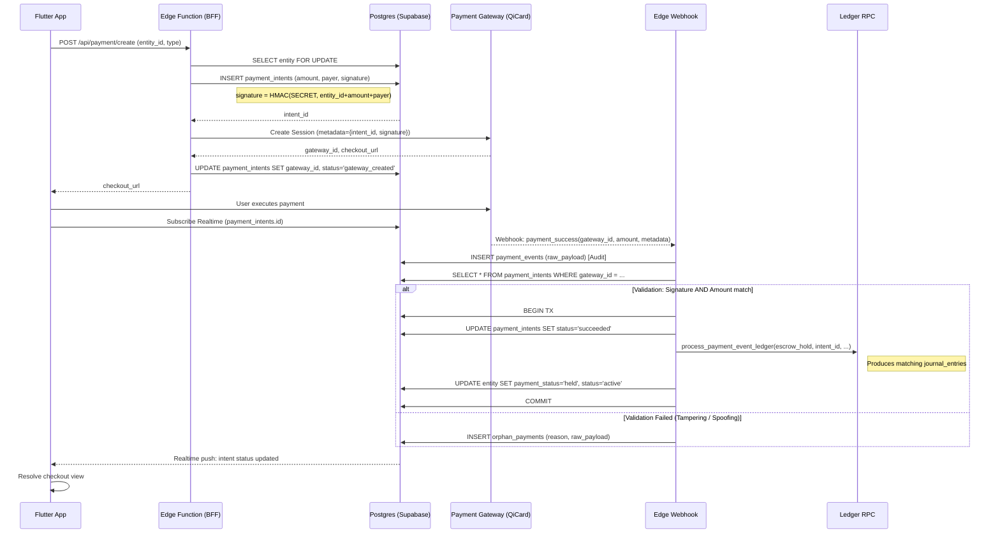

# 99_EVERYTHING_FULL_REPORT: SLine Payment System Audit

## 0) Skills Selection & Rationale

Selected Skills:

1. **Evidence-First Reading**: Grounded analysis directly in `SUPABASE_SETUP.md` to spot missing table derivations.
2. **Threat Modeling (Security)**: Prioritized webhook signature validation to prevent payload tampering and fake webhook invocations.
3. **Invariants & Contracts**: Engineered strict requirements (e.g., a payment cannot exist in the ledger without an intent).
4. **Idempotency & Concurrency**: Leveraged Supabase idempotency to prevent double-charging users during retry loops.
5. **DB-First Financial Modeling**: Unified the proposed external payment constraints with the actual v2.16 double-entry ledger logic.

_Intentionally Not Used_:

- **Repo Mapping**: Focus remained rigidly on the DB schema logic and cross-boundary integrations (External APIs), avoiding noise from unrelated Flutter widget mapping.

---

## 1) Final Verdict

Is the hardened system truly an upgrade, or just conceptual?
**VERDICT: Purely Conceptual (Currently), but a CRITICAL UPGRADE.**
The current reality (v2.16 Ledger) is excellent at tracking internal funds, but it expects authorized, perfectly formatted events. The platform is currently exposed to "Random Webhook Hits" lacking a server-side pre-authorization contract. The diagram provided a strong defense plan, but this report translates it into a concrete, auditable, and production-ready architecture.

---

## 2) Cross-File Conflict Detector

### Conflict Map

- **Event Naming Conflict**: The legacy diagram uses `process_payment_event`, whereas the active schema requires `process_payment_event_ledger`.
- **Idempotency Conflict**: Existing ledger counts on `journal_entries.idempotency_key`. We must ensure the `payment_intents.gateway_intent_id` cleanly maps into this field to maintain the double-entry integrity.
- **Missing Dependencies**: Diagram references `payment_intents`, `payment_events`, and `orphan_payments` – all **missing** from `SUPABASE_SETUP.md`.

### Canonical Glossary

- **Gateway Intent**: The external payment session ID emitted by the payment provider (e.g., QiCard session).
- **Payment Intent (`payment_intents`)**: The SLine internal pre-authorization row. The definitive contract binding Entity -> Payer -> Expected Amount.
- **Payment Event (`payment_events`)**: The immutable, raw JSON log of every hit hitting the webhook endpoint.
- **Ledger Line (`ledger_lines`)**: The immutable double-entry movement inside SLine.

### Implementation Order

1. **Foundation**: Build `payment_intents`, `payment_events`, `orphan_payments` schema & RLS.
2. **Ledger Bind**: Modify `process_payment_event_ledger` RPC to require a `payment_intent_id`.
3. **Edge Defense**: Deploy Webhook Handler with HMAC-SHA256 signature verification.
4. **UI Adaptation**: Client apps shift from polling to realtime observation of Intent status.

---

## 3) Minimal "Production-Ready Delta"

### Required Database Adjustments

1. **Create Table: `payment_intents`**
   - Columns: `id (uuid)`, `entity_type (text)`, `entity_id (uuid)`, `payer_id (uuid)`, `gross_amount (numeric)`, `currency (text)`, `gateway_intent_id (text)`, `signature (text)`, `status (text)`, `created_at`, `paid_at`.
   - RLS: `SELECT` for payer, `INSERT/UPDATE` restricted to `service_role`.
2. **Create Table: `payment_events`**
   - Columns: `id (uuid)`, `gateway_intent_id (text)`, `raw_payload (jsonb)`, `created_at`.
   - RLS: Restricted to `service_role` (Append-only).
3. **Create Table: `orphan_payments`**
   - Columns: `id (uuid)`, `gateway_intent_id (text)`, `raw_payload (jsonb)`, `reason (text)`, `investigated (boolean)`.
4. **Alter RPC**: Modify `process_payment_event_ledger` adding `p_payment_intent_id uuid` and injecting it into the tracking metadata of `journal_entries`.

---

## 4) UI Surfaces Requirement

### App UI (Flutter)

- **Relevant Screens**: `BookingCheckout`, `DirectOfferCheckout`.
- **Rendered States**:
  - `created`: Renders Loading spinner ("Initializing Secure Checkout...").
  - `gateway_created`: Renders native WebView or intent redirect.
  - `succeeded`: Renders Success Confetti ("Payment Received! Escrow Held.") and allows navigation to the active task.
  - `failed` / `orphaned`: Renders Error Dialog ("Verification failed. We're investigating. Don't pay again.").
- **Source of Truth**: Supabase Realtime subscription on `payment_intents` (`id = current_intent_id`).
- **Crash Recovery**: If the app cold-boots, it queries the `payment_intents` table where `entity_id` matches the active work task. State hydrates instantly without querying the external gateway.

### Admin Dashboard UI (Next.js)

- **Orphan Payments Queue**:
  - _Data Source_: `orphan_payments` table.
  - _Minimal Components_: DataTable (Date, Gateway ID, Reason), Raw JSON Viewer Modal, `Force Resolve` / `Refund` action buttons.
  - _Acceptance Criteria_: Admins must be able to view the RAW payload that caused the signature mismatch.
- **Payment Trace Explorer**:
  - _Data Source_: Custom view joining `payment_intents`, `payment_events`, `journal_entries`.
  - _Minimal Components_: Search bar taking UUIDs, rendering an interactive timeline showing Intent Created -> Gateway Confirmed -> Webhook Arrived -> Escrow Ledger Entry Created.

---

## 5) Final Mermaid Diagram: End-to-End Hardened Flow

---

## 6) Go / No-Go Decision

**Decision**: **GO**

**Ship Criteria Before Merge**:

1. All three hardened tracking tables are deployed to Supabase with strict `service_role` constraints.
2. The `process_payment_event_ledger` signature is successfully altered to demand a `payment_intent_id`.
3. Edge functions are deployed configuring the specific Vault SECRET for HMAC.
4. Flutter App logic removes any attempt at passing payment intents from client-state.
