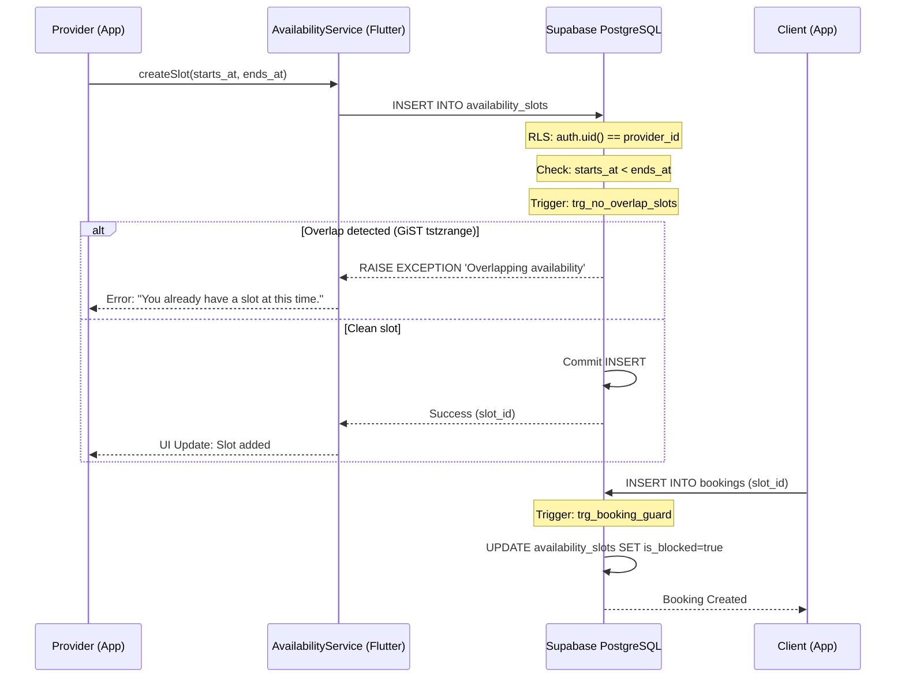

# 00_HOLISTIC_REPORT: Availability & Overlap Guard

**Skills Selected:**

1. **Threat Modeling (Security):** To evaluate what a malicious provider or client might do to bypass schedule limits.
2. **Invariants & Contracts:** To rigorously define the overlap block DB trigger (`trg_no_overlap_slots`) rules.
3. **Production Migration Planning:** Because the Flutter code is completely missing, ensuring the path to production is documented.
4. **Diagram Crafting (Mermaid):** Refactoring the flow from just an error condition diagram into a complete sequence.

**Why these skills fit:** The core of this diagram is a database guardrail to prevent double-booking. Threat modeling and invariant enforcement natively apply here. The Flutter app lacks this implementation entirely, requiring production migration planning to connect the UI to the DB contract. A sequence diagram better illustrates this full journey than a simple flowchart.

**Skills intentionally not used:**

- _State Machine & Lifecycle:_ Availability slots are binary (open or `is_blocked=true`). There is no complex lifecycle for the slot itself, just the bookings mapped to it.
- _DB-First Financial Modeling:_ Slot overlap checking happens prior to financial commitments, rendering this skill less relevant here.

---

## A) What This Diagram Is

- **Current Description:** It illustrates the PostgreSQL-level guard (`trg_no_overlap_slots`) preventing overlapping schedules for service providers.
- **System Boundaries & Assumptions:** Assumes providers will use an interface to insert hours. The boundary ends at the PostgreSQL trigger.

## B) Why It Exists

- **Problem it solves:** Prevents a provider from accidentally or maliciously declaring themselves available overlapping times. Prevents two clients from booking the exact same slot.
- **Risks it prevents:** Double-bookings, schedule collisions, resulting in disputes and refunds.

## C) Where It Lives in the Product

- **App entry points:** _Missing._ Providers have no screen or service layer code in Flutter to add availability.
- **Service/Logic layer touchpoints:** _Missing._ Bookings read them (in `booking_model.dart`), but no `AvailabilityService` exists to create them.
- **DB/RPC dependencies:** Table `availability_slots`, Trigger `trg_no_overlap_slots` calling `fn_reject_overlapping_slots()`.
- **Admin touchpoints:** None explicitly required, though admins may need to view slots during a dispute.

## D) Current Diagram Evaluation (Score)

- **What's Good:** It correctly points to the exact DB function (`fn_reject_overlapping_slots`) and the type of check (`tstzrange` GiST).
- **What's Missing:** The entire successful path, the booking integration (how a slot becomes `is_blocked=true`), and the Flutter components.
- **What's Ambiguous:** It mentions `is_blocked=false only` but does not explain how blocks occur.
- **What's Unsafe:** Relying on a diagram that implies the feature is built when the Flutter code comprises 0% of the write path.
- **Score NOW:** 4/10. It is a DB snippet, not a system diagram.

## E) Extracted Invariants & Contracts

1. **Owner-Only Creation:** Only the user matching `provider_id` can INSERT or UPDATE their slots (Evidence: RLS `slots_write_owner` in `SUPABASE_SETUP.md`).
2. **No Overlaps:** A provider cannot have two slots where `tstzrange(starts_at, ends_at, '[)')` overlap, assuming `is_blocked = false` (Evidence: Trigger `trg_no_overlap_slots` in `SUPABASE_SETUP.md`).
3. **Time Flow:** `starts_at` must be strictly before `ends_at` (Implied in Postgres rules, but must be enforced if not natively checked).

## F) Failure Modes & Attack Scenarios

1. **Scenario:** Malicious client books a slot, but the slot doesn't transition to `is_blocked=true` immediately.
   - _What happens now:_ Another client could book the same open slot.
   - _What should happen:_ The `bookings_insert` logic should atomically set `is_blocked = true` on the slot. (Currently handled theoretically, but diagram doesn't show it).
   - _Missing Guardrails:_ Explicit link between booking creation and slot blocking.
   - _Validation:_ Integration test attempting two concurrent bookings on the same slot must yield 1 success, 1 failure.
2. **Scenario:** Provider deletes a slot that already has a completed booking.
   - _What happens now:_ Unknown—if `bookings` has a hard FK to `availability_slots(id)`, it will restrict deletion.
   - _What should happen:_ Slots with attached bookings cannot be deleted (Foreign key constraint RESTRICT).

## G) Production-Grade Improvement Plan (Step-by-step)

- **Phase 0: Observability & logs**
  - What: Ensure `LoggerService` tracks `availability_slot_created` and `availability_slot_blocked` events.
  - Why: Debugging double-bookings if they theoretically bypass constraints.
- **Phase 1: Core contracts/invariants enforcement**
  - What: Implement `lib/features/availability/services/availability_service.dart`. Add proper exceptions throwing for `Overlapping availability slot`.
  - Why: Fulfills the "Missing" Flutter edge in the diagram.
- **Phase 2: Hardening (security, idempotency, race conditions)**
  - What: Ensure slot deletion applies a soft-delete (`deleted_at`) or is restricted if `bookings` exist, instead of hard CASCADE deletes which erase financial history context.
  - Why: Auditability.
- **Phase 3: Admin tooling & auditability**
  - What: Add `slots` view to Admin Dashboard to investigate schedule disputes.
- **Phase 4: Performance & scale**
  - What: Add BTREE indexes on `provider_id` + `starts_at` for fast schedule loading.
  - Why: Ensure the `Profile` view doesn't lag when fetching upcoming slots.

## H) Best Diagram Recommendation

- **Which diagram type is best:** Sequence Diagram.
- **Why:** The process involves the Flutter App sending data, the DB evaluating concurrent rules (GiST overlap), and returning success/rejection. A flowchart oversimplifies the client-server interaction and misses the booking link.

## I) Final Improved Diagram (Mermaid)

## J) Risk Register

### J1) Risks if we keep the current system

- **Dependency Missing:** The front-end literally lacks the ability to insert slots.
  - _Severity:_ High
  - _Likelihood:_ 100%
  - _Impact:_ App cannot function for standard slotted jobs.
- **DB Error Unhandled:** The app doesn't map the Postgres exception string to a user-friendly UI message.
  - _Severity:_ Medium

### J2) Risks introduced by improvements

- **Complexity in UI:** Forcing users to manually map slots leads to friction.
  - _Mitigation:_ Allow bulk insertion or standard weekly hours that generate slots automatically.

## K) Verification Checklist (Production Readiness)

- [ ] `AvailabilityService` implemented in Flutter using strict MVVM.
- [ ] Error mapping handles Postgres code for overlap exceptions and explains it to the user.
- [ ] RLS policy `slots_write_owner` confirmed in tests with a malicious actor attempting cross-provider inserts.
- [ ] Foreign Key `bookings.slot_id -> availability_slots.id` configured with `RESTRICT` on delete to preserve history.

## L) Final Verdict

- **Score AFTER fixes:** 9/10
- **Blockers to Production:** Missing Flutter implementation (`AvailabilityService`, UI, Error Mapping).
- **Ship Criteria:** Service merged, tests pass asserting overlap rejection returns specific UI error state, and Bookings properly mark custom slots as `is_blocked=true`.
