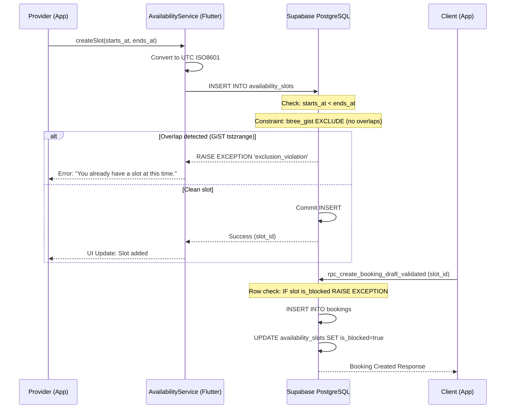

# Patch Plan: Availability & Overlap Guard

## 1. Minimal SQL Changes

### A. Implement Overlap Guard (Postgres constraints)

Adding the GiST `EXCLUDE` constraint directly to `availability_slots` is safer and faster than a PL/pgSQL trigger.

```sql
-- Requires btree_gist extension
CREATE EXTENSION IF NOT EXISTS btree_gist;

-- Prevents ANY two rows for the SAME provider from having overlapping starts_at/ends_at
ALTER TABLE public.availability_slots
ADD CONSTRAINT no_overlapping_slots
EXCLUDE USING gist (
  provider_id WITH =,
  tstzrange(starts_at, ends_at, '[)') WITH &&
);
```

### B. Patch `rpc_create_booking_draft_validated`

The current booking RPC leaves slots as `is_blocked = false`. We must atomically claim the slot.

```sql
-- Inside rpc_create_booking_draft_validated
-- After INSERT INTO public.bookings (...) RETURNING * INTO v_booking;

  UPDATE public.availability_slots
  SET is_blocked = true
  WHERE id = p_slot_id;

-- RETURN v_booking;
```

## 2. Minimal Flutter implementation (MVVM)

- `lib/features/availability/services/availability_service.dart`
  ```dart
  // Expected contract
  class AvailabilityService {
    Future<void> createSlot(DateTime startsAt, DateTime endsAt) async {
       // Must convert to UTC ISO8601
       await supabase.from('availability_slots').insert({
         'starts_at': startsAt.toUtc().toIso8601String(),
         'ends_at': endsAt.toUtc().toIso8601String(),
       });
    }
  }
  ```
- `lib/features/availability/viewmodels/availability_viewmodel.dart`
  - Handles UI state, triggers `AvailabilityService`.
  - Maps `PostgrestException` code `23P01` (exclusion violation) to `You already have a slot during this time period.`
- `lib/features/availability/view/availability_manager_screen.dart`
  - Presents a calendar/time picker explicitly bounded to 1-hour increments.

## 3. Updated Mermaid Diagram (Reflective of true patched system)


