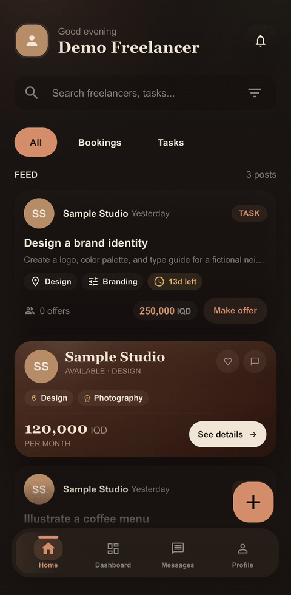
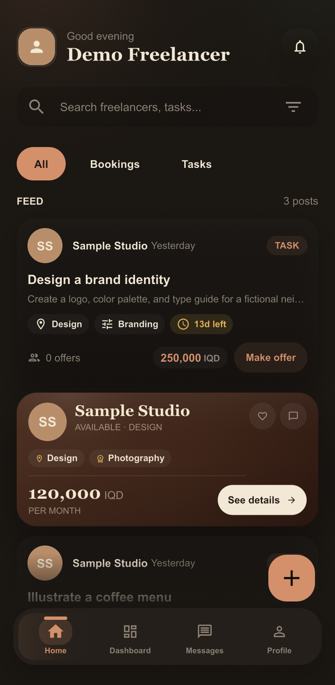
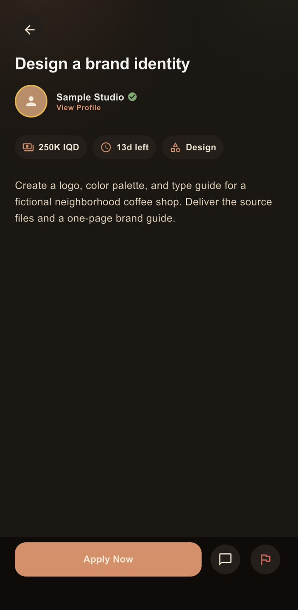
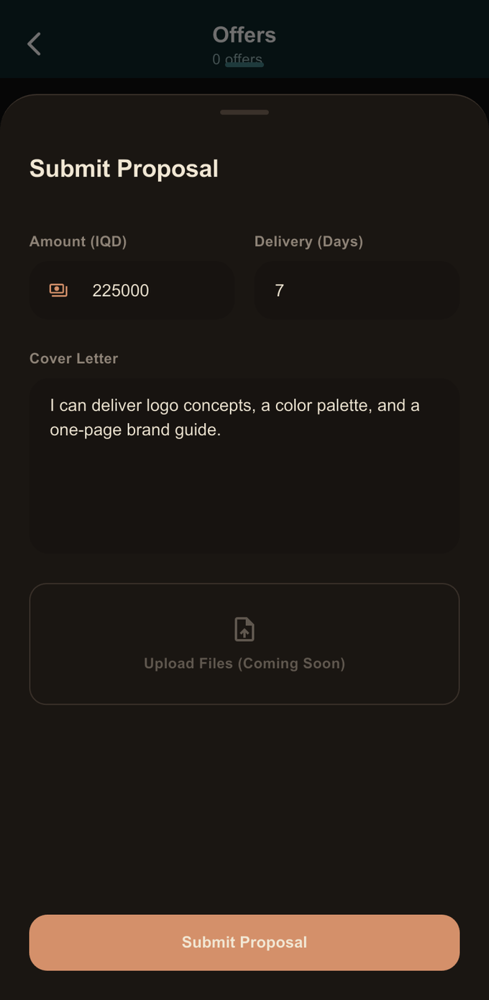
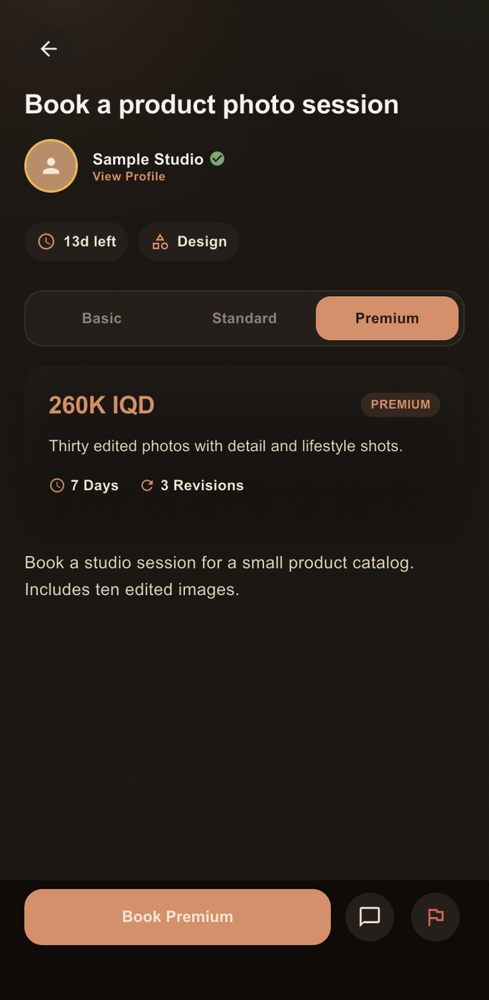

# SLine

SLine is a freelance marketplace. Clients post project briefs and review proposals or book a service. Freelancers browse open work and respond to listings in the same Flutter app.

**Private commercial project under NDA.** This README and its captures are for authorized readers.

## App demos

[Browse open work](#browse-open-work) · [Draft a proposal](#draft-a-proposal) · [Compare booking packages](#compare-booking-packages) · [Run the app](#run-the-app)

These clips show SLine running on an iPhone 18 Pro simulator with a fictional account and listings from a local mock API.

### Browse open work

On Home, select **Tasks** to show open projects. Open **Design a brand identity** to see the budget, deadline, and full brief.


### Draft a proposal

From the task details, choose **Apply Now** and enter an amount, delivery time, and cover letter. The clip ends on the completed form before submission.


### Compare booking packages

On Home, select **Bookings** and open the product photo session. Switch between **Basic**, **Standard**, and **Premium** to compare prices, delivery times, and revisions before booking.



<details>
<summary>Still screenshots of the three workflows</summary>

**Home feed.** Browse tasks and bookings, or filter by listing type.



**Task details.** Read the project brief, budget, and time left before applying.



**Proposal form.** Review the amount, delivery time, and cover letter before sending an offer.



**Booking packages.** The Premium tier shows the price, package contents, delivery time, and revisions.



</details>

## Beyond the demos

The Dashboard has tabs for bookings, work, wallet activity, and the inbox. The dashboard settings let users switch between client and freelancer roles. Users can also search their conversations in Messages and show portfolio items on their profile. See the [developer guide](Sline_everything/DEVELOPER_GUIDE.md).

## Run the app

Use a complete checkout and Flutter **3.41.9**, the version pinned in CI. The package requires Dart **3.11 or later in the 3.x series**. For iOS, install Xcode and CocoaPods and start a simulator. For Android, install the Android SDK and start an emulator. See the [package manifest](pubspec.yaml) and [CI configuration](.github/workflows/ci.yml).

Ask the maintainer for an approved development Supabase project, its client key, and a test account. Confirm the URL and client key in [Supabase configuration](lib/core/services/supabase_config.dart) target that development project before you launch. The [backend setup](Sline_everything/SUPABASE_SETUP.md) documents the required schema and policies.

```sh
flutter pub get
flutter gen-l10n
flutter devices
flutter run -d <device_id>
```

Replace `<device_id>` with an ID from `flutter devices`. A fresh simulator install should open the sign-in screen. Sign in with your test account to reach Home. To follow the discovery example, use a development project with at least one open task.

Follow [Browse open work](#browse-open-work) to try the same workflow after signing in.

## Architecture and contribution

Flutter views read ViewModel state through Provider. ViewModels call services and repositories for Supabase access. The backend uses PostgreSQL, Row-Level Security, database functions, and Edge Functions. Supabase also provides authentication, storage, and realtime updates.

My six-month contract covered backend development and Supabase integration with the Flutter client and companion administration dashboard. UI/UX design was outside my role. The [dashboard repository](https://github.com/faroqomar/SlineDashbord) has its own setup.

## Development checks

```sh
flutter analyze --no-fatal-infos
flutter test --coverage
```

CI also runs formatting, MVVM boundary checks, and Android and web builds. Use the [developer guide](Sline_everything/DEVELOPER_GUIDE.md) for backend and integration test prerequisites.

- [Repository rules](AGENTS.md)
- [Contribution workflow](CONTRIBUTING.md)
- [Project structure](Sline_everything/STRUCTURE.md)
- [Source map](Sline_everything/DOC_SOURCE_MAP.md)

Rights and disclosure are governed by the project owner's agreements.
