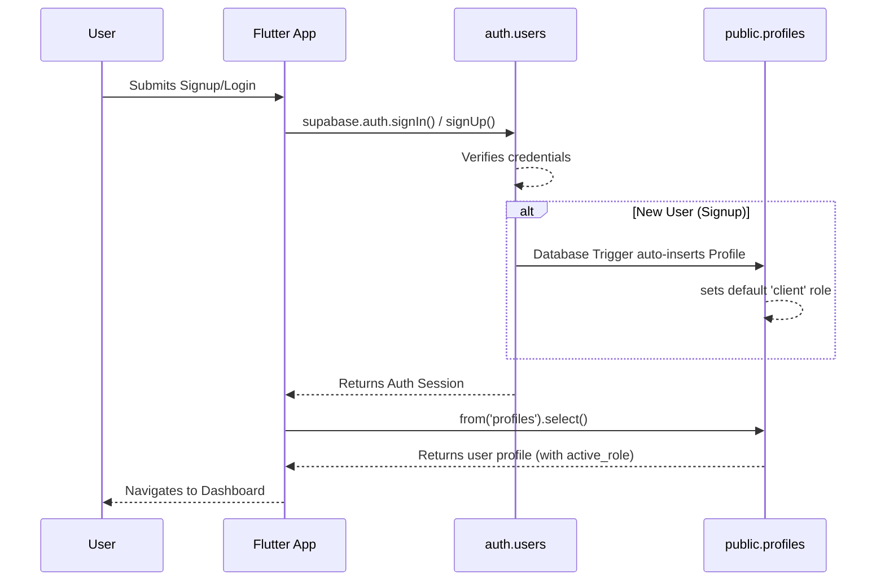
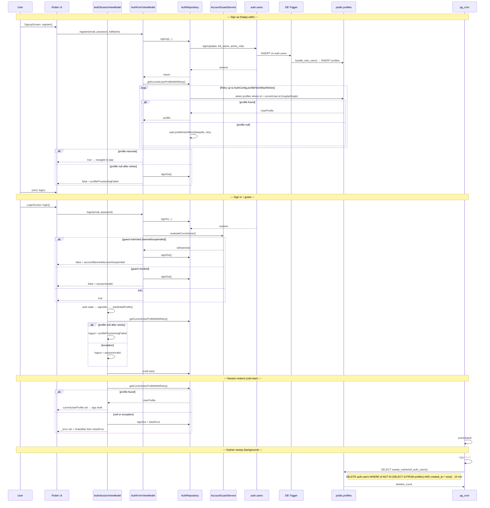

# Auth & Profile Provisioning — Diagram Document

---

## What every diagram document must include (bullet checklist)

### Diagram Title + Version

- **Diagram name (exact):** Auth & Profile Provisioning
- **Version:** v2 (final) — 2026-03-06
- **Owner/author:** SLine team / Auth & Identity

### Purpose

- **What this diagram is showing, in one paragraph.**  
  End-to-end flow from user signup/login through Supabase Auth, database-triggered profile creation, app-side profile fetch with retry, session restore, and optional orphan cleanup. It shows who does what (User, Flutter app, auth.users, public.profiles, trigger, cron) and when the app retries or signs out on failure.

- **What problem it solves (why it exists).**  
  Ensures a single, clear picture of identity lifecycle: how profiles are created (trigger), how the app tolerates trigger latency (retry), how failed provisioning is handled (sign out + message), and how orphan auth users are cleaned up (view + sweeper + cron). Prevents duplicate or contradictory docs and supports onboarding, debugging, and compliance.

### Scope

- **What’s included (features/entities covered).**
  - Sign up (email/password, full_name) → auth.users INSERT → trigger → profiles INSERT.
  - Sign in → session → profile fetch with retry (AuthConfig).
  - Session restore (cold start) → profile fetch with retry; on null/exception → logout + error message.
  - AccountGuard on login and cold start (banned/suspended/revoked).
  - Logout (clear profile, clear error, sign out).
  - Orphan sweep: view `vw_orphaned_auth_users`, function `sweep_orphaned_auth_users()`, pg_cron job every 15 minutes.
  - User-facing messages (AuthMessages) and config (AuthConfig).

- **What’s explicitly excluded (out of scope).**
  - Password reset / recovery flow (separate diagram or doc).
  - Profile edit, avatar, role switch (Profile feature).
  - RLS policies for other tables; only profiles + auth provisioning are in scope.

### Assumptions

- Profile row is created **only** by the Postgres trigger on `auth.users` INSERT (no client-side profile INSERT in normal flow).
- Retry is used only for **reading** the profile after signup or session restore; config is in `AuthConfig` (enableProfileFetchRetry, profileFetchMaxRetries, profileFetchRetryDelayMs).
- Orphan sweep deletes auth users with **no** profile and created **more than 15 minutes** ago; sweep runs on a schedule (pg_cron), not on every request.
- Payments and escrow are out of scope; no payment events in this diagram.
- Session validity is enforced by Supabase Auth; RLS uses `auth.uid()`.

### Glossary (human-readable)

| Term | Meaning |
|------|--------|
| **auth.users** | Supabase internal table; one row per signed-up user (id, email, etc.). |
| **public.profiles** | App identity table; one row per user (id = auth.users.id, full_name, email, active_role, etc.). |
| **Trigger** | Postgres trigger `on_auth_user_created` on `auth.users` AFTER INSERT; calls `handle_new_user()` to insert into `public.profiles`. |
| **Orphan** | An auth.users row with no corresponding public.profiles row (e.g. trigger failed or delayed beyond sweep window). |
| **Retry** | Client-side loop: fetch profile up to N times with delay between attempts (AuthConfig). |
| **AccountGuard** | Service that evaluates current user (banned/suspended/revoked); blocks access and can force sign out. |
| **RLS** | Row-Level Security; policies restrict SELECT/INSERT/UPDATE/DELETE to rows where `auth.uid() = id` for profiles. |
| **SECURITY DEFINER** | Function runs with definer’s rights; used for sweeper so it can delete from auth.users. |
| **pg_cron** | Postgres extension for scheduled jobs (e.g. run sweeper every 15 minutes). |

### Legend: what each symbol means

- **Participant (sequence diagram):** Actor or system component (User, Flutter App, Auth, DB, Trigger, Cron).
- **Solid arrow (→):** Synchronous call or request (e.g. signUp, signIn, select from profiles).
- **Dashed arrow (– –):** Response or return (e.g. session, profile row).
- **Alt / loop:** Branch or retry (e.g. “profile null → retry” or “profile null after retries → sign out”).
- **Note/label:** Condition or guard (e.g. “created_at &lt; 15 min ago” for sweep exclusion).

### Actors and responsibilities

| Actor | Allowed | Forbidden |
|-------|--------|-----------|
| **User** | Sign up, sign in, sign out, see error messages (AuthMessages). | Direct access to auth.users or profiles; changing another user’s profile. |
| **Flutter App (ViewModels)** | Call AuthRepository (signUp, signIn, signOut, getCurrentUserProfileWithRetry); show loading/error; clear error on logout. | Direct Supabase calls from View layer; storing raw exception text in log messages. |
| **AuthRepository** | Supabase Auth API; read profiles with `.maybeSingle()`; retry with AuthConfig. | Insert/update profiles (trigger owns creation); expose unmasked email in logs. |
| **AccountGuardService** | Evaluate current user; force sign out if banned/suspended/revoked. | Change profile or auth data. |
| **DB trigger (on_auth_user_created)** | INSERT one row into public.profiles on auth.users INSERT. | Modify auth.users; delete profiles. |
| **System/Cron (pg_cron)** | Run `sweep_orphaned_auth_users()` on schedule. | Run arbitrary SQL; change data outside orphan rule (no profile, &gt; 15 min). |

### System components (where it lives)

- **App entry points:** Login screen (`lib/features/auth/view/login_screen.dart`), Signup screen (`lib/features/auth/view/signup_screen.dart`). Cold start: `main.dart` → auth state listener → `AuthSessionViewModel._loadInitialProfile()`.
- **Service / ViewModel / Repository:**
  - `lib/features/auth/viewmodels/auth_session_view_model.dart` — session state, profile load with retry, logout, clearError on logout.
  - `lib/features/auth/viewmodels/auth_form_view_model.dart` — login/signup/reset form state, error mapping (AuthMessages).
  - `lib/features/auth/data/auth_repository.dart` — signUp, signIn, signOut, getCurrentUserProfileWithRetry, _fetchProfileOnce (`.maybeSingle()`).
  - `lib/core/config/auth_config.dart` — enableProfileFetchRetry, profileFetchMaxRetries, profileFetchRetryDelayMs.
  - `lib/core/constants/auth_messages.dart` — profileProvisioningFailed, sessionInvalid, accountBanned, accountSuspended.
  - `lib/core/services/account_guard_service.dart` — evaluateCurrentUser (login + cold start in main.dart).
- **Database objects:**
  - **Tables:** `auth.users`, `public.profiles`.
  - **View:** `vw_orphaned_auth_users` (auth users with no profile; for monitoring).
  - **Function:** `sweep_orphaned_auth_users()` (SECURITY DEFINER; deletes auth.users with no profile and created_at &lt; now() - 15 min).
  - **Trigger:** `on_auth_user_created` on `auth.users` AFTER INSERT → `handle_new_user()`.
  - **Cron:** pg_cron job `sweep-orphaned-auth-users` schedule `*/15 * * * *`.
  - **Policies (RLS):** profiles SELECT/INSERT/UPDATE/DELETE where `auth.uid() = id`.

---

## OLD diagram (pre–retry/orphan-sweep/canonical reference)

Kept for history. Does not show retry, orphan sweep, AccountGuard, or clearError on logout.

---

## NEW diagram (implemented — v2 final, 2026-03-06)

Includes: trigger, profile fetch with retry (AuthConfig), session restore, null/exception handling (logout + AuthMessages), AccountGuard (login + cold start), logout with clearError, orphan view + sweeper + pg_cron.

---

## Step-by-step flow (“human story”)

### Happy path (sign up)

1. User fills signup form → SignupScreen calls `AuthFormViewModel.register(...)`.
2. AuthFormViewModel calls `AuthRepository.signUp(...)` → Supabase `signUp` with `data: { full_name, active_role: 'client' }`.
3. Auth creates row in `auth.users` → trigger `on_auth_user_created` runs → `handle_new_user()` inserts one row into `public.profiles` (id = auth user id).
4. If no session returned, repository signs in with same credentials.
5. AuthFormViewModel calls `AuthRepository.getCurrentUserProfileWithRetry()` → up to 3 attempts, 500 ms apart; one attempt returns profile.
6. User is signed in; AuthSessionViewModel gets auth state change and loads profile (retry path); UI navigates to main app.

### Happy path (sign in)

1. User submits login → AuthFormViewModel.login() → AuthRepository.signIn().
2. AccountGuardService.evaluateCurrentUser() runs; not restricted/revoked.
3. AuthSessionViewModel receives signedIn → _loadInitialProfile() → getCurrentUserProfileWithRetry() → profile returned.
4. currentUserProfile set; app shows main shell.

### Common failure path (profile not ready)

1. After signup, trigger is slow; getCurrentUserProfileWithRetry() tries 3 times, gets null each time.
2. AuthFormViewModel (signup) or AuthSessionViewModel (session restore) calls signOut(), sets _error = AuthMessages.profileProvisioningFailed.
3. User sees message (e.g. LoginScreen SnackBar); can try again later.

### Common failure path (exception on profile load)

1. _loadInitialProfile() throws (e.g. network). AppLogger.e('Failed to load profile', tag: 'Auth', error: e).
2. AuthSessionViewModel calls logout() (signOut + clearError), sets _error = AuthMessages.sessionInvalid.
3. User redirected to login; error shown once then cleared.

### Logout

1. User or app calls AuthSessionViewModel.logout() → clearError() then signOut(); _currentUserProfile = null.
2. Stale session error is cleared so next login does not show old message.

### Orphan sweep (background)

1. pg_cron runs every 15 minutes → executes `SELECT sweep_orphaned_auth_users()`.
2. Function deletes from auth.users where id not in (select id from profiles) and created_at &lt; now() - 15 minutes.
3. Returns deleted count; RAISE NOTICE for logs. Monitoring: query `vw_orphaned_auth_users` for current orphans.

---

## State machine (session / UI)

- **No session:** currentUser = null, currentUserProfile = null → show Login/Signup.
- **Session, loading profile:** isLoading = true; retry in progress.
- **Session, profile loaded:** currentUserProfile != null → show app shell.
- **Session, profile failed (null or exception):** logout() called → back to “No session” with _error set briefly (SnackBar then clearError).
- **Logout:** clearError(); signOut(); currentUserProfile = null → “No session”.

Allowed: no session → (sign in/sign up) → session loading → session with profile; session with profile → logout → no session; session loading → (failure) → logout → no session. Forbidden: app shell visible without a valid profile for current auth.uid().

---

## Invariants (must-always-be-true rules)

- A profile row is created only by the trigger on auth.users INSERT (or explicit admin/heal path), not by the app’s normal signup flow.
- The app never shows the main app shell with a non-null session but null currentUserProfile after retries have been exhausted (it signs out and shows an error).
- Orphan sweep deletes only auth.users rows that have no profiles and are older than 15 minutes.
- RLS: profiles rows are visible/editable only when auth.uid() = id.
- Logout always clears error state (clearError) so the next login does not show a stale session error.

---

## Guards & validation rules

| Guard | Where | Source of truth |
|-------|--------|------------------|
| auth.uid() = id for profiles | RLS (SELECT/INSERT/UPDATE/DELETE) | DB |
| Profile fetch retry limit | AuthConfig.profileFetchMaxRetries (3) | App (AuthConfig) |
| Orphan sweep: no profile AND created_at &lt; now() - 15 min | sweep_orphaned_auth_users() | DB function |
| Banned/suspended/revoked | AccountGuardService.evaluateCurrentUser() | App (service) |
| Session exists before profile fetch | AuthRepository (currentUser check) | App |

---

## Failure modes (what can go wrong)

| Failure | System behavior |
|--------|------------------|
| Trigger delayed | Retry up to 3 times with 500 ms delay; if still null, sign out + profileProvisioningFailed. |
| App crash mid-step | On next open, session restore runs; if profile load fails, logout + error. |
| Duplicate signup (same email) | Supabase returns error; AuthFormViewModel shows mapped message (e.g. “account already exists”). |
| Network timeout on profile fetch | Retry; after max attempts, sign out + error. |
| Orphan sweep runs while trigger pending | Users created &lt; 15 min ago are not deleted; sweep is idempotent. |
| Double logout | signOut() and clearError() are safe to call repeatedly. |

---

## Security & abuse scenarios

- **Spoofing identity:** Supabase Auth issues session; RLS uses auth.uid(). App does not trust client-supplied user id for profile write.
- **Unauthorized state change:** Profile insert is only via trigger (SECURITY DEFINER) or RLS-bound update (auth.uid() = id).
- **User seeing another user’s profile:** Profiles SELECT allowed only where auth.uid() = id; cross-user reads go through rpc_get_profile_summaries or search_profiles, not raw profiles.
- **Orphan sweep abuse:** Function is SECURITY DEFINER with fixed logic (no profile, &gt; 15 min); cron job is server-scheduled, not user-triggered.

---

## Data model mapping

- **“Profile exists”:** public.profiles has row with id = auth.uid().
- **“Orphan”:** auth.users.id not in (select id from public.profiles); view vw_orphaned_auth_users exposes id, email, created_at.
- **“Retry”:** Client state: attempt count 1..N, delay between attempts from AuthConfig; no DB column.
- **Session:** auth.sessions (Supabase); app uses currentUser and currentUserProfile in memory.

Required: profiles.id = auth.users.id (FK). Index on profiles(id) (PK). No extra index required for orphan view (join on id).

---

## Observability & forensics

- **Logs (AppLogger, tag 'Auth'):** Profile fetch attempt/success/failure, “Profile not found after retries - signing out”, “Failed to load profile” (error/stackTrace), “Profile creation failed after signup - signing out”, login/signup/signout (email masked). No raw exception string in message (error passed as `error` parameter).
- **DB:** RAISE NOTICE in sweep_orphaned_auth_users (deleted count). Monitoring: SELECT * FROM vw_orphaned_auth_users for current orphans.
- **Orphan event:** If an auth user has no profile after 15+ minutes, they appear in vw_orphaned_auth_users and will be deleted on next cron run; trace via created_at and sweep logs.

---

## Verification checklist

- Unit tests: AuthRepository (null currentUser path; retry behavior with mock). See test/unit/auth/auth_repository_test.dart.
- Widget tests: Login/signup screens with AuthFormViewModel/AuthSessionViewModel; error display and clearError. See test/widget/auth/.
- DB: RLS on profiles (auth.uid() = id); trigger on_auth_user_created present; sweep_orphaned_auth_users() and vw_orphaned_auth_users exist; cron job scheduled.
- Concurrency: Double sign-in/sign-out safe; retry loop is single-threaded per flow.

---

## Dependencies

- **Depends on:** Supabase Auth, public.profiles table, trigger migration (e.g. 20260301_auth_profile_bootstrap.sql), migrations 20260306120000 (view + sweeper) and 20260306120100 (pg_cron schedule).
- **Other diagrams/features that depend on this:** Profile feature (edits profile), Dashboard/Home (currentUserProfile), any feature that checks auth/session.

---

## Open questions / missing evidence

- None for current scope. Trigger name in codebase appears as both `on_auth_user_created` (migration) and `trg_on_auth_user_created` (docs); implementation uses `on_auth_user_created` in SQL.

---

## Final status

- **Verdict:** PASS
- **Production ready?** YES. Trigger-based provisioning, retry, guarded session restore, logout clearError, and orphan sweep with pg_cron are implemented and documented. AuthMessages and AuthConfig centralize copy and behavior.
- **Next actions:** (1) Run app verification checklist (.TODO/CHECKLIST_AuthProfileProvisioning_Verification.md). (2) Keep this doc in sync with any future AuthConfig or AuthMessages changes.
