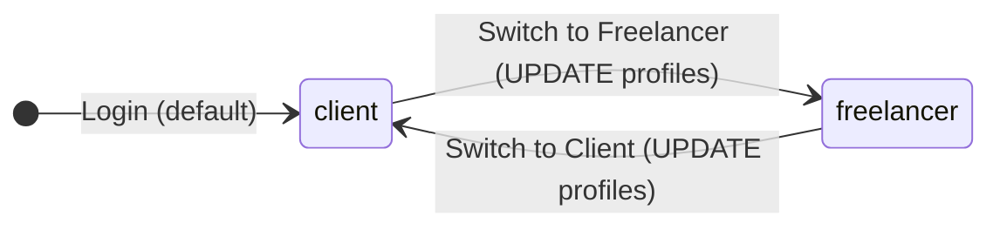
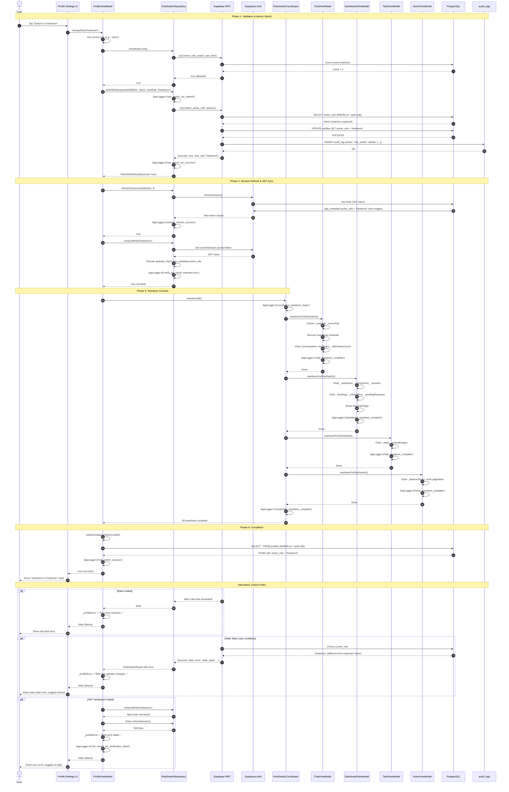

# Role Switching Flow — Diagram Document

---

## Diagram Title + Version

- **Diagram name (exact):** `02_role-switching-flow`
- **Version:** v2 (Final) — Implemented
- **Date:** 2026-03-06
- **Owner/author:** SLine team (Documentation: @DocsKeeper; Implementation: @Executor + @Architect)

---

## Purpose

- **What this diagram is showing, in one paragraph.**  
  This diagram shows the end-to-end role switching flow: from the user tapping “Switch to Freelancer” or “Switch to Client” in Profile Settings, through rate limiting, atomic RPC, JWT claim sync, session refresh, cross-ViewModel teardown, and profile reload. It includes both the happy path and the main failure paths (rate limit, stale state, JWT mismatch).

- **What problem it solves (why it exists).**  
  The original flow was a simple `UPDATE profiles SET active_role = …` with no race protection, no JWT sync, and no cleanup of cached data. That led to race conditions (multi-device, double-tap), data leakage between Client/Freelancer personas, slow RLS (table joins), and no audit trail. This diagram documents the hardened flow that fixes all of that.

---

## Scope

- **What’s included:**  
  Profile Settings UI, ProfileViewModel, RoleSwitchRepository, Supabase RPC (`switch_active_role`, `check_role_switch_rate_limit`), Supabase Auth (session refresh), RoleSwitchCoordinator, all RoleSwitchAware ViewModels (Chat, Dashboard, Task, Home), PostgreSQL `profiles` update, trigger `trg_sync_role_to_jwt`, JWT-based RLS policies, `audit_logs`, and error handling (stale_state, rate_limit, session_error, db_error).

- **What’s explicitly excluded:**  
  Login/signup, profile editing (name/bio/avatar), moderation/force-logout, other dashboard features. Role switch does not create or modify tasks, bookings, or chat messages; it only changes `active_role` and clears in-memory caches.

---

## Assumptions

- User is already authenticated; `auth.uid()` is set and session is valid.
- `profiles.active_role` is always one of `'client'` or `'freelancer'`.
- JWT claims are updated by a DB trigger on `profiles` (sync to `auth.users.app_metadata`); the app does not write to `app_metadata` directly.
- Rate limit is enforced server-side only (3 switches per minute per user); client does not enforce it.
- Teardown is best-effort: if one ViewModel’s teardown throws, others still run; coordinator collects errors and may throw `RoleSwitchTeardownException` after all have run.
- Payments and bookings are not modified by role switch; only visibility and RLS (via JWT role) change.

---

## Glossary (Human-readable)

| Term | Definition |
|------|------------|
| **active_role** | Column on `profiles`: `'client'` or `'freelancer'`. Drives which dashboard/actions the user sees. |
| **Client** | Persona that posts tasks, books freelancers, awards tenders. |
| **Freelancer** | Persona that submits proposals, manages availability, delivers work. |
| **JWT** | JSON Web Token; contains `app_metadata.active_role` after trigger sync. |
| **RLS** | Row-Level Security; PostgreSQL policies that restrict rows by role (using JWT claim). |
| **RPC** | Remote Procedure Call; server-side function (`switch_active_role`, `check_role_switch_rate_limit`). |
| **Teardown** | Clearing in-memory caches and unsubscribing from Realtime so the new role sees no stale data. |
| **expected_old_role** | Guard parameter: RPC only updates if current DB role equals this (prevents races). |
| **stale_state** | Error when role was already changed (e.g. other device); switch aborted. |
| **rate_limit** | Error when user has exceeded 3 switches in the last minute. |
| **session_error** | Session refresh failed; user should re-login. |
| **db_error** | Generic database error during switch. |
| **Idempotency** | Same request twice: first succeeds, second returns stale_state (no double switch). |
| **audit_logs** | Table logging role switch attempts (who, when, from/to role, success/failure). |

---

## Legend (What each symbol means)

- **Actor:** User (human).
- **Participant/box:** Component (UI, ViewModel, Repository, RPC, Auth, Coordinator, ViewModels, DB, audit_logs).
- **Solid arrow (→):** Synchronous call or request.
- **Dashed arrow (– –):** Response or return.
- **Note over X,Y:** Phase or grouping label.
- **alt … end:** Alternative path (e.g. rate limit, stale state, JWT failure).
- **Node “User”:** The logged-in user triggering the switch.
- **Guards:** Conditions in RPC (e.g. `current_role = expected_old_role`) and in UI (e.g. show error if `!result.isSuccess`).

---

## Actors and Responsibilities

| Actor | Allowed | Forbidden |
|-------|--------|-----------|
| **User (Client or Freelancer)** | Tap switch in Profile Settings; see success/error message; use app as new role after success. | Cannot bypass rate limit or RPC; cannot directly set JWT or DB. |
| **ProfileViewModel** | Call repository (rate limit, switch, refresh, verify JWT); call coordinator teardown; reload profile; set error message on failure. | No direct Supabase calls from View layer; no direct reference to other ViewModels. |
| **RoleSwitchCoordinator** | Register/unregister RoleSwitchAware ViewModels; call `teardownForRoleSwitch()` on each. | Cannot perform RPC or DB writes; cannot hold references to ViewModels after unregister. |
| **Chat/Dashboard/Task/Home ViewModels** | Clear caches, cancel subscriptions, remove channels; register/unregister with coordinator. | Cannot call ProfileViewModel or switch role themselves. |
| **System (Supabase RPC / Trigger)** | Enforce rate limit; compare expected_old_role; update `profiles`; sync to JWT; write audit_logs. | Cannot be bypassed by client; client cannot write to `auth.users.app_metadata` directly. |

---

## System Components (Where it lives)

- **App entry points:** Profile Settings screen — “Switch to Freelancer” / “Switch to Client” (e.g. `lib/features/profile/view/profile_screen.dart` or role-switch widget).
- **ViewModel:** `lib/features/profile/viewmodels/profile_view_model.dart` — `changeRole(String newRole)`.
- **Repository:** `lib/features/profile/data/role_switch_repository.dart` — `checkRateLimit()`, `switchRole()`, `refreshSession()`, `verifyJwtRole()`.
- **Coordinator:** `lib/core/services/role_switch_coordinator.dart` — `teardownAll()`.
- **Mixin:** `lib/core/mixins/role_switch_aware.dart` — `teardownForRoleSwitch()`.
- **Model:** `lib/features/profile/models/role_switch_result.dart` — RPC response (success, error, message).

**Database:**

- **Tables:** `profiles` (column `active_role`), `audit_logs`.
- **RPC:** `switch_active_role(p_expected_old_role, p_new_role)`, `check_role_switch_rate_limit()`.
- **Trigger:** `trg_sync_role_to_jwt` on `profiles` AFTER UPDATE OF `active_role` → syncs to `auth.users.app_metadata`.
- **Policies (RLS):** JWT-based policies (e.g. `task_requests_insert_freelancer_jwt`, `availability_slots_*_freelancer_jwt`, `tasks_insert_client_jwt`) using `auth.jwt()->'app_metadata'->>'active_role'`.

---

## Step-by-Step Flow (“Human Story”)

**Happy path**

1. User taps “Switch to Freelancer” (or Client) in Profile Settings.
2. ProfileViewModel gets current role from loaded profile (e.g. `client`).
3. ProfileViewModel calls RoleSwitchRepository.checkRateLimit() → RPC checks last 3 switches in 1 minute; returns true (allowed).
4. ProfileViewModel calls RoleSwitchRepository.switchRole(expectedOldRole: 'client', newRole: 'freelancer').
5. RPC reads current `profiles.active_role`; if it equals `expected_old_role`, RPC updates to `freelancer`, writes audit_log, returns success.
6. ProfileViewModel calls refreshSession() so the new JWT (with updated claim) is issued.
7. ProfileViewModel calls verifyJwtRole('freelancer'); if mismatch, retry refresh once, then fail with session_error.
8. ProfileViewModel calls RoleSwitchCoordinator().teardownAll(); each registered ViewModel (Chat, Dashboard, Task, Home) clears caches and unsubscribes (e.g. Chat removes Realtime channels).
9. ProfileViewModel calls loadUserData() to reload profile from DB.
10. UI shows “Switched to Freelancer” (or Client); user sees dashboard for the new role.

**Most common failure paths**

- **Rate limit:** Step 3 returns false → UI shows “Too many role switches. Please wait a minute.”
- **Stale state:** In step 5, current role in DB is already `freelancer` (e.g. switched on another device) → RPC returns `{ success: false, error: 'stale_state' }` → UI shows “Role was already changed. Please refresh.”
- **JWT verification failed:** After step 6, JWT still has old role → step 7 fails after retry → UI shows “Role sync failed. Please log in again.”

---

## OLD Diagram (Pre–v2.18, Conceptual State View)

*Before hardening, the flow was documented as a simple state flip with no RPC guard, no JWT sync, and no teardown. Below is the old conceptual state diagram (kept for history).*

**OLD — Diagram name:** `02_role-switching-flow` (State, v1)  
**OLD — Version:** v1 (Pre–v2.18)  
**OLD — Status:** Superseded by Sequence v2 (Implemented)

**What the OLD flow did not show:**  
Rate limit, atomic guard (`expected_old_role`), JWT sync trigger, session refresh, teardown of ViewModels, audit logging, or failure paths. The implementation was a direct `UPDATE profiles SET active_role = ?` with no race protection or cache cleanup.

---

## NEW / Implemented Diagram (v2 — Sequence)

**Diagram name:** `02_role-switching-flow` (Sequence)  
**Version:** v2 (Final)  
**Date:** 2026-03-06  
**Status:** Implemented, production ready

---

## State Machine Explanation (if states exist)

- **Logical states:** `client` and `freelancer` (values of `profiles.active_role`).
- **Allowed transitions:** `client` → `freelancer`; `freelancer` → `client`. Only the authenticated user (owner of the profile) can trigger, via RPC with correct `expected_old_role`.
- **Forbidden transitions:** Switching to a role that is not `client` or `freelancer` (RPC returns `invalid_role`). Switching when DB role does not match `expected_old_role` (RPC returns `stale_state`). No direct UPDATE from client; only via `switch_active_role` RPC.

---

## Invariants (Must-always-be-true rules)

- Role switch is atomic: either the full sequence (DB update + audit + session refresh + JWT match + teardown + reload) succeeds, or the user sees an error and DB role is unchanged (or already changed elsewhere — then stale_state).
- JWT `app_metadata.active_role` matches `profiles.active_role` after a successful switch (enforced by trigger + refresh + verify).
- A user cannot see or act on data for the other role after teardown: caches are cleared and channels removed before UI shows the new role.
- Every switch attempt is recorded in `audit_logs` (success or failure).
- At most 3 successful switches per user per rolling minute (enforced in RPC/DB).
- RLS for role-sensitive tables uses JWT claim, not a join to `profiles`, for performance and consistency.

---

## Guards & Validation Rules

| Guard | Where it runs | Source of truth |
|-------|----------------|------------------|
| Rate limit: ≤3 switches in last 60 seconds | Server (RPC `check_role_switch_rate_limit`) | DB / RPC |
| expected_old_role equals current `profiles.active_role` | Server (RPC `switch_active_role`) | DB |
| new_role in ('client','freelancer') | Server (RPC) | DB |
| Session exists and is valid | Client + Auth (refreshSession) | Supabase Auth |
| JWT claim equals requested new role after refresh | Client (verifyJwtRole) | JWT payload |
| ViewModels registered with coordinator | Client (register/unregister) | App runtime |

---

## Failure Modes (What can go wrong)

| Failure | System behavior |
|--------|------------------|
| App crash mid-step | DB may be updated; next launch user has new role; teardown did not run — acceptable, next load is fresh. |
| Double-tap / duplicate request | First succeeds; second gets stale_state (DB already updated). |
| Retry after network glitch | Idempotent: same expected_old_role + new_role again returns success or stale_state. |
| Two devices switch at once | One wins; the other gets stale_state and should refresh. |
| Session expired during switch | refreshSession fails → session_error → user told to re-login. |
| Trigger or JWT sync delayed | verifyJwtRole may fail; retry once; then session_error. |
| Teardown throws in one ViewModel | Coordinator continues others; then may throw RoleSwitchTeardownException; ProfileViewModel logs and can show generic error; DB and JWT are already updated. |

---

## Security & Abuse Scenarios

- **Spoofing identity:** User can only switch their own role; RPC uses `auth.uid()` and updates only that profile row.
- **Unauthorized state change:** Only `switch_active_role` RPC can change `active_role`; client cannot direct UPDATE; RLS on `profiles` remains.
- **Paying / acting without owning entity:** N/A for role switch; role only affects which RLS policies allow (e.g. freelancer can submit task_requests).
- **Escrow trapped:** N/A.
- **User seeing another user’s data:** RLS + JWT ensure user only sees rows allowed for their role and identity; teardown clears in-memory caches so no stale cross-role data.

---

## Data Model Mapping

| Diagram / UX concept | DB / model |
|----------------------|------------|
| “User is Client” | `profiles.active_role = 'client'` |
| “User is Freelancer” | `profiles.active_role = 'freelancer'` |
| “Role in token” | JWT `app_metadata.active_role` (synced by trigger) |
| “Switch attempt” | `audit_logs` row: action `role_switch`, details (user_id, from_role, to_role, success, error) |
| “Rate limit” | RPC counts rows in `audit_logs` for this user and action in last 60 seconds |
| Success result | `RoleSwitchResult(success: true, newRole: 'freelancer')` |
| Error result | `RoleSwitchResult(success: false, errorCode: 'stale_state'|'rate_limit'|…)` |

Required: index or efficient query on `audit_logs` for (user_id, action, created_at) for rate limit. Constraint: `active_role` in (`'client'`,`'freelancer'`) if desired (optional).

---

## Observability & Forensics

- **Logs:** AppLogger with tags such as `role_switch_*`, `coordinator_teardown_*`, `session_refresh_*`, `verify_jwt_*`; no tokens in logs.
- **Audit:** Every attempt in `audit_logs` (who, when, from_role, to_role, success, error code).
- **Admin:** Query `audit_logs` by user_id or time range to trace “role switch story”.
- **Orphan:** If app crashes after DB update but before teardown, next app load uses new role and fresh data; no orphan state. If RPC fails after no UPDATE, no DB change.

---

## Verification Checklist

- **Unit tests:** RoleSwitchResult parsing (success/error codes, displayError); coordinator teardown (mock ViewModels). ✅ 17 tests in `test/unit/profile/role_switch_result_test.dart`.
- **Integration tests:** Optional: full flow with test Supabase (rate limit, stale_state, success).
- **DB tests:** RLS and trigger (e.g. pgTAP or manual: update profile, confirm JWT claim; confirm RLS policies use JWT).
- **Concurrency:** Double-tap → second gets stale_state; two devices → one stale_state.

---

## Dependencies

- **Depends on:** Auth (user logged in, session); Profile feature (profile loaded, current role); Supabase (RPC, Auth, trigger, audit_logs); RoleSwitchAware ViewModels (Chat, Dashboard, Task, Home) registered with coordinator.
- **Other diagrams/features that depend on this:** Dashboard (which tab/content by role), Home (discovery by role), Tasks (create vs propose), Chat (visibility), RLS policy docs.
- **Ordering:** Migration `20260306_role_switch_foundation.sql` must be applied before this flow is used.

---

## Open Questions / Missing Evidence

- None for current implementation. Feature flag for staged rollout is optional (not blocking).
- Cleanup scheduled 2026-03-20: remove deprecated `changeRoleLegacy` and old non-JWT RLS policies once all clients use new flow.

---

## Final Status

- **Verdict:** PASS  
- **Production ready?** YES. Atomic RPC, JWT sync, teardown, audit, and error paths implemented and documented. Unit tests pass; lint clean; DB objects confirmed.
- **Next actions:** Optional — add feature flag; monitor AppLogger events `role_switch_*`; run Phase 7 cleanup (deprecations) on 2026-03-20.

---

**Last Updated:** 2026-03-06  
**Implementation:** Phase 0–4 complete  
**Migration window:** 14 days (cleanup scheduled 2026-03-20)
