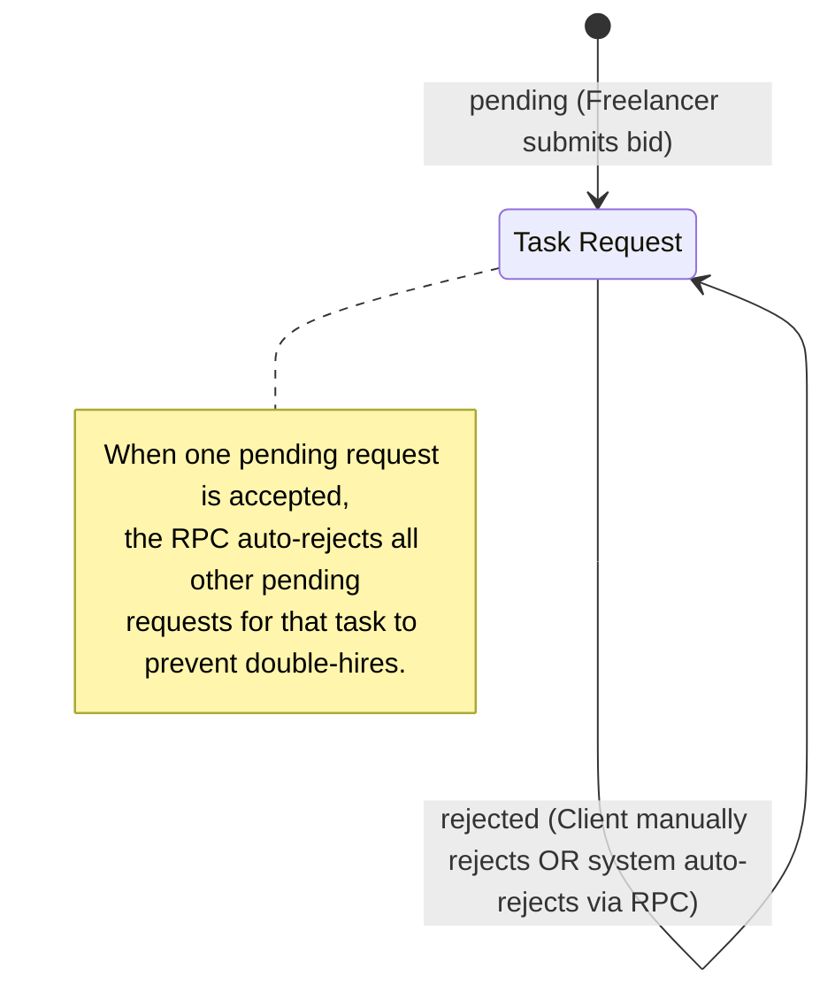
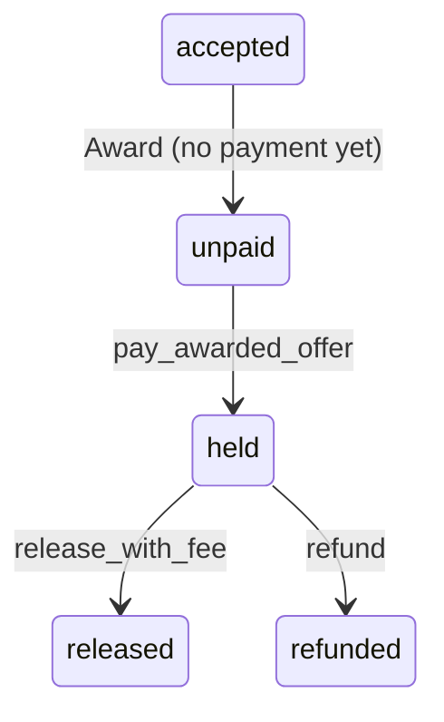

# Task Request (Bid) Flow — Diagram Document

---

## Diagram Title + Version

- **Diagram name**: Task Request Bid Flow
- **Version**: v2 (final)
- **Date**: 2026-03-08
- **Owner/author**: SLine Engineering

---

## Purpose

- **What this diagram is showing**: The complete lifecycle of task requests (bids/offers) on tender tasks: submission, replacement, acceptance, rejection, two-step award with payment, auto-expiry, and optimistic price locking.
- **What problem it solves**: Ensures consistent, secure handling of multi-freelancer bidding; prevents bait-and-switch fraud; enforces single-winner-per-task; coordinates award and payment as separate steps with escrow.

---

## Scope

**Included:**
- Bid submission and replacement
- Client accept/reject
- Two-step award (award → pay)
- Optimistic price lock
- Single Winner Rule (reject remaining bids on accept)
- Payment deadline and auto-expiry
- RPCs, RLS, triggers, indexes

**Excluded:**
- Direct offers (chat-to-work) — see `06_direct-chat-offer-flow.md`
- Booking flow — see booking diagrams
- Ledger/escrow internals — see tender-task-lifecycle

---

## Assumptions

- Payments are finalised only via `process_payment_event_ledger` (escrow_hold, release_with_fee).
- Escrow is append-only; no direct edits to ledger lines.
- Task must be `open` for bids to be submitted or replaced.
- `system_config.tender_payment_timeout_hours` (default 48h) defines payment window.
- Price in DB is stored in major units; RPCs use cents (`price * 100`).

---

## Glossary

| Term | Definition |
|------|------------|
| **task_request** | A freelancer's bid/offer on a tender task; table `task_requests`. |
| **bid** | Synonym for task_request. |
| **offer** | Synonym for task_request in UI context. |
| **tender** | Task type where clients accept bids from freelancers. |
| **pending** | Bid status: awaiting client decision. |
| **accepted** | Bid status: client selected this bid; payment window starts. |
| **rejected** | Bid status: client declined or system auto-rejected (another bid won). |
| **withdrawn** | Bid status: freelancer replaced their offer. |
| **unpaid** | Payment status: accepted but not yet paid. |
| **held** | Payment status: funds in escrow; work can begin. |
| **released** | Payment status: payment completed to freelancer. |
| **refunded** | Payment status: funds returned to client. |
| **escrow_hold** | Money event: move client funds to platform escrow. |
| **release_with_fee** | Money event: release escrow to freelancer minus platform fee. |
| **refund** | Money event: return escrow to client. |
| **RPC** | Remote Procedure Call; stored procedure in Postgres. |
| **RLS** | Row Level Security; per-row access control. |
| **idempotency** | Repeated calls produce same result; no duplicate side effects. |
| **optimistic lock** | Price validation: client-captured price must match DB at accept time. |

---

## Legend

| Symbol | Meaning |
|--------|---------|
| **Circle/Rounded rect** | State (pending, accepted, rejected, withdrawn). |
| **Solid arrow** | User action (Submit, Accept, Reject, Replace, Award, Pay). |
| **Dashed arrow** | System/automated transition (e.g. cron expiry). |
| **Diamond** | Guard/validation (task open?, price match?, deadline passed?). |
| **DB table** | Postgres table. |
| **RPC** | Stored procedure (SECURITY DEFINER). |

---

## Actors and Responsibilities

| Actor | Allowed | Forbidden |
|-------|---------|-----------|
| **Freelancer** | Submit bid; replace own pending bid; withdraw bid; view own bids. | Accept/reject; award; pay; change another's bid. |
| **Client** | View bids; accept one; reject; award; pay. | Submit bid; replace bid; change bid price directly. |
| **System/Cron** | Run `cleanup_expired_awards`; reject expired unpaid awards. | Accept or pay on behalf of user. |
| **Admin** | View audit logs; no direct bid manipulation. | Bypass RLS for normal user flows. |

---

## System Components (Where it lives)

### App entry points

- Task Feed (Freelancer): discover tasks, open `SubmitRequestSheet`
- Task Details → Requests tab (Client): `RequestsListScreen`
- Dashboard Inbox (Client): `DashboardOfferCard` via `InboxTab`
- Work tab (Client): `TenderPaymentScreen` for pay/cancel

### Service / ViewModel / Repository

| Layer | File |
|-------|------|
| Model | `lib/features/tasks/models/task_request_model.dart` |
| Service | `lib/features/tasks/services/task_requests_service.dart` |
| Service | `lib/features/tasks/services/task_service.dart` |
| ViewModel | `lib/features/tasks/viewmodels/task_requests_view_model.dart` |
| ViewModel | `lib/features/dashboard/viewmodels/dashboard_view_model.dart` |
| View | `lib/features/tasks/view/widgets/requests/requests_list_screen.dart` |
| View | `lib/features/tasks/view/widgets/requests/submit_request_sheet.dart` |
| View | `lib/features/tasks/view/widgets/dashboard_offer_card.dart` |

### Database objects

| Type | Name |
|------|------|
| Table | `task_requests` |
| Table | `tasks` |
| View | `vw_unified_work_items` (for work tab) |
| RPC | `accept_task_request` |
| RPC | `reject_task_request` |
| RPC | `replace_task_request` |
| RPC | `award_task_offer` |
| RPC | `pay_awarded_offer` |
| RPC | `cancel_awarded_offer` |
| RPC | `cleanup_expired_awards` |
| Trigger | `trg_task_requests_before_insert_guard` |
| Trigger | `trg_task_requests_after_insert_notify_owner` |
| Index | `idx_one_accepted_per_task` |
| Index | `idx_task_requests_awarded_unpaid` |
| RLS | `task_requests_insert_freelancer_jwt`, `tr_select`, `tr_update`, etc. |

---

## OLD Diagram (Pre-Implementation v1)

**OLD scope**: Basic accept/reject only; no two-step award, no payment window, no optimistic price lock.

---

## NEW Diagram (Implemented v2)

```mermaid
stateDiagram-v2
    [*] --> pending: Freelancer submits bid

    pending --> pending: Freelancer replaces (replace_task_request; update in place)

    pending --> accepted: Client awards (accept_task_request / award_task_offer)
    pending --> rejected: Client rejects (reject_task_request)
    pending --> rejected: System auto-rejects (another bid won)

    accepted --> rejected: Payment deadline expired (cleanup_expired_awards)
    accepted --> rejected: Client cancels (cancel_awarded_offer) → task reopens
    accepted --> held: Client pays (pay_awarded_offer → escrow_hold)

    held --> released: Client approves delivery (release_with_fee)
    held --> refunded: Dispute/refund path

    note right of accepted
      payment_status = unpaid
      payment_deadline = NOW + 48h
      Optimistic lock: p_expected_price_cents
    end note

    note right of held
      payment_status = held
      task.status = in_progress
    end note
```

### Payment status sub-states (accepted)

---

## Step-by-step Flow (“Human Story”)

### Happy path

1. **Freelancer submits bid**: Opens task, taps “Submit Offer”, enters price/days/note. `TaskRequestsService.submit()` inserts into `task_requests` (status=`pending`). RLS: freelancer must match `auth.uid()` and `active_role='freelancer'`.
2. **Client views bids**: Opens task details → Requests tab. `TaskRequestsViewModel` loads bids; `RequestsListScreen` shows list with expiration countdown.
3. **Client awards offer**: Taps “Award” on one bid. `expectedPriceCents` captured at dialog open. `TaskRequestsViewModel.award(requestId, expectedPriceCents)` → `TaskService.awardOffer()` → `award_task_offer` RPC. RPC validates price, sets status=`accepted`, payment_status=`unpaid`, `payment_deadline`.
4. **Single Winner Rule**: `accept_task_request` (or `award_task_offer`) rejects all other pending bids on the same task.
5. **Client pays**: From Inbox or Work tab, taps “Pay”. `pay_awarded_offer` RPC → `process_payment_event_ledger` (escrow_hold). Task moves to `in_progress`; payment_status=`held`.
6. **Work begins**: Freelancer sees task in Work tab; delivery flow follows.

### Common failure paths

| Failure | System behaviour |
|---------|------------------|
| Price changed before award | RPC raises `PRICE_MISMATCH`; client sees error; must refresh and re-award. |
| Double-click Award | RPC returns `already_accepted`; idempotent, no duplicate state. |
| Payment deadline expired | `cleanup_expired_awards` cron sets bid to `rejected`, task to `open`. |
| Task not open | RPC rejects; “Cannot accept offers on task with status: assigned”. |

---

## State Machine Explanation

### States

| State | Meaning |
|-------|---------|
| `pending` | Bid awaiting client decision; 24h response window. |
| `accepted` | Client selected this bid; payment window (48h default) started. |
| `rejected` | Client declined or system auto-rejected. |
| `withdrawn` | Freelancer replaced their offer (old row). |

### Payment status (when accepted)

| Status | Meaning |
|--------|---------|
| `unpaid` | Awarded but not yet paid. |
| `held` | Funds in escrow; work can begin. |
| `released` | Payment completed to freelancer. |
| `refunded` | Funds returned to client. |

### Allowed transitions

| From | To | Trigger |
|------|-----|---------|
| pending | accepted | Client awards (accept_task_request / award_task_offer) |
| pending | rejected | Client rejects or another bid won |
| pending | pending | Freelancer replaces (new row) |
| pending | withdrawn | Freelancer replaces (old row) |
| accepted | held | Client pays |
| accepted | rejected | Cron expiry or client cancels |
| held | released | Client approves delivery |
| held | refunded | refund |

### Forbidden transitions

- Direct status UPDATE from UI (only via RPC).
- Accepting a bid when task is not `open`.
- Paying when payment_deadline has passed (cron handles expiry).

---

## Invariants

- A task has at most one `accepted` task_request (`idx_one_accepted_per_task`).
- A payment cannot be finalised unless intent matches entity_id + amount.
- Escrow release is idempotent per entity.
- `task_requests` rows are visible only to participants (RLS).
- `p_expected_price_cents` must match current price when provided (optimistic lock).

---

## Guards & Validation Rules

| Guard | Where | Source of truth |
|-------|-------|-----------------|
| Task is `open` | RPC | DB |
| Caller is task owner | RPC | DB |
| Price matches `p_expected_price_cents` | RPC | DB |
| Caller is freelancer (bid submit/replace) | RPC + RLS | DB |
| Payment deadline not expired | RPC | DB |
| One active offer per freelancer per task | Trigger | DB |

---

## Failure Modes

| Failure | Mitigation |
|---------|------------|
| App crash mid-step | RPC is atomic; retry is idempotent. |
| Duplicate webhook | Ledger idempotency keys reject duplicates. |
| Race: two users act at once | Optimistic lock prevents double-award; unique index prevents two accepted. |
| Timeout: payment deadline | Cron job expires unpaid awards; notifications sent. |
| Missing metadata | RPC validates required fields; raises clear errors. |

---

## Security & Abuse Scenarios

| Scenario | Prevention |
|----------|------------|
| Spoofing identity | RPC uses `auth.uid()`; no client-supplied actor IDs. |
| Unauthorised state change | Direct UPDATE blocked; only RPCs allowed. |
| Paying without owning | RPC checks `tasks.owner_id = auth.uid()`. |
| Bait-and-switch | `p_expected_price_cents` validated at award time. |
| Escrow trapped | `release_with_fee` and `refund` paths; dispute flow. |
| Seeing another user’s bids | RLS on `task_requests`; owner/freelancer scoped. |

---

## Data Model Mapping

| Diagram concept | DB field |
|-----------------|----------|
| `pending` | `task_requests.status = 'pending'` |
| `accepted` | `task_requests.status = 'accepted'` |
| `rejected` | `task_requests.status = 'rejected'` |
| `withdrawn` | `task_requests.status = 'withdrawn'` |
| `unpaid` | `task_requests.payment_status = 'unpaid'` |
| `held` | `task_requests.payment_status = 'held'` |
| `released` | `task_requests.payment_status = 'released'` |
| Payment window | `task_requests.payment_deadline` |
| Fee locked | `task_requests.fee_rate_applied_bps` at award time |

---

## Observability & Forensics

| Event | Logged |
|-------|--------|
| `PRICE_MISMATCH_ATTEMPT` | `admin_logs` |
| `OFFER_ACCEPTED` | `admin_logs` |
| `AWARD_AUTO_EXPIRED` | `admin_logs` (cron) |
| `offer_accepted` | `activity_log` |

- Admin views: `admin_logs` for audit trail.
- Trace: `task_requests.id` → `admin_logs.target_id` for “money story”.

---

## Verification Checklist

- [x] Unit tests: `task_requests_service_test.dart`, `task_request_model_test.dart`
- [x] Integration tests: `bid_lifecycle_test.dart`
- [x] RLS tests: `task_requests_rls_test.dart`
- [x] Concurrency: idempotency and double-award covered in tests

---

## Dependencies

- **Depends on**: `03_tender-task-lifecycle.md`, `SUPABASE_SETUP.md` schema
- **Depended on by**: Work tab, Inbox, TenderPaymentScreen
- **Ordering**: Must be implemented after task schema and RLS

---

## Open Questions / Missing Evidence

- None. All RPCs, migrations, and indexes verified via Supabase MCP (SQL_VERIFICATION_REPORT).

---

## Final Status

- **Verdict**: PASS
- **Production Ready?**: YES
  - Optimistic price lock in place (requests_list_screen + inbox)
  - Single Winner Rule in Accept RPC (reject remaining bids)
  - Two-step award with payment deadline
  - Idempotency and audit logging
- **Next actions**: None; feature complete.
