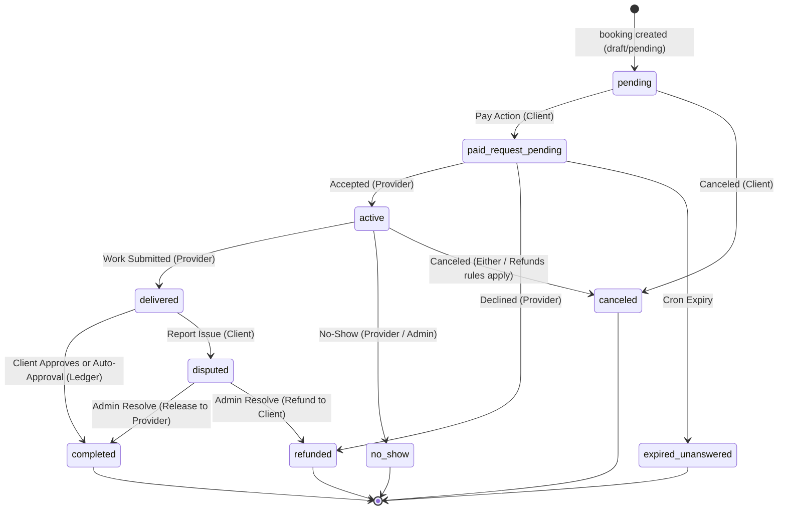

# Booking Lifecycle — Diagram Document

---

## OLD Diagram (pre–full-checklist, retained for reference)

**Diagram name:** Booking Lifecycle (legacy)  
**Status:** Superseded by "NEW & Implemented" section below. Kept for history.

### OLD — What this diagram is

The lifecycle of a scheduled "Booking" task. It maps every possible state a booking can enter from creation to completion. Client cannot cancel after delivery (use Report Issue → disputed); admin can resolve disputed to completed or refunded.

### OLD — Where it lives

- App: Booking checkout screen, booking details screen.
- Service: `WorkManagementService`, `BookingService` (guard in app for cancel-after-delivery).
- Supabase: `bookings` table, `trg_booking_guard`, `rpc_finalize_auto_approval` (booking branch + ledger), `admin_resolve_booking_dispute`.

### OLD — Diagram (Mermaid)

---

## NEW & Implemented Diagram (full checklist)

---

### • Diagram Title + Version

- **Diagram Title:** Booking Lifecycle (Pay-First, Guard-Enforced)
- **Diagram name (exact):** `05_booking-lifecycle.md`
- **Version:** v2 (final) — 2026-03-08
- **Owner/author:** SLine team / Backend + App feature owners
- **Last verified:** 2026-03-08 (Plan: `.TODO/PLAN_BookingLifecycle_2026-03-08_PlanCritic.md`; Execution: `.TODO/EXECUTION_LOG_PLAN_BookingLifecycle_2026-03-08.md`)

---

### • Purpose

- **What this diagram is showing, in one paragraph.**  
  The lifecycle of a **booking**: every state from creation (pending) through payment (paid_request_pending), acceptance/decline/expiry, active work, delivery, and completion or dispute. It shows who (Client, Provider, Admin, System/Cron) can move the booking between states and how escrow (held → released/refunded) is tied to those transitions.
- **What problem it solves (why it exists).**  
  Bookings are pay-first: money must be escrowed before work starts. The diagram and guard prevent invalid transitions (e.g. client canceling after delivery to trap funds or grief), ensure disputed bookings are resolved only by admin (release or refund), and keep a single source of truth for “what state is allowed next” (DB trigger + app guard).

---

### • Scope

- **What’s included (features/entities covered).**  
  Booking entity only: `bookings` table, `booking_status_enum`, `payment_status_enum` on bookings; trigger `fn_booking_guard`; RPCs `rpc_approve_delivery` (booking branch), `rpc_finalize_auto_approval` (booking branch), `admin_resolve_booking_dispute`; ledger events `release_with_fee` and `refund` for bookings; app screens (checkout, booking details, work item details when opened as booking); Report Issue → dispute and admin resolve.
- **What’s explicitly excluded (out of scope).**  
  Task lifecycle (tender/task_request), direct_offer lifecycle, dispute submission flow details (see 14/14a), payment gateway creation (QiCard checkout), wallet/ledger schema details (see ledger/escrow diagrams). Cron expiry of paid_request_pending is in scope; cron implementation detail is not.
- **Assumptions.**  
  Payments are finalised only via server (RPC + ledger); escrow release/refund is append-only in ledger and idempotent (stable key + FOR UPDATE). No client-side–only status change can bypass the DB trigger. Admin is identified by `profiles.roles @> '{admin}'` (`is_admin()`). Review window is represented by `review_expires_at`; auto-approval runs via `rpc_finalize_auto_approval`. Dispute existence blocks release (escrow guard in RPCs).

---

### • Glossary (Human-readable)

| Term | Meaning |
|------|--------|
| **booking** | A scheduled work commitment tied to a task; has client, provider, status, payment_status, and (for slotless) no slot. |
| **task_request** | (Out of scope here) Tender offer/bid on a task. |
| **direct_offer** | (Out of scope here) Chat-originated offer without a task/booking. |
| **dispute** | An open or active dispute row (task_id or booking’s task) blocks escrow release; disputed booking is resolved by admin only. |
| **pending** | Booking created, not yet paid. |
| **paid_request_pending** | Client has paid (escrow held); waiting for provider accept/decline or cron expiry. |
| **active** | Provider accepted; work in progress. |
| **delivered** | Provider submitted delivery; client can approve or Report Issue. |
| **completed** | Client approved or auto-approval; funds released to provider (release_with_fee). |
| **canceled** | Booking canceled (client before delivery, or either in active with refund rules). |
| **refunded** | Money returned to client (provider declined, or admin resolved dispute as refund). |
| **disputed** | Client used “Report Issue”; admin must resolve to completed or refunded. |
| **expired_unanswered** | Provider did not respond before cron expiry (paid_request_pending → expired_unanswered). |
| **no_show** | Provider or admin marked no-show (active → no_show); not by client. |
| **escrow_hold** | Money locked in platform escrow (payment_status = held). |
| **release_with_fee** | Ledger event: release from escrow to provider (and platform fee); booking status → completed, payment_status → released. |
| **refund** | Ledger event: return funds to client; booking status → refunded, payment_status → refunded. |
| **RPC** | Remote procedure call (Supabase/Postgres function). |
| **RLS** | Row-Level Security (who can see/update rows). |
| **idempotency** | Same key used on retry does not double-release; stable key = f(entity_id, event_type, status, payment_status) (no timestamp). |
| **Frozen guard** | When an open/active dispute exists for the task (or booking’s task), rpc_approve_delivery and rpc_finalize_auto_approval do not release funds. |

---

### • Legend

- **State (rounded box):** One value of `booking_status_enum` (pending, paid_request_pending, active, delivered, completed, canceled, refunded, disputed, expired_unanswered, no_show).
- **Arrow:** Allowed transition; label = who can trigger and/or action (e.g. “Client Approves”, “Admin Resolve”).
- **Actor in label:** Client, Provider, Admin, System/Cron.
- **Guard:** Enforced in DB by `fn_booking_guard` (BEFORE UPDATE on `bookings`); app layer blocks client delivered→canceled in `BookingService.updateBookingStatus` (StateError, “Use Report Issue”).
- **Escrow guard:** In RPCs (rpc_approve_delivery, rpc_finalize_auto_approval): if open/active dispute for task (or booking’s task), release is blocked.

---

### • NEW & Implemented — Diagram (Mermaid)

```mermaid
stateDiagram-v2
    [*] --> pending: booking created (draft/pending)

    pending --> paid_request_pending: Pay Action (Client)
    pending --> canceled: Cancel (Client)

    paid_request_pending --> active: Accept (Provider)
    paid_request_pending --> refunded: Decline (Provider)
    paid_request_pending --> expired_unanswered: Cron Expiry (System)

    active --> delivered: Submit delivery (Provider)
    active --> no_show: No-Show (Provider / Admin only)
    active --> canceled: Cancel (Either; refund rules apply)

    delivered --> completed: Client Approve or Auto-Approval (Ledger release_with_fee)
    delivered --> disputed: Report Issue (Client)

    disputed --> completed: Admin Resolve — Release (Ledger release_with_fee)
    disputed --> refunded: Admin Resolve — Refund (Ledger refund)

    completed --> [*]
    canceled --> [*]
    refunded --> [*]
    expired_unanswered --> [*]
    no_show --> [*]
```

---

### • Actors and Responsibilities

| Actor | Allowed | Forbidden |
|-------|--------|-----------|
| **Client** | Create/pay (pending → paid_request_pending); cancel before delivery (pending → canceled); approve delivery when delivered (delivered → completed via rpc_approve_delivery); Report Issue when delivered (delivered → disputed). | Set delivered → canceled (guard + app StateError); set active → no_show; set disputed → completed/refunded; approve when dispute open/active (escrow guard). |
| **Provider (Freelancer)** | Accept/decline (paid_request_pending → active / refunded); submit delivery (active → delivered); cancel in active (with refund rules); set no_show (active → no_show). | Set delivered → completed or disputed; set disputed → anything; approve delivery (client-only). |
| **Admin** | Resolve disputed → completed (release_with_fee) or refunded (refund) via admin_resolve_booking_dispute; set active → no_show. | Resolve disputed without being admin (RPC checks is_admin). |
| **System/Cron** | paid_request_pending → expired_unanswered (expiry); delivered → completed when review_expires_at passed via rpc_finalize_auto_approval (if no open/active dispute). | Release when dispute open/active (escrow guard in rpc_finalize_auto_approval). |
| **Payment Gateway** | (Not in this diagram) Creates escrow (booking payment flow); outcome reflected in booking status/payment_status by server. | Cannot change booking status directly; server authoritatively sets paid_request_pending after payment. |

---

### • System Components (Where it lives)

- **App entry points:**  
  - `lib/features/booking/view/payment_checkout_screen.dart` — create/pay booking.  
  - `lib/features/booking/view/booking_details_screen.dart` — view booking, Approve, Report Issue, cancel (when allowed).  
  - `lib/features/booking/view/bookings_discovery_screen.dart` — discovery.  
  - `lib/features/work/view/work_item_details_screen.dart` — when work item is a booking: Approve, Report Issue (uses booking’s task_id for dispute).
- **Service / ViewModel / Repository:**  
  - `lib/features/booking/services/booking_service.dart` — updateBookingStatus (includes guard: client + delivered + cancel → StateError).  
  - `lib/features/booking/viewmodels/booking_view_model.dart` — updateBookingStatus, submitDispute; treats StateError from guard as warning log only.  
  - `lib/features/booking/data/booking_repository.dart` — updateBookingStatus delegates to service.  
  - `lib/features/work/services/work_management_service.dart` — approveDelivery (calls RPC); reads booking data.  
  - `lib/core/app_enums.dart` — BookingStatus (includes disputed, noShow); mapping to/from DB.
- **Database objects:**  
  - **Tables:** `bookings` (status, payment_status, client_id, provider_id, task_id, review_expires_at, etc.).  
  - **Views:** (none specific to this lifecycle; `vw_unified_work_items` includes bookings).  
  - **RPCs:** `rpc_approve_delivery(entity_type, entity_id)` (booking branch); `rpc_finalize_auto_approval` (booking branch); `admin_resolve_booking_dispute(p_booking_id, p_resolution, p_idempotency_key)`; `process_payment_event_ledger(...)` (release_with_fee, refund).  
  - **Triggers:** `trg_booking_guard` BEFORE UPDATE → `fn_booking_guard()`.  
  - **Policies (RLS):** Standard booking RLS (participant/client/provider visibility and update rules); admin_resolve_booking_dispute is SECURITY DEFINER and checks is_admin.

---

### • Step-by-step Flow (“Human Story”)

**Happy path (simplified):**

1. Client creates booking and pays → status pending → paid_request_pending (escrow held).  
2. Provider accepts → paid_request_pending → active.  
3. Provider submits delivery → active → delivered; review_expires_at set.  
4. Client taps Approve → app calls rpc_approve_delivery(booking, id) → RPC checks no open/active dispute, locks row, builds idempotency key, calls process_payment_event_ledger('release_with_fee', 'booking', ...) → status completed, payment_status released; user sees “Completed”.  
5. Alternative: client does nothing; after review_expires_at, cron/caller runs rpc_finalize_auto_approval → same dispute check and ledger release → completed.

**Common failure paths:**

1. Client tries to cancel after delivery → app guard in BookingService.updateBookingStatus throws StateError (“Use Report Issue”); ViewModel logs warning, no crash; user should use Report Issue.  
2. Client taps Report Issue when delivered → submitDispute(taskId: booking.taskId) → dispute created; booking can be moved to disputed (or disputed is reflected via dispute row); admin later resolves via admin_resolve_booking_dispute.  
3. Admin resolves disputed → completed: RPC calls process_payment_event_ledger('release_with_fee', ...) with disputed allowed (ledger patch 20260308210400); booking → completed, payment released.  
4. Duplicate approve (double-tap / retry): same idempotency key + FOR UPDATE → ledger idempotent; no double release.

---

### • State Machine Explanation

- **States (booking_status_enum):** pending, paid_request_pending, active, delivered, completed, canceled, refunded, disputed, expired_unanswered, no_show.  
- **Allowed transitions (from → to) and who:**  
  - pending → paid_request_pending (Client); pending → canceled (Client).  
  - paid_request_pending → active (Provider); → refunded (Provider); → expired_unanswered (System).  
  - active → delivered (Provider); → no_show (Provider or Admin); → canceled (Either).  
  - delivered → completed (Client or rpc_finalize_auto_approval); → disputed (Client).  
  - disputed → completed (Admin); → refunded (Admin).  
  - Terminal: completed, canceled, refunded, expired_unanswered, no_show → [*].  
- **Forbidden transitions (and why):**  
  - delivered → canceled by Client (griefing / trapping funds); enforced by fn_booking_guard + app guard.  
  - disputed → completed or refunded by non-admin (only admin_resolve_booking_dispute).  
  - active → no_show by Client (only Provider or Admin).

---

### • Invariants (Must-always-be-true rules)

- A booking cannot move to completed or refunded for money movement unless the corresponding ledger event (release_with_fee or refund) succeeds (RPC + process_payment_event_ledger).  
- Escrow release happens only once per booking (idempotency key = f(entity_id, release_with_fee, status, payment_status); FOR UPDATE before ledger call).  
- Client cannot set delivered → canceled (DB trigger + app guard).  
- Disputed → completed or refunded only via admin_resolve_booking_dispute and only when booking status = disputed and payment_status = held.  
- No release (rpc_approve_delivery or rpc_finalize_auto_approval) when an open/active dispute exists for the task or booking’s task (escrow guard).  
- User can only see/update bookings where they are participant (RLS).

---

### • Guards & Validation Rules

| Guard / rule | Where it runs | Source of truth |
|--------------|----------------|------------------|
| Client cannot delivered → canceled | App: BookingService.updateBookingStatus (StateError); DB: fn_booking_guard | DB (trigger rejects invalid UPDATE). |
| delivered → completed only by client or rpc_finalize_auto_approval | RPC (ownership + dispute check) | RPC + ledger. |
| delivered → disputed only by client | fn_booking_guard (actor implied by transition); app: Report Issue only for client | DB. |
| disputed → completed/refunded only by admin | admin_resolve_booking_dispute: is_admin(auth.uid()) | RPC (SECURITY DEFINER). |
| active → no_show only provider or admin | fn_booking_guard | DB. |
| No release when open/active dispute | rpc_approve_delivery, rpc_finalize_auto_approval (dispute check) | RPC. |
| payment_status = held before release_with_fee | process_payment_event_ledger (gate validation) | Ledger RPC. |

---

### • Failure Modes (What can go wrong)

| Failure | System behaviour |
|--------|-------------------|
| App crash mid-step | Client can retry Approve; same idempotency key prevents double release. |
| Duplicate webhook / double-tap | Idempotency key + FOR UPDATE; ledger rejects duplicate key. |
| Retry causing duplicate UPDATE | Idempotent ledger call; status already completed/released. |
| Race (two users act at once) | FOR UPDATE locks row; second caller waits or fails validation. |
| Missing metadata / wrong entity_id | RPC validates entity_type + entity_id and ownership; ledger validates entity state. |
| Timeout / TTL expiry | paid_request_pending → expired_unanswered by cron; review_expires_at used for auto-approval. |
| Admin resolves without dispute open | admin_resolve_booking_dispute requires status = disputed and payment_status = held. |

---

### • Security & Abuse Scenarios

- **Spoofing identity:** All mutations use auth.uid(); RPCs and RLS enforce participant/admin.  
- **Unauthorised state changes:** fn_booking_guard rejects invalid transitions; admin_resolve_booking_dispute checks is_admin.  
- **Paying without owning entity:** Booking creation and payment are server-validated; client_id/provider_id on booking row.  
- **Escrow trapped forever:** delivered → completed (client or auto) or disputed → completed/refunded (admin); no dead-end for held funds.  
- **User seeing another user’s data:** RLS on bookings restricts to participant/client/provider; admin views are separate.

---

### • Data Model Mapping

- **delivered** = `bookings.status = 'delivered'`.  
- **review window** = `bookings.review_expires_at` (used by rpc_finalize_auto_approval).  
- **payment held** = `bookings.payment_status = 'held'`.  
- **released** = `bookings.payment_status = 'released'` after process_payment_event_ledger('release_with_fee', ...).  
- **disputed** = `bookings.status = 'disputed'` (and/or dispute row exists for task; escrow guard uses dispute row status IN ('open','active')).  
- **Indexes/constraints:** Primary key on bookings.id; foreign keys client_id, provider_id, task_id; trigger trg_booking_guard on UPDATE. Indexes for list/dashboard queries (e.g. client_id, status) as per SUPABASE_SETUP.

---

### • Observability & Forensics

- **Logs/audit:** AppLogger in booking flow (e.g. updateBookingStatus, submitDispute, approve); ledger writes to journal_entries/ledger_lines with p_meta (e.g. request_id, session_id) for tracing.  
- **Admin / money story:** Ledger and booking rows; admin_resolve_booking_dispute and process_payment_event_ledger are the single path for release/refund when disputed.  
- **Orphan event:** If a booking is stuck in delivered with payment_status = held and no dispute, rpc_finalize_auto_approval (or manual approve) can still run when review_expires_at passed; idempotency key prevents double release on retry.

---

### • Verification Checklist

- **Unit tests:** Booking status transitions and guard behaviour (e.g. client delivered+cancel throws in service); ViewModel treats StateError as warning.  
- **Integration tests:** Approve flow calling RPC; dispute submission and admin resolve (if available in test env).  
- **DB tests:** RLS and fn_booking_guard (e.g. attempt invalid transition raises).  
- **Concurrency:** Double-tap approve / duplicate idempotency key does not double-release (covered by idempotency + FOR UPDATE).

---

### • Dependencies

- **Depends on:** Ledger (process_payment_event_ledger); auth (auth.uid(), is_admin); disputes (escrow guard and admin_resolve flow); tasks (booking belongs to task).  
- **Depended on by:** Unified work view (bookings as one branch); dispute lifecycle (14/14a); wallet/escrow diagrams; work item details (booking CTA and Report Issue).  
- **Ordering:** Booking lifecycle guard and RPCs must be in place before relying on “no delivered→canceled” and “disputed only by admin” in other docs.

---

### • Open Questions / Missing Evidence

- None for current implemented behaviour. Plan and execution log are linked; migrations 20260308210000–20260308210500 applied.  
- Optional future: explicit “dispute created” event updating booking to disputed in same transaction (currently dispute row exists; booking status may be set by app or RPC as needed).

---

### • Final Status

- **Verdict:** PASS  
- **Production ready?** YES. Guard, RPCs, ledger integration, and app guard are implemented and documented; enum includes disputed and no_show; admin_resolve_booking_dispute and ledger patch (disputed+admin, parameter 40 enum cast) applied.  
- **Next actions:** Keep in sync with SUPABASE_SETUP §4.2 and §9; update this doc if new states or transitions are added.
