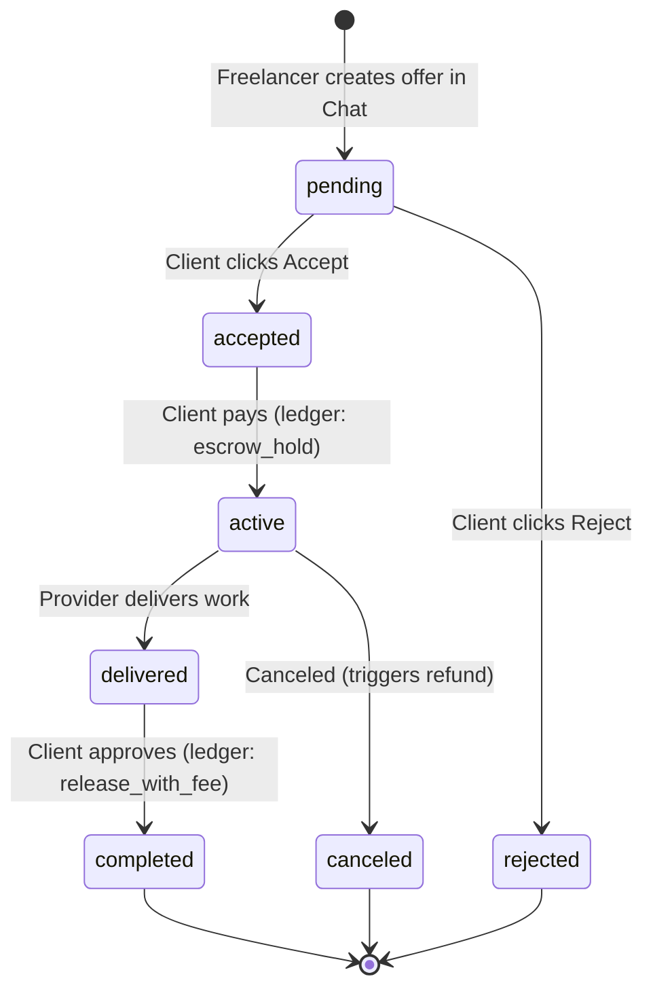
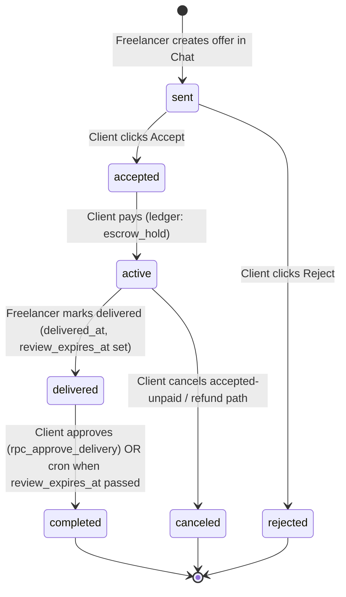

# 06 — Direct Chat Offer Flow

---

## Diagram Title + Version

| Field | Value |
|-------|--------|
| **Diagram name (exact)** | 06_direct-chat-offer-flow |
| **Version** | v2 (final) — 2026-03-08 |
| **Owner/author** | SLine team / Direct Offers & Chat |
| **Previous version** | v1 (OLD) — simpler state diagram without timestamps, cron, trigger details; see § OLD Diagram below. |

---

## Purpose

- **What this diagram is showing:** The **Direct Chat Offer** flow: a freelancer sends a priced offer from a 1:1 chat; the client accepts in chat (no payment there); the offer appears in the Dashboard as **Pending Payment**; the client pays via QiCard from the Dashboard; after payment (escrow_hold), the offer becomes **active** with payment **held**; the freelancer marks work **delivered** (setting `delivered_at` and `review_expires_at`); the client **approves** and escrow is released (release_with_fee), or a **cron job** auto-releases when `review_expires_at` has passed. Price, currency, and fee are locked at accept and protected by a DB trigger; disputes can be linked to the offer via `disputes.direct_offer_id`.
- **What problem it solves:** Gives an alternate path to work without a public task (chat-to-work). Ensures no permanent escrow lock (auto-release after review window), correct fee from row on release, payment traceability, and clear state/role rules so client and freelancer actions are unambiguous.

---

## Scope

- **What’s included:** Create offer in chat; accept in chat (no payment); pay from Dashboard (QiCard/create + recovery); mark delivered (with delivered_at, review_expires_at); client approve → release; cron auto-release when review_expires_at passed; trigger protecting price/currency/fee; disputes.direct_offer_id and RLS; ledger escrow_hold, release_with_fee, refund for direct_offer; rpc_approve_delivery direct_offer branch; admin refund and admin views.
- **What’s explicitly excluded:** Task/booking flows; tender (task_request) flow; withdrawal; dispute resolution workflow (only creation/linkage in scope).
- **Assumptions:** Payment is finalised only via QiCard webhook or recovery (edge writes payment_request_id etc. before redirect). Escrow release is single exit: `rpc_approve_delivery` or cron calling same ledger path; idempotency key is deterministic (entity_id + status + payment_status). Fee for release is always read from `direct_offers.fee_rate_applied_bps` (never client-supplied). Currency is IQD for MVP. RLS and service layer enforce client/freelancer roles.

---

## Glossary (Human-Readable)

| Term | Definition |
|------|-------------|
| **direct_offer** | Entity: chat-to-work offer (no task/booking); row in `direct_offers` with client_id, freelancer_id, price, status, payment_status. |
| **booking** | Entity type for slot-based work; out of scope for this diagram. |
| **task_request** | Entity type for tender bids; out of scope for this diagram. |
| **dispute** | Row in `disputes`; can reference `direct_offer_id`; complainant must be client or freelancer of that offer. |
| **sent** | Offer status: created by freelancer, not yet accepted. |
| **accepted** | Offer status: client accepted in chat; payment_status still unpaid. |
| **rejected** | Offer status: client rejected. |
| **active** | Offer status: payment held in escrow; work in progress. |
| **delivered** | Offer status: freelancer marked work delivered; delivered_at and review_expires_at set. |
| **completed** | Offer status: escrow released; payment_status released. |
| **canceled** | Offer status: canceled (e.g. client canceled accepted-unpaid, or freelancer canceled sent). |
| **refunded** | Offer status/payment_status after admin or refund path. |
| **unpaid** | payment_status before escrow. |
| **held** | payment_status: money in escrow. |
| **released** | payment_status: money moved to freelancer available. |
| **escrow_hold** | Ledger event: lock client funds into escrow for this offer. |
| **release_with_fee** | Ledger event: release escrow to freelancer (minus platform fee); fee from direct_offers row. |
| **refund** | Ledger event: return funds to client (e.g. admin_refund_direct_offer). |
| **RPC** | Remote procedure call (Postgres function, e.g. rpc_approve_delivery, process_payment_event_ledger). |
| **RLS** | Row-Level Security: user sees/updates only rows where they are participant (client_id or freelancer_id). |
| **idempotency** | Same key applied twice produces one effect (e.g. one release); key = digest(entity_id + ':release_with_fee:' + status + payment_status). |
| **review_expires_at** | Timestamp: after this time, cron may auto-release if client did not approve (e.g. delivered_at + 3 days). |

---

## Legend: What Each Symbol Means

- **State diagram nodes:** Each rounded box = one offer status (sent, accepted, active, delivered, completed, rejected, canceled). **[***]** = initial/terminal.
- **Arrows:** Label on arrow = who/what triggers the transition (e.g. "Client clicks Accept", "Client pays (ledger: escrow_hold)", "cron when review_expires_at passed").
- **Guards:** Not drawn as separate shapes; they are enforced in DB (fn_direct_offer_guard, trg_direct_offer_protect_price_currency) and RPC (rpc_approve_delivery checks client_id, status, payment_status). Source of truth: DB and RPC.

---

## Actors and Responsibilities

| Actor | Allowed | Forbidden |
|-------|---------|-----------|
| **Client** | Accept offer in chat; pay from Dashboard (QiCard); approve delivery (release escrow) for own offer; cancel accepted-unpaid offer; view own offers. | Mark delivered; cancel sent offer; change price/currency/fee after accept; release escrow for another user’s offer. |
| **Freelancer** | Create offer in chat; cancel sent offer; mark delivered (when active); view own offers. | Accept offer; pay; approve delivery; change price/currency/fee after send. |
| **System/Cron** | Run `run_auto_release_expired_direct_offers()` hourly: select delivered+held with review_expires_at < now(), call process_payment_event_ledger release_with_fee with fee from row, update to completed/released. | Double-release (idempotency key prevents); change price/currency/fee. |
| **Payment Gateway (QiCard)** | Webhook/recovery → edge → ledger escrow_hold; edge writes payment_request_id, payment_expires_at before redirect. | Release funds; spoof client. |
| **Admin** | admin_refund_direct_offer (idempotent); view admin.vw_direct_offer_money_story, admin.vw_direct_offer_stuck_funds. | Direct ledger writes outside RPC; approve delivery (client-only). |

---

## System Components (Where It Lives)

- **App entry points:** Chat UI (Create Offer, Accept/Reject in offer bubble); Dashboard (work list → Pay / open detail); DirectOfferDetailsScreen (Pay, Mark Delivered, Approve & release, Cancel); PaymentWebViewScreen / dashboard URL return for recovery.
- **Service / ViewModel:** `lib/features/direct_offers/services/direct_offers_service.dart` (DirectOffersService); `lib/features/direct_offers/viewmodels/direct_offer_details_view_model.dart` (DirectOfferDetailsViewModel); chat: `lib/features/chat/viewmodels/chat_view_model.dart`; dashboard: `lib/features/dashboard/viewmodels/dashboard_view_model.dart`.
- **Database objects:**
  - **Tables:** `direct_offers` (id, conversation_id, client_id, freelancer_id, price, days, status, payment_status, currency, fee_rate_applied_bps, payment_request_id, payment_gateway_id, payment_correlation_id, payment_expires_at, payment_recovered_at, delivered_at, review_expires_at, …); `disputes` (direct_offer_id, complainant_id, defendant_id, …).
  - **Views:** (none specific to this flow); admin: `admin.vw_direct_offer_money_story`, `admin.vw_direct_offer_stuck_funds`.
  - **RPC:** `rpc_approve_delivery(entity_type, entity_id)` (direct_offer branch reads fee from row); `process_payment_event_ledger` (escrow_hold, release_with_fee, refund for direct_offer); `run_auto_release_expired_direct_offers()`; `admin_refund_direct_offer`.
  - **Triggers:** `fn_direct_offer_guard` (status/payment_status transitions); `fn_direct_offer_guard_insert` (reject self-offer); `trg_direct_offer_protect_price_currency` (block UPDATE of price, currency, fee_rate_applied_bps when status != 'sent' or payment_status != 'unpaid').
  - **Policies (RLS):** direct_offers: SELECT/UPDATE for client or freelancer; INSERT for freelancer (conversation participant). disputes: INSERT when complainant_id = auth.uid() and (task_id or (direct_offer_id and user is party to offer)); SELECT for complainant or defendant.

---

## OLD Diagram (v1 — Pre-Hardening)

Kept for reference. Did not show sent vs pending naming, review_expires_at, cron auto-release, or trigger protecting fee.

---

## Implemented Diagram (v2 — 2026-03-08)

Current state machine after hardening: sent naming, delivered_at/review_expires_at, cron auto-release, trigger protecting price/currency/fee, disputes.direct_offer_id.

---

## Step-by-Step Flow ("Human Story")

### Happy path

1. **Trigger:** Freelancer creates offer in chat (price, days, title, description). Service inserts `direct_offers` (status= sent, payment_status= unpaid) and sends offer message with payload.offer_id.
2. **Client accepts:** Client taps Accept in chat. Service updates offer to status= accepted, payment_status= unpaid, fee_rate_applied_bps= 1000, currency= IQD. No payment in chat.
3. **Dashboard:** Offer appears as Pending Payment. Client taps Pay → app calls edge `qicard_payment_create_direct_offer`; edge creates session and **must** write payment_request_id, payment_correlation_id, payment_expires_at to direct_offers before returning form_url.
4. **Payment:** Client completes payment in QiCard WebView/browser. Webhook or recovery runs → process_payment_event_ledger(escrow_hold, direct_offer, …) → offer status= active, payment_status= held.
5. **Deliver:** Freelancer taps Mark Delivered. Service updates status= delivered, delivered_at= now(), review_expires_at= now() + 3 days.
6. **Complete (manual):** Client taps Approve & release. Service calls rpc_approve_delivery('direct_offer', offer_id). RPC locks row, validates client_id = auth.uid(), status= delivered, payment_status= held; computes idempotency key; calls process_payment_event_ledger(release_with_fee, …, fee from row); updates offer to payment_status= released, status= completed.
7. **Complete (auto):** If client does nothing, cron runs hourly. run_auto_release_expired_direct_offers() selects rows where status= delivered, payment_status= held, review_expires_at < now(); for each, same idempotency key and ledger call; updates to completed/released.

### Common failure paths

- **Offer not found:** getOffer returns null → service throws; UI shows error.
- **Wrong role:** Client calls markDelivered or freelancer calls payNow/completeOffer → service throws.
- **Invalid state:** markDelivered when not active → service throws. completeOffer when not delivered or not held → RPC raises.
- **Duplicate release:** Second approve or second cron run for same offer → idempotency key identical → ledger returns success without second write; row already completed.

---

## State Machine Explanation

| State | Meaning (plain English) |
|-------|-------------------------|
| **sent** | Offer created by freelancer; waiting for client to accept or reject. |
| **accepted** | Client accepted in chat; payment not yet done; fee and currency locked. |
| **rejected** | Client rejected; terminal. |
| **active** | Payment held in escrow; work in progress. |
| **delivered** | Freelancer marked delivered; delivered_at and review_expires_at set; client can approve or wait for auto-release. |
| **completed** | Escrow released; terminal. |
| **canceled** | Canceled (sent by freelancer or accepted-unpaid by client); terminal. |
| **refunded** | Admin or refund path; terminal. |

**Allowed transitions (who triggers):** sent→accepted (client Accept); sent→rejected (client Reject); sent→canceled (freelancer Cancel); accepted→active (payment: webhook/recovery); accepted→canceled (client cancel accepted-unpaid); active→delivered (freelancer Mark Delivered); active→canceled/refunded (refund path); delivered→completed (client Approve or cron).

**Forbidden transitions:** Any transition not in fn_direct_offer_guard; UPDATE of price, currency, fee_rate_applied_bps when not (sent + unpaid) — blocked by trg_direct_offer_protect_price_currency. Client cannot mark delivered; freelancer cannot pay or approve.

---

## Invariants (Must-Always-Be-True Rules)

- Offer status and payment_status transitions are only those allowed by `fn_direct_offer_guard`.
- Price, currency, and fee_rate_applied_bps cannot be changed after the offer leaves (sent, unpaid); enforced by trigger.
- Release happens at most once per offer (idempotency key in process_payment_event_ledger).
- User can only see/update direct_offers rows where they are client_id or freelancer_id (RLS).
- Complainant for a dispute with direct_offer_id must be client or freelancer of that offer (RLS disputes_insert_own).
- Fee used on release_with_fee for direct_offer is always from direct_offers.fee_rate_applied_bps (and price from row); never from client-supplied p_meta.
- Delivered offers have a path to release: either client approves or cron runs after review_expires_at.

---

## Guards & Validation Rules

| Guard | Where it runs | Source of truth |
|-------|----------------|-----------------|
| Valid status/payment_status transition | DB trigger fn_direct_offer_guard | DB |
| No UPDATE of price/currency/fee when not (sent, unpaid) | DB trigger trg_direct_offer_protect_price_currency | DB |
| No self-offer (client_id = freelancer_id) | DB trigger fn_direct_offer_guard_insert | DB |
| Only client can accept, pay, approve delivery | Service + RPC (rpc_approve_delivery checks client_id = auth.uid()) | RPC + service |
| Only freelancer can create, cancel sent, mark delivered | Service (checks freelancer_id = current user) | Service |
| Offer must be delivered and payment_status held for release | RPC rpc_approve_delivery | RPC |
| Cron: only rows with review_expires_at IS NOT NULL and review_expires_at < now() | run_auto_release_expired_direct_offers() | DB function |

---

## Failure Modes (What Can Go Wrong)

| Failure | System behaviour |
|---------|------------------|
| App crash mid-step | No partial ledger write (RPC atomic); retry uses same idempotency key. |
| Duplicate webhook / double recovery | Idempotency key (entity_id + payment_request_id or equivalent); second call succeeds without second escrow_hold. |
| Retry causing duplicate release | Idempotency key (entity_id + ':release_with_fee:' + status + payment_status); second call returns success without second ledger write. |
| Two users act at once (e.g. client and cron) | FOR UPDATE in rpc_approve_delivery and cron; one wins; idempotency ensures one release. |
| Missing payment_request_id before redirect | Contract requires edge to write before redirect; recovery validates row; without it recovery may fail or not double-apply. |
| review_expires_at null on old delivered row | Cron filters review_expires_at IS NOT NULL; old rows not auto-released until app sets it (markDelivered now sets it). |

---

## Security & Abuse Scenarios

- **Spoofing identity:** RPC and service use auth.uid(); RLS restricts rows by client_id/freelancer_id. Edge verifies gateway payload.
- **Unauthorised state change:** fn_direct_offer_guard and trigger block invalid transitions and price/currency/fee changes.
- **Paying without owning:** Ledger and RPC use entity row; only client can trigger pay path; RLS prevents seeing other users’ offers.
- **Escrow trapped forever:** review_expires_at set on markDelivered; cron auto-releases after window; client can always approve before that.
- **Seeing another user’s data:** RLS SELECT on direct_offers and disputes limits to participant only.

---

## Data Model Mapping

| Diagram / UI concept | DB / field |
|----------------------|------------|
| Offer “sent” | status = 'sent' |
| Offer “accepted” (pending payment) | status = 'accepted', payment_status = 'unpaid' |
| Payment held | payment_status = 'held', status = 'active' |
| Delivered | status = 'delivered', delivered_at NOT NULL, review_expires_at NOT NULL |
| Review window | review_expires_at (e.g. delivered_at + 3 days) |
| Completed | status = 'completed', payment_status = 'released' |
| Payment traceability | payment_request_id, payment_gateway_id, payment_correlation_id, payment_expires_at, payment_recovered_at |
| Fee locked at accept | fee_rate_applied_bps, currency (trigger prevents change after sent/unpaid) |

**Indexes:** idx_direct_offers_processing (partial: accepted, unpaid, payment_request_id NOT NULL) for processing checkouts. Other indexes: conversation, client_status, freelancer_status.

---

## Observability & Forensics

- **Logs:** AppLogger in DirectOffersService (create, accept, pay, recover, cancel, reject, markDelivered, completeOffer); recover success includes payment_request_id; no PII (no client_id/freelancer_id in app logs).
- **Audit:** process_payment_event_ledger writes journal_entries and audit_logs; rpc_approve_delivery and cron use same ledger; actor_user_id can be null for cron (audit_logs.actor_user_id nullable).
- **Admin views:** admin.vw_direct_offer_money_story (ledger story per offer), admin.vw_direct_offer_stuck_funds (delivered 7+ days or active 30+ days with payment held). Service_role only for views.

---

## Verification Checklist

- **Unit tests:** test/features/direct_offers/direct_offers_service_test.dart — client cannot cancelOffer, freelancer cannot payNow, markDelivered throws when !isActive.
- **Integration:** Manual E2E: create → accept → pay → deliver → approve (and optionally wait for cron or set review_expires_at in past).
- **DB:** RLS (other user cannot SELECT/UPDATE offer); trigger (UPDATE price on accepted row raises); cron (run_auto_release_expired_direct_offers releases only expired delivered+held).
- **Concurrency:** Idempotency key prevents double release; FOR UPDATE in RPC and cron.

---

## Dependencies

- **Depends on:** Ledger (process_payment_event_ledger, journal_entries, ledger_lines); rpc_approve_delivery; Chat (conversations, messages, offer message payload); Dashboard (work list, payment return URL); QiCard edge (qicard_payment_create_direct_offer, qicard_payment_recovery_direct_offer); disputes table and RLS.
- **Depended on by:** Dashboard unified work list; Wallet (balance/activity after release); Admin refund and admin views. Diagram 09 (ledger), 21 (wallet/escrow) reference direct_offer as entity type.

---

## Open Questions / Missing Evidence

- **Edge:** Confirm qicard_payment_create_direct_offer writes payment_request_id, payment_correlation_id, payment_expires_at to direct_offers before redirect (per contract). Not verified in Flutter repo (edge in supabase/functions/).
- **Dispute UI:** createDisputeForDirectOffer and “Report issue” on DirectOfferDetailsScreen are optional in plan; if not yet implemented, document as future.

---

## Final Status

| Item | Value |
|------|--------|
| **Verdict** | PASS |
| **Production ready?** | YES — migrations applied; trigger, RLS, cron, fee-from-row, and app model/service aligned with contract. Edge payment persistence and dispute UI are the only optional gaps. |
| **Next actions** | (1) Confirm edge writes payment_* before redirect. (2) Add createDisputeForDirectOffer + “Report issue” when required. (3) Run RLS negative tests (other user SELECT/UPDATE) if not already in CI. |

---

**Last verified:** 2026-03-08 (Direct Chat Offer Flow hardening).  
**Plan:** `.TODO/PLAN_DirectChatOfferFlow_2026-03-07_CRITIC.md`  
**Contract:** `.TODO/06_direct_offer_contract.md`  
**Execution log:** `.TODO/EXECUTION_LOG_DirectChatOfferFlow_2026-03-07_CRITIC.md`
