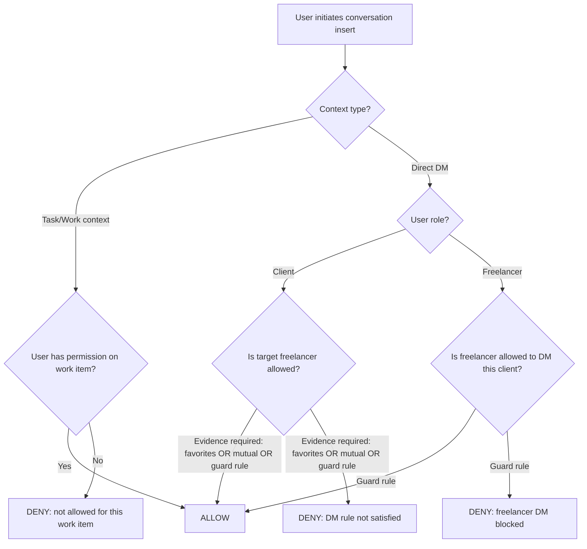
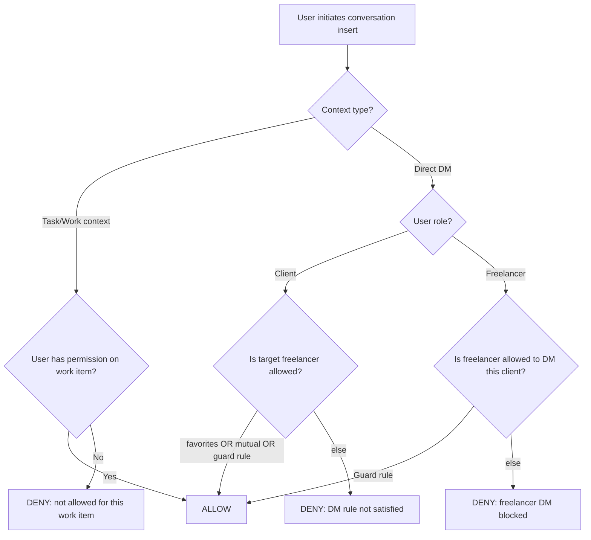
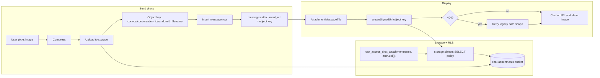

# Chat Creation Matrix & Chat Attachments

---

## Diagram document checklist

### Diagram Title + Version
- **Diagram name (exact):** Chat Creation Matrix & Chat Attachments
- **Version:** v2 / 2026-03-06
- **Owner/author:** SLine team / Backend + Flutter

### Purpose
- **What this diagram is showing, in one paragraph.**  
  When a user is allowed to start a direct conversation (DM) and how chat image attachments are uploaded, stored, and displayed. It covers the conversation-creation guard (favorites, role, task context), the chat-attachments storage path contract, RLS for storage, and the UI flow for sending and viewing photos.
- **What problem it solves (why it exists).**  
  Prevents DM spam (freelancers flooding clients) and ensures chat photos are stored under the correct path, protected by participant-scoped RLS, and displayed via signed URLs without “File not available.” errors.

### Scope
- **What’s included:** Conversation creation (guard, favorites, task context), `conversations` and `messages` tables, chat attachment upload path (`convos/<conversation_id>/<filename>`), storage bucket `chat-attachments`, RLS helper `can_access_chat_attachment`, storage policies (SELECT/INSERT), signed URL resolution and 404 retry, `AttachmentMessageTile` and error mapping.
- **What’s explicitly excluded:** Chat text-only messages (no attachment path), other buckets (avatars, task-images, portfolio), realtime presence/typing, message delivery/read receipts semantics.
- **Assumptions:**  
  - Conversation creation is enforced only by the DB trigger (client can call API; guard is source of truth).  
  - Storage RLS uses `can_access_chat_attachment(name, auth.uid())` when `storage_rls_v2_enabled` is `true`; otherwise fallback allows SELECT for `chat-attachments`.  
  - Signed URLs are short-lived (e.g. 1h); app caches them with shorter cache TTL.  
  - Attachment path in DB is the storage object key (no bucket prefix).

### Glossary (human-readable)
- **Conversation** — One chat instance between two users; row in `conversations`.
- **Guard / conversations_before_insert_guard** — DB trigger that blocks or allows inserting a new conversation based on role, favorites, task context.
- **Favorites** — Client’s list of freelancers they can start a DM with; table `favorites`.
- **Task context** — Conversation tied to a task/work item; permission checked by guard.
- **attachment_url** — Message column storing the storage path (e.g. `convos/<uuid>/<random>_<filename>`).
- **chat-attachments** — Private Supabase Storage bucket for chat images.
- **can_access_chat_attachment** — RLS helper: true iff `p_uid` is a participant of the conversation inferred from path `convos/<conversation_id>/...` or legacy `convos/convos/<conversation_id>/...`.
- **Signed URL** — Short-lived URL to download a private storage object; created via Storage API.
- **RLS** — Row-Level Security; policies on tables (and storage.objects) that restrict rows by role/condition.
- **RPC** — Remote procedure call (e.g. `start_direct_conversation_v1`); not required for attachment flow.
- **TTL** — Time-to-live (signed URL expiry, cache duration).

### Legend
- **Nodes:** Rounded = process/step; Diamond = decision (guard/condition); Rectangle = outcome or external system.
- **Arrows:** Sync call (e.g. app → MessageService → Supabase); dashed = optional/fallback.
- **Guards:** Written on edges (e.g. “favorites OR task context”, “participant check”).

---

## OLD diagram (Chat Creation Matrix only — pre-attachments doc)

*(This was the original 07 diagram: conversation creation only, no attachment flow.)*

---

## NEW / Implemented diagrams

### Chat Creation Matrix (implemented)

<!-- Separate Mermaid blocks so parser does not merge -->

### Chat Attachments — Upload, Storage, Display (implemented)

**Path contract:**  
- **Normal:** `convos/<conversation_id>/<randomId>_<sanitized_filename>`  
- **Legacy (backward compat):** `convos/convos/<conversation_id>/<filename>` — RLS helper accepts both.

---

### Actors and responsibilities
- **Client:** Can start DM with freelancers in favorites (or task context); can send and view attachment messages in conversations they participate in.
- **Freelancer:** Can start DM only when allowed by guard (e.g. task/work context); can send and view attachment messages in their conversations.
- **System/Cron:** No direct actor for this flow.
- **Forbidden:** Any user cannot read storage objects for conversations they are not a participant in (enforced by `can_access_chat_attachment`).

---

### System components (where it lives)
- **App entry points:** “Message” on freelancer profile or task bid (conversation creation); attachment button in chat input (send photo). Chat screen shows messages and resolves attachment URLs for display.
- **Service / ViewModel / Repository:**
  - `lib/features/chat/viewmodels/chat_view_model.dart` — triggers `sendImageAttachment`, holds messages.
  - `lib/features/chat/attachments/services/send_attachment_usecase.dart` — pick → compress → upload → send message.
  - `lib/features/chat/attachments/services/upload_service.dart` — `SupabaseAttachmentUploader`: `uploadImage(conversationId, filename, bytes)` → path; `createSignedUrl(path)`.
  - `lib/features/chat/services/attachment_service.dart` — `uploadBytes` (path `convos/$conversationId/${randomId}_$safeName`), `createSignedUrl` (with 404 → alternate path retry).
  - `lib/features/chat/services/message_service.dart` — `sendMessage(..., attachmentUrl: storagePath)`.
  - `lib/features/chat/attachments/widgets/attachment_message_tile.dart` — uses `storagePath` from message, calls resolver or `createSignedUrl`, caches result, shows error or image.
- **Database objects:**
  - **Tables:** `conversations`, `messages` (incl. `attachment_url`), `favorites`; `app_config` (key `storage_rls_v2_enabled`).
  - **RPC:** e.g. `start_direct_conversation_v1` (conversation creation); attachment flow uses direct insert + storage API.
  - **Triggers:** `conversations_before_insert_guard` (conversation creation).
  - **Policies (RLS):** Application RLS on `conversations`/`messages`; **storage:** `chat_attach_select_restricted_v2`, `chat_attach_insert_auth` on `storage.objects` (see script below).
  - **Helper:** `can_access_chat_attachment(p_object_name, p_uid)` — parses path, looks up `conversations.user1_id`/`user2_id`, returns true iff `p_uid` is one of them. Accepts both `convos/<id>/...` and `convos/convos/<id>/...`.

---

### Step-by-step flow (human story)

**Conversation creation (unchanged):**  
1. User taps Message (profile or task).  
2. App calls create conversation (or RPC).  
3. Trigger `conversations_before_insert_guard` runs: context (task vs DM), role (client vs freelancer), favorites/task permission.  
4. Allow → row inserted; Deny → error to user.

**Send photo (happy path):**  
1. User picks image in chat.  
2. App compresses, then uploads to bucket `chat-attachments` at path `convos/<conversationId>/<randomId>_<safeName>`.  
3. Upload returns; app inserts message with `attachment_url` = that path.  
4. User sees message; tile loads signed URL and shows image.

**Display photo (happy path):**  
1. Message list includes message with `attachment_url`.  
2. `AttachmentMessageTile` gets `storagePath = msg.attachmentUrl`.  
3. Cache checked; if miss, `createSignedUrl(storagePath)` called.  
4. Storage RLS: `can_access_chat_attachment(name, auth.uid())` (or fallback if v2 disabled).  
5. Signed URL returned → cached → image displayed.

**Display photo (failure path):**  
1. `createSignedUrl` returns 404 (e.g. wrong path shape or policy missing).  
2. If path is `convos/convos/...`, retry with `convos/<id>/...`; if path is `convos/<id>/...`, retry with `convos/convos/<id>/...`.  
3. If still 404, error cached briefly; UI shows “File not available.” (from `ErrorMapper` for StorageException 404).

---

### State machine
- **Conversation:** Created / exists. No explicit state machine for “conversation status” in this diagram.  
- **Message:** Has `attachment_url` or not; no attachment-specific states.  
- **Attachment display:** Loading → Resolved (URL) or Error (cached or not).

---

### Invariants (must-always-be-true)
- A conversation row exists only if the guard allowed it (trigger is source of truth).  
- `attachment_url` is exactly the storage object key (no bucket name prefix).  
- Only participants of the conversation can get a signed URL for a path under `convos/<that_conversation_id>/` (RLS helper + policy).  
- Upload path format is `convos/<conversationId>/<randomId>_<safeName>` (single `convos/` prefix).

---

### Guards and validation rules
- **Conversation creation:** Guard: role, context (task vs DM), favorites or task permission. Runs in DB trigger.  
- **Storage SELECT:** Guard: `bucket_id = 'chat-attachments'` AND (`can_access_chat_attachment(name, auth.uid())` OR `storage_rls_v2_enabled` ≠ `'true'`). Runs in RLS on `storage.objects`.  
- **Storage INSERT:** Guard: `bucket_id = 'chat-attachments'`, authenticated. Runs in RLS.  
- **Path parsing:** `can_access_chat_attachment`: path must start with `convos/`, then conversation UUID (or legacy `convos/` then UUID); user must be `user1_id` or `user2_id` of that conversation. Source of truth: DB function.

---

### Failure modes
- **App crash mid-upload:** Message may not be inserted; object may exist. No automatic cleanup; acceptable.  
- **createSignedUrl 404:** Retry with alternate path shape once; then cache error and show “File not available.”  
- **Missing storage policies:** All signed URL requests 404 until `chat_attach_select_restricted_v2` (and INSERT policy) are created (run script in Dashboard).  
- **Wrong path in DB (legacy double prefix):** RLS helper accepts it; if object was uploaded at single prefix, 404 retry tries single prefix and can succeed.

---

### Security and abuse
- **Spoofing identity:** Storage uses `auth.uid()` in RLS; only participant can pass `can_access_chat_attachment`.  
- **Unauthorised state changes:** Conversation creation is server-side guard; attachment path is set by app from upload result only.  
- **Seeing another user’s attachments:** RLS ensures only participants get SELECT on that object path.

---

### Data model mapping
- **Conversation:** `conversations.id`, `user1_id`, `user2_id`.  
- **Message with attachment:** `messages.attachment_url` = storage path; `attachment_type` = `'image'`, etc.  
- **Path formats:** `convos/<conversation_id>/<file>` (normal); `convos/convos/<conversation_id>/<file>` (legacy, still accepted by helper).  
- **Storage:** `storage.objects` with `bucket_id = 'chat-attachments'`, `name` = path.

---

### Observability and forensics
- App logs: e.g. `[ATTACH] image uploaded + message created: path=...`, `[CHAT] opened: convo=...`.  
- Supabase: Storage API errors (404/403) surface as StorageException; message rows and `attachment_url` can be queried for a conversation.  
- Admin: Can inspect `messages.attachment_url` and bucket objects by path to trace “message + attachment” story.

---

### Verification checklist
- Unit tests: MessageService (send with attachment_url), path building in AttachmentService.  
- Integration: Send photo in chat, reopen chat, confirm image loads.  
- DB: RLS on `conversations`/`messages`; `can_access_chat_attachment` for both path shapes; storage policies applied (script run in Dashboard).  
- Concurrency: Single user sending one photo; no duplicate path expected (random suffix).

---

### Dependencies
- **Depends on:** Conversations and messages schema; `app_config` (optional key `storage_rls_v2_enabled`); Storage bucket `chat-attachments` created; `can_access_chat_attachment` and backward-compat migration applied.  
- **Other diagrams:** May reference auth (who is `auth.uid()`), profile/favorites for conversation creation.

---

### Open questions / missing evidence
- **Storage policies:** Must be run manually from `supabase/scripts/chat_attachments_storage_policies.sql` in Dashboard (migrations cannot own `storage.objects`).  
- **Debug instrumentation:** Optional `_agentDebugLog` in `attachment_service.dart` / `attachment_message_tile.dart` can be removed after verification.

---

### Final status
- **Verdict:** PASS (with manual storage policy step).  
- **Production ready?** YES, provided: (1) `supabase/migrations/20260306180100_chat_attachment_path_backward_compat.sql` applied, (2) `supabase/scripts/chat_attachments_storage_policies.sql` run once in Supabase Dashboard SQL Editor.  
- **Next actions:** Remove debug logging when no longer needed; add integration test that sends photo and asserts image loads in same session.

---

## Reference: storage policies script (run in Dashboard)

Storage policies are not in migrations (ownership of `storage.objects`). Run manually:

**File:** `supabase/scripts/chat_attachments_storage_policies.sql`

- **SELECT policy** `chat_attach_select_restricted_v2`: allow when `can_access_chat_attachment(name, auth.uid())` OR `storage_rls_v2_enabled` is not `'true'`.  
- **INSERT policy** `chat_attach_insert_auth`: allow authenticated INSERT to `chat-attachments` bucket.

See `supabase/scripts/README.md` for when to run.
